# 🎫 CHAMADO DE RBAC — Liberação para equipe de Cloud Support abrir chamados (Tickets) com a equipe técnica do Azure. 

* Número do chamado: REQ-2026-1031-001
* Categoria: Cloud IT Support | Tickets Técnico | Portal Azure
* Serviço: RBAC | IAM
* Tipo de solicitação: Mudança | Implantação
* Prioridade: Média
* Solicitante: Support Cloud
* Equipe responsável: Infraestrutura Cloud
* Status: 

    ```
    ☑ Em análise
    ☐ Em implementação
    ☐ Aguardando validação
    ☐ Concluído
    ```

# 1. 📌 Descrição.

* Atualmente a equipe de **Cloud Support** não conseguem abrir Tickets junto a equipe Técnica do Azure.

    * Com colaborador com perfil de **Contributor** que consegue abrir chamados *Tecnicos* no portal.

        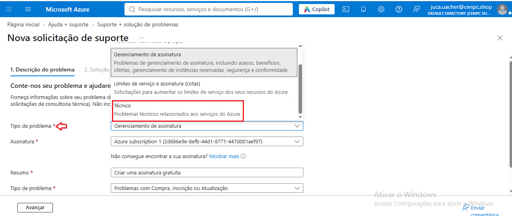

    * Com colaborador sem perfil que **não** consegue abrir chamados técnicos.

        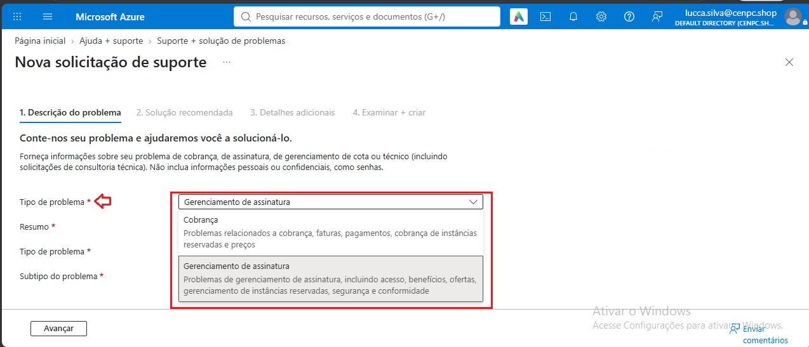

* A solicitação é para os colaboradores do **Cloud Support** tenham permissão de:

    * Iniciar uma VM.
    * Reiniciar uma VM.
    * Desalocar uma VM (Stop).
    * Abrir chamados técnicos junto ao HD do Azure.

* Esta permissão será associada na subscription.

# 2. 📝 Atendimento | 📸 Evidências.

* Inicialmente será editado e configurado o arquivo **.JSON**.

    ```
    {
    "Name": "Virtual Machine Operator and Cloud Support CENPC (Custom)",
    "IsCustom": true,
    "Description": "Permite visualizar, iniciar, reiniciar e parar máquinas virtuais e abrir tickets de suporte no Azure.",
    "Permissions": [
        {
            "Actions": [
                "Microsoft.Support/*",
                "Microsoft.Resources/subscriptions/resourceGroups/read",
                "Microsoft.Compute/virtualMachines/read",
                "Microsoft.Compute/virtualMachines/start/action",
                "Microsoft.Compute/virtualMachines/deallocate/action",
                "Microsoft.Compute/virtualMachines/restart/action",
                "Microsoft.Network/networkInterfaces/read",
                "Microsoft.Compute/disks/read"
            ],
            "NotActions": [],
            "DataActions": [],
            "NotDataActions": []
        }
    ],
    "AssignableScopes": [
        "/subscriptions/SEU-SUBSCRIPTION-ID"
    ]
}
    ```

```
    2. Entenda as permissões configuradas
    
    * Permissão	                ===>    Finalidade
   
    * Microsoft.Support/*       ====>   Operações de suporte
    * resourceGroups/read       ====>   Visualizar Resource Groups
    * virtualMachines/read      ====>   Visualizar VMs
    * start/action      	    ====>   Iniciar VMs
    * deallocate/action	        ====>   Desalocar VMs
    * restart/action            ====>   Reiniciar VMs
    * networkInterfaces/read    ====>   Visualizar interfaces de rede
    * disks/read                ====>   Visualizar discos
```

* Salvando o arquivo com extensão **.JSON**.

    * No portal, execute o **Cloud Shell** para importar o arquivo **.JSON** utilizando POwershell.

        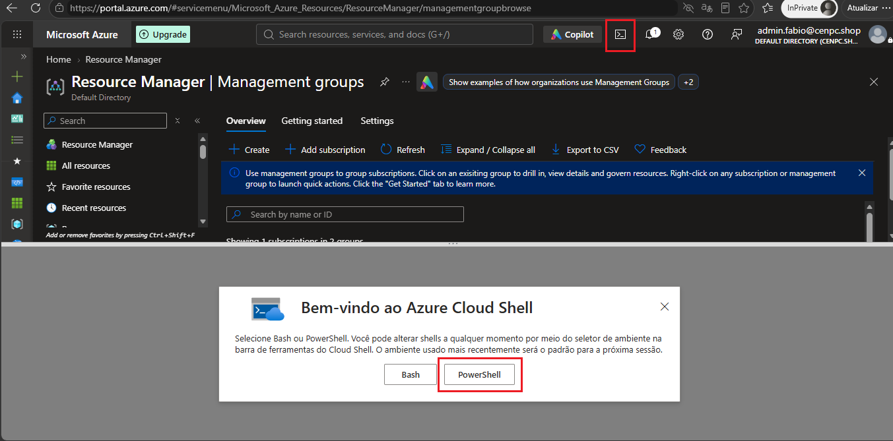

        * Selecione a opção mais apropriada.

            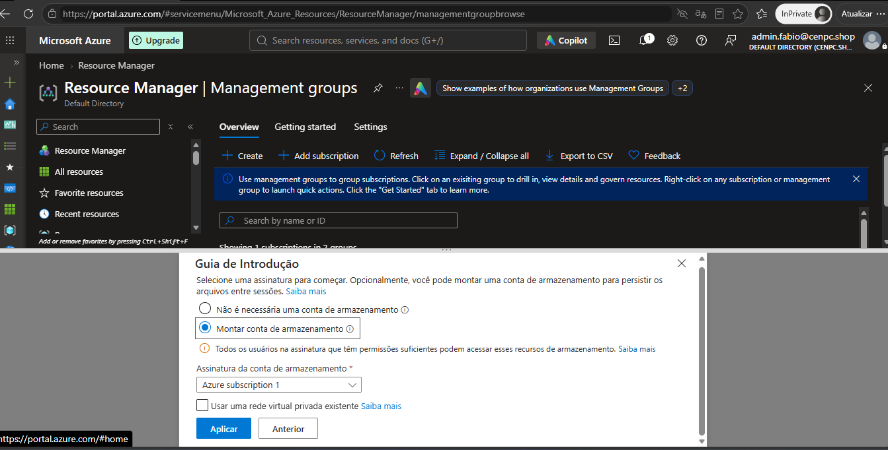

        * Selecione a opção para Microsoft criar uma **conta de armazenamento** | **Storage Account**.

            

        * Abra o gerenciamento de arquivos > Carregar | Upload.

            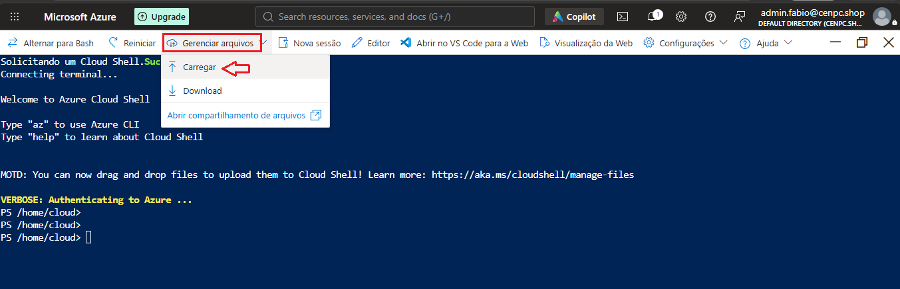
        
        * Selecione o arquivo **.JSON** que foi editado.

            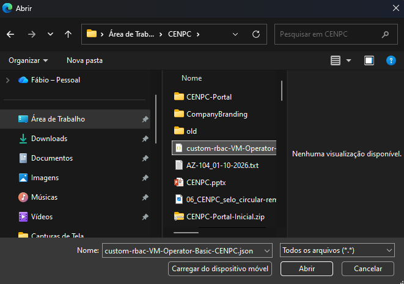

        * O Upload do arquivo foi realizado.

            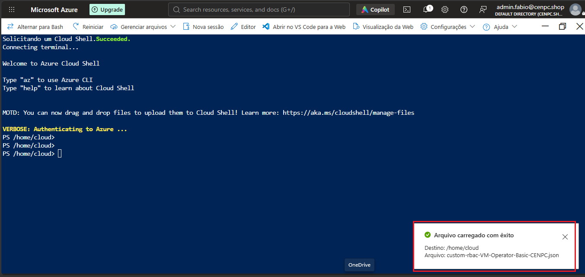

        * Verifique se o arquivo está no diretório executando o comando *ls*

            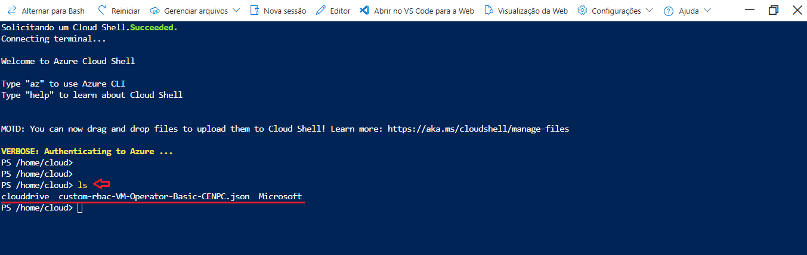
        
        * Em seguida, executando o comando abaixo para cadastrar o arquivo RBAC que foi criado.

            ```
            New-AzRoleDefinition -InputFile $HOME/custom-rbac-VM-Operator-Basic-CENPC.json
           
            ```
            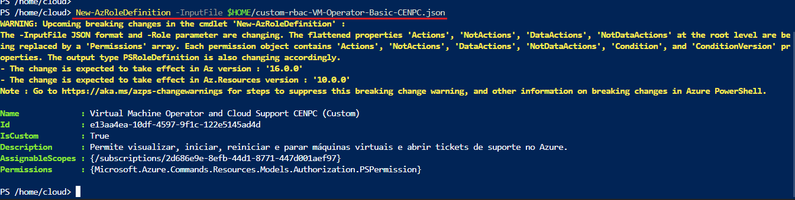


* Com perfil de Owner na subscription > **Access Control (IAM) > ADD > ADD Role Assignement**.

    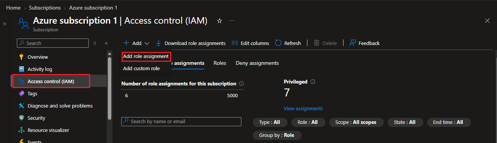

    * Em **Role** > *Job function roles* na **Tipo | Type** da busca, altere para **Custom role**  

        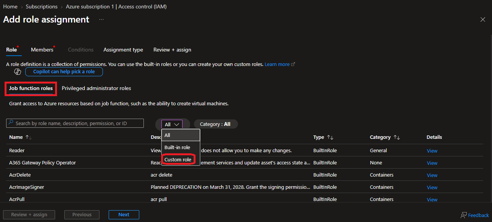
    
    * O portal vai localizar a regra que foi customizada.

        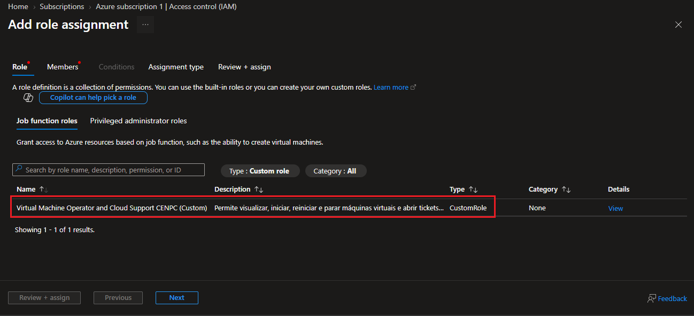

    * Clique na regra e clique em AVANÇAR.

    * Selecione o grupo de colaboradores que estarão nesta regra e clique em avançar.

        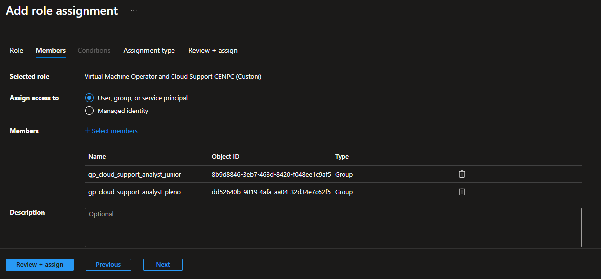

    * Em seguida, selecione a opção que mais se enquadra na empresa. *Neste exemplo será ACTIVE*.

        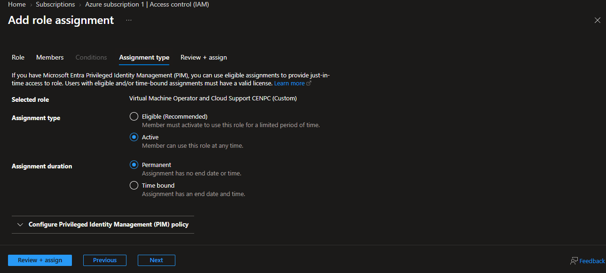

    * Para finalizar, clique em **REVIEW + ASSIGN**.

        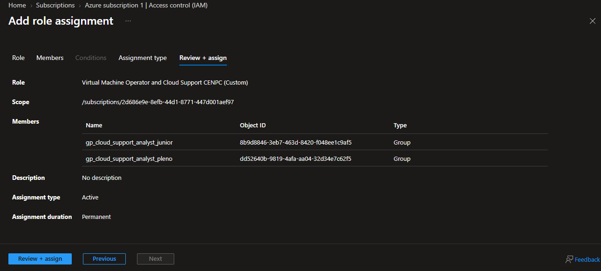

        * Regra adicionada com sucesso.

            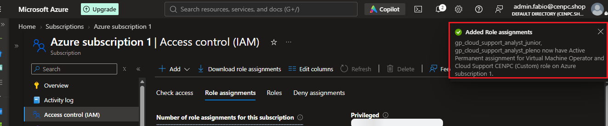

* Procedimentos realizados, proxímo passo será a validação. 

# 3. 💻 Comandos / Scripts Utilizados

> Registrar somente os comandos relevantes para reprodução do procedimento.

```powershell
# Listando o arquivo se estava no diretório.

ls
```
```powershell
# Comando para cadastrar o arquivo RBAC criado.

New-AzRoleDefinition -InputFile $HOME/custom-rbac-VM-Operator-Basic-CENPC.json
```

# 4. 🔎 Validação dos usuários

* Com o colaborador da equipe de *Cloud Support* foi realizado um novo teste para abertura de Ticket para equipe do suporte técnico da Microsoft Azure.

    * Após atualização, o colaborador conseguirá abrir Tickets com a equipe tecnica da Microsoft Azure.

        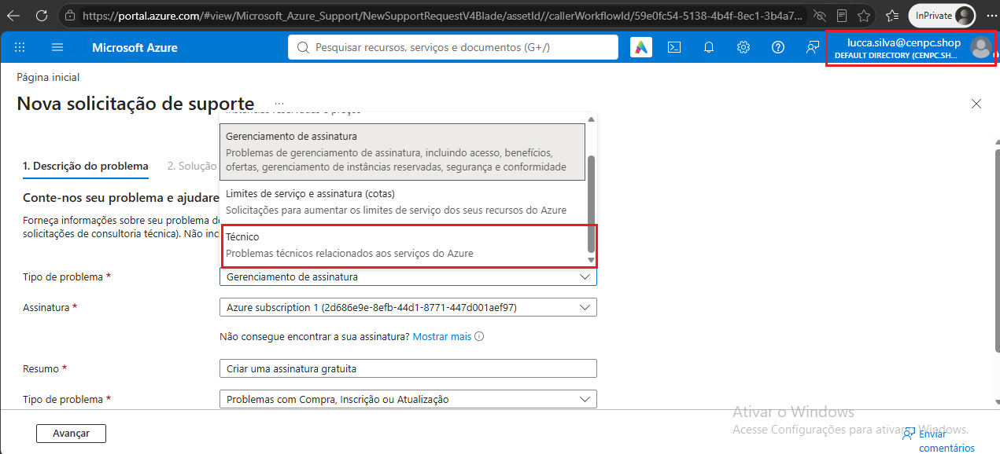

# 5. 📸 Evidências

```
📁 REQ-2026-1031-001
└── 📁 img
    ├── 📄 001.png
    ├── 📄 002.png
    ├── 📄 003.png
    ├── 📄 004.png
    ├── 📄 005.png
    ├── 📄 006.png
    ├── 📄 007.png
    ├── 📄 008.png
    ├── 📄 01.png
    ├── 📄 02.png
    ├── 📄 03.png
    ├── 📄 04.png
    ├── 📄 05.png
    ├── 📄 06.png
    ├── 📄 07.png
    ├── 📄 08.png
    ├── 📄 09.png
    └── 📄 10.png
```
    
# 6.🏁 Encerramento

**Motivo do encerramento:** *Solicitação atendida e validada com sucesso.*

**Próxima ação:** *Nenhuma ação pendente*.

* Status:

    ```
    ☐ Em análise
    ☐ Em implementação
    ☐ Aguardando validação
    ☑ Concluído
    ```

* Analista responsável: Fabio Silva

#