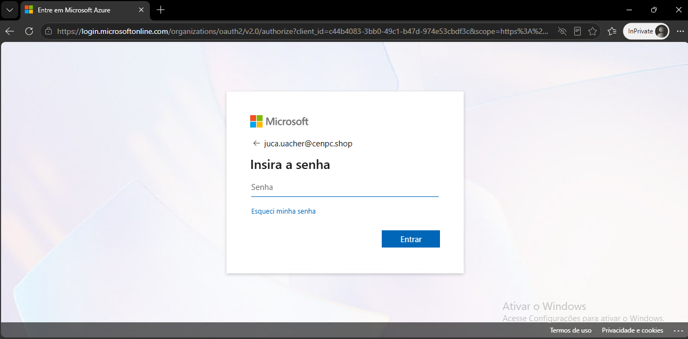
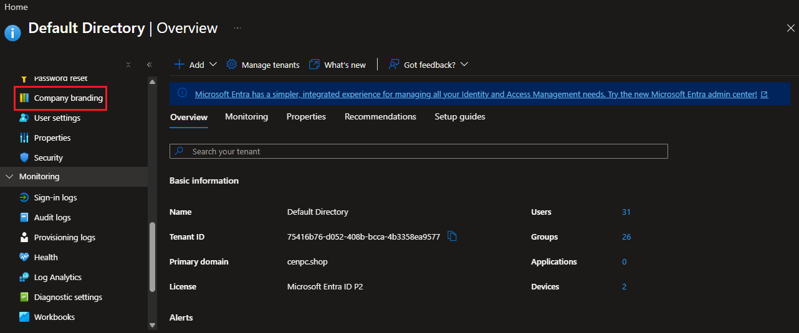
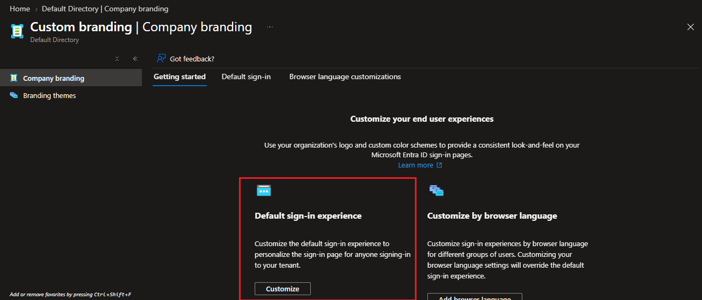
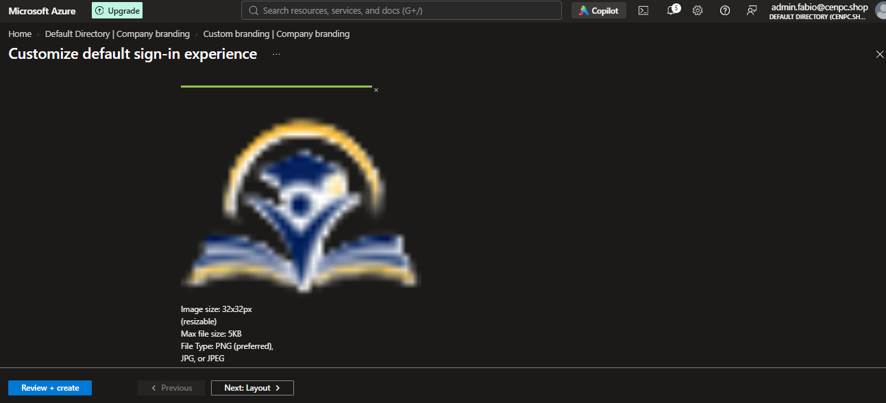
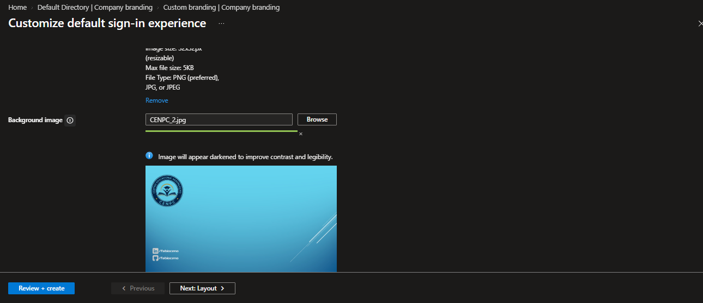
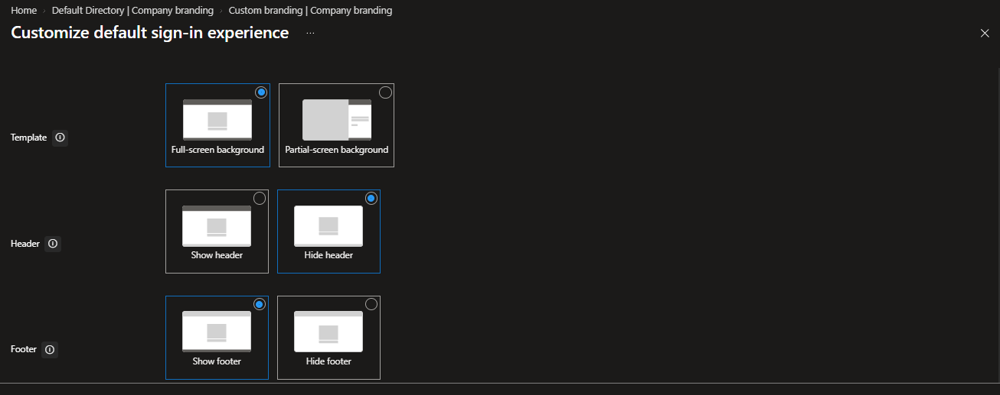
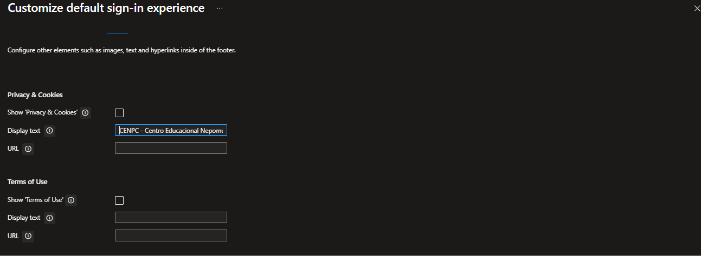
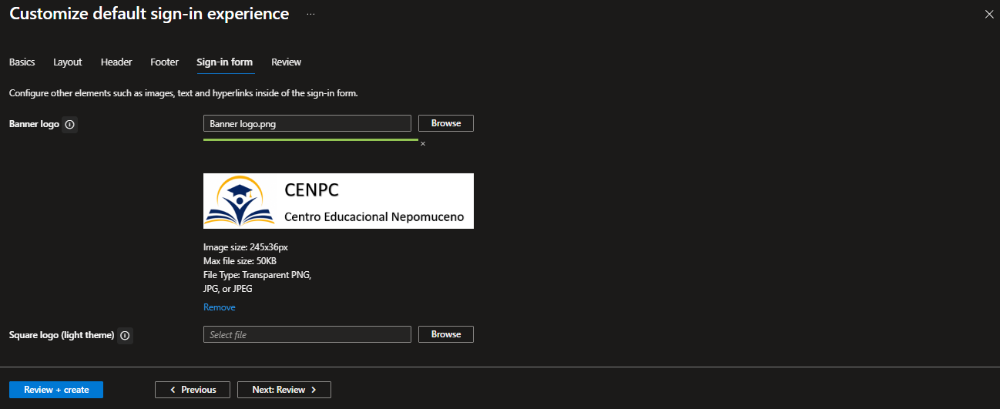
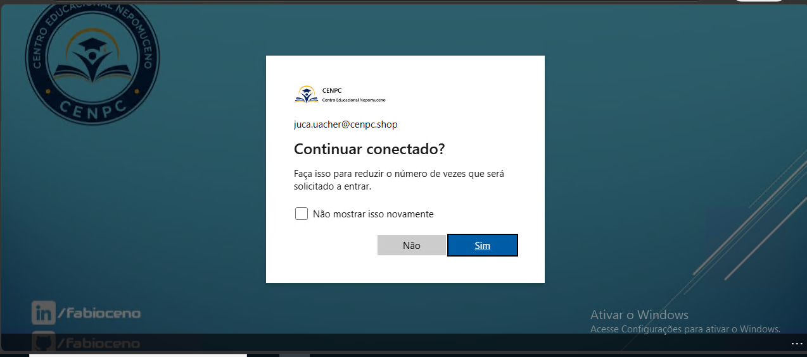

# 🎫 CHAMADO IDENTIDADE VISUAL - COMPANY BRANDING

* Número do chamado: CHG-2026-1022-001
* Categoria: Portal | Identidade Visual
* Prioridade: Média
* Solicitante: Diretoria
* Equipe responsável: Suporte Técnico
* Status: 

    ```
    ☑ Em análise
    ☐ Em implementação
    ☐ Aguardando validação
    ☐ Concluído
    ```

# 1. 📌 Descrição.

* A diretoria solicitou que configurasse a identidade visual do portal CENPC no Azure na tela de logon.

* Atualmente a tela de logon está no padrão do template Microsoft Azure.

    


# 2. 📝 Atendimento | 📸 Evidências.

* No portal Azure > Entra ID > Manage > Company Branding.

    

* Em Company Branding > Default sign-in Experience.

    

### **Basic**

* **Favicon:** imagem configurada no formato `32 × 32 px`

            
            
* **Background:** imagem configurada no formato `1920 × 1080 px`

    

#### Layout

* **Template:** `Full-screen background`
* **Header:** `Show header`
* **Footer:** `Show footer`

    

#### Footer

* **Show 'Privacy & Cookies':** `Hidden`
* **Display text:** `CENPC`
* **Show 'Terms of Use':** `Hidden`

    

#### Sign-in form

* **Banner logo:** `Configured`
* **Square logo (light theme):** `Configured`
* **Square logo (dark theme):** `Configured`
* **Username hint text:** `Endereço de e-mail`
* **Show self-service password reset:** `Show`

    

# 3. 💻 Comandos / Scripts Utilizados

> Registrar somente os comandos relevantes para reprodução do procedimento.

```powershell
    Nenhum comando foi utilizado.
```

# 4. 🔎 Validação dos usuários

* A tela de logon do portal CENPC no Azure foi configurada com sucesso.

    
    
# 6.🏁 Encerramento

* Status:

    ```
    ☐ Em análise
    ☐ Em implementação
    ☐ Aguardando validação
    ☑ Concluído
    ```

* Analista responsável: Fabio Silva

#