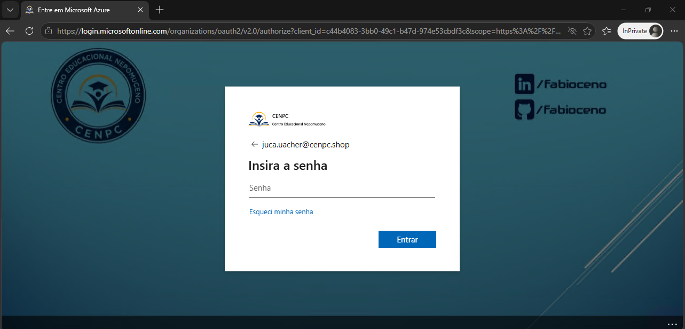
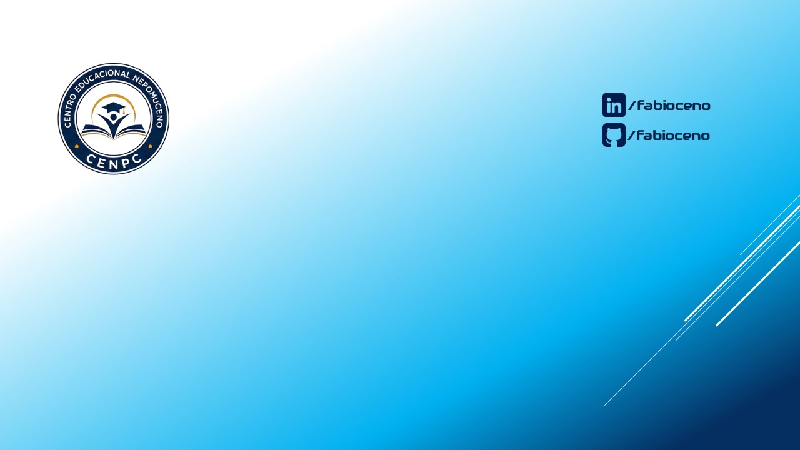
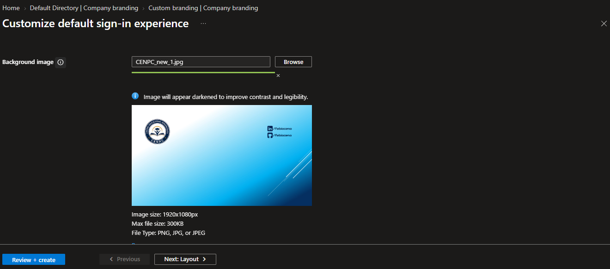
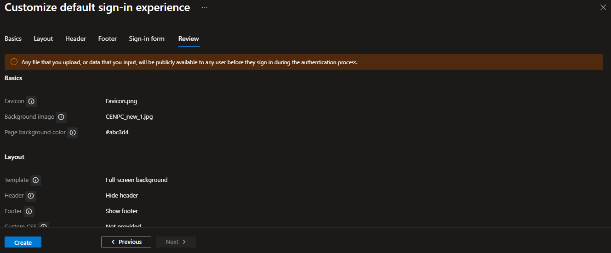
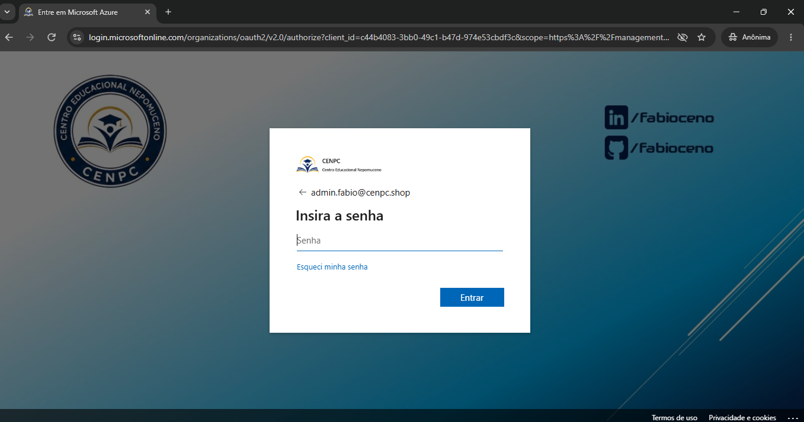

# 🎫 CHAMADO -  IDENTIDADE VISUAL (COMPANY BRANDING)

* Número do chamado: CHG-2026-1108-001
* Categoria: FPortal | Identidade Visual
* Serviço: Microsoft Entra ID
* Tipo de solicitação: Mudança / Implantação
* Prioridade: Média
* Solicitante: Marketing
* Equipe responsável: Suporte Técnico
* Status: 

    ```
    ☑ Em análise
    ☐ Em implementação
    ☐ Aguardando validação
    ☐ Concluído
    ```

# 1. 📌 Descrição.

* A equipe de Marketing solicitou que fosse atualizado o company brainding da pagina de logon do CENPC.

    * **Antigo**:

        

    * **Novo**:

        


# 2. 📝 Atendimento | 📸 Evidências.

* Portal Azure > Entra ID > Manage > Company Branding.

    * Default sign-in experience > Customize.

    * Alterado o "Background image" para imagem solicitada pela equipe de MKT.

        

    * Após as atualizações foi clicado em CREATE.

         


# 3. 💻 Comandos / Scripts Utilizados

> Registrar somente os comandos relevantes para reprodução do procedimento.

```powershell

    Nenhum comando foi utilizado.

```

# 4. 🔎 Validação dos usuários

* A atualização do Company Branding foi realizada com sucesso.

     


# 5. 📸 Evidências

```
📁 CHG-2026-1108-001
└── 📁 img
    ├── 📄 01.png
    ├── 📄 02.png
    ├── 📄 03.png
    ├── 📄 04.png
    └── 📄 05.png
```

    
# 6.🏁 Encerramento


* **Motivo do encerramento:** Solicitação atendida e validada com sucesso.

* **Próxima ação:** Nenhuma ação pendente.

* Status:

    ```
    ☐ Em análise
    ☐ Em implementação
    ☐ Aguardando validação
    ☑ Concluído
    ```

* Analista responsável: Fabio Silva

#