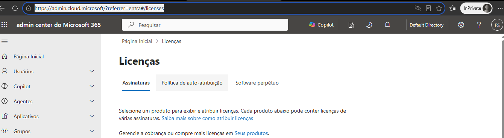
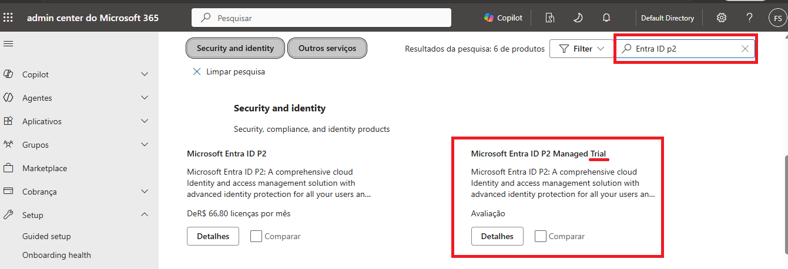
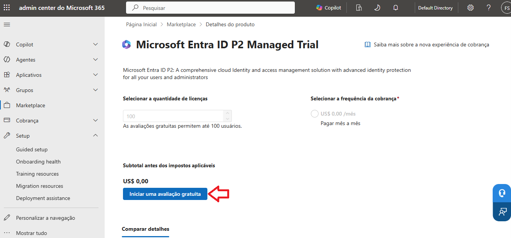
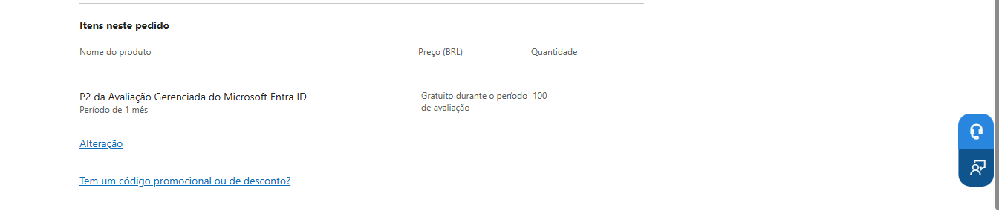
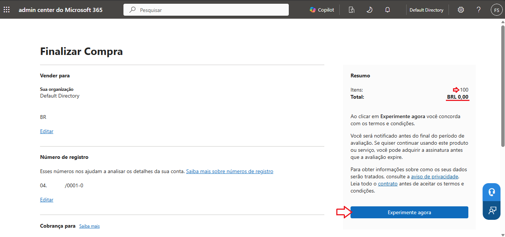
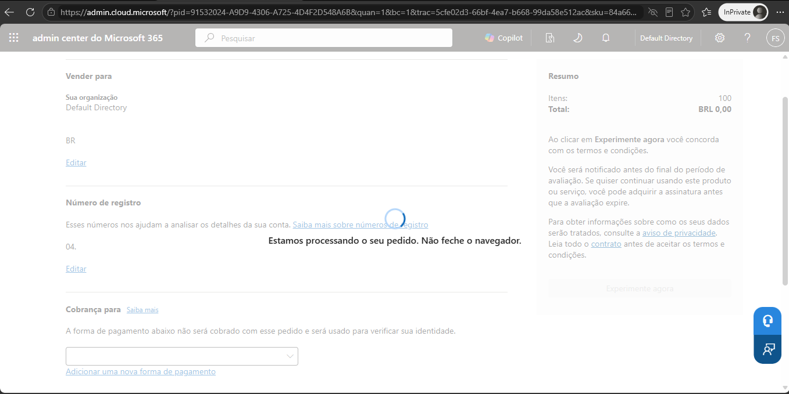
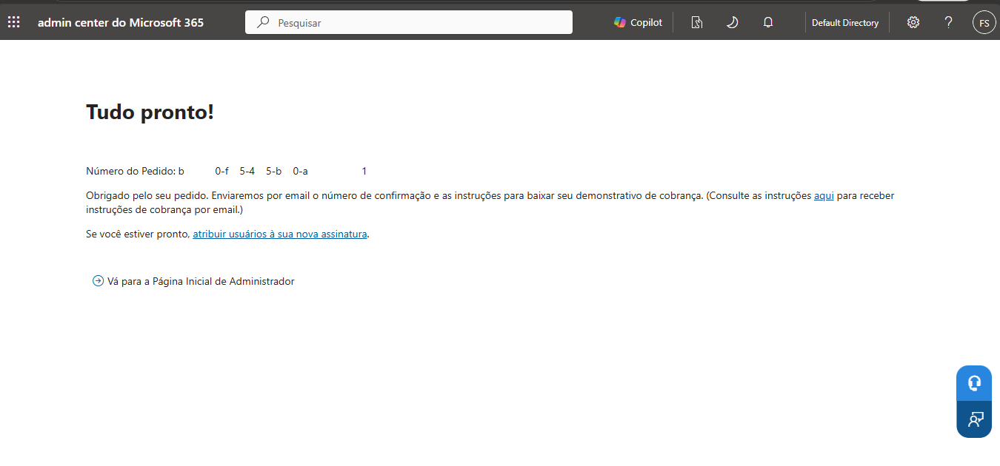
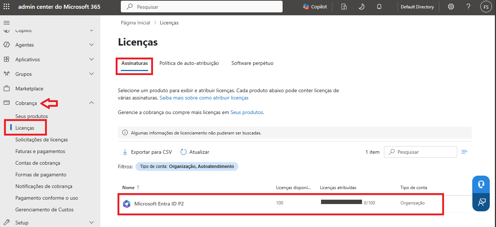

# 🎫 CHAMADO - Implantação e Ativação do Microsoft Entra ID Premium P2.

* Número do chamado: CHG-2026-0211-001
* Categoria: Licenças | Entra ID P2
* Serviço: Microsoft Entra ID
* Tipo de solicitação: Mudança / Implantação
* Prioridade: Média
* Solicitante: Cloud IT Infraestructure
* Equipe responsável: Suporte Técnico
* Status: 

    ```
    ☑ Em análise
    ☐ Em implementação
    ☐ Aguardando validação
    ☐ Concluído
    ```

# 1. 📌 Descrição.

* Habilitar os recursos Premium P2 no tenant, permitindo utilizar funcionalidades como Identity Protection, Privileged Identity Management (PIM) e Conditional Access, conforme os requisitos de licenciamento.

# 2. 📝 Atendimento | 📸 Evidências.

* Com usuário com perfil de **Global Administrator** foi realizado o acesso ao portal *https://admin.cloud.microsoft*

    

* Em Marketplace > Todos os Produtos > no filtro pesquise *Entra ID p2* e selecione o **Microsoft Entra ID P2 Managed Trial**.

    

    * Ao clicar em *Ver detalhes* clique em **Iniciar uma avaliação gratuita**.    
        
        

    * Para finalizar a compra, será necessário inserir as informações referente ao dados de cobrança.

        

    * Após o cadastro, clique em **Experimente Agora**.

        

    * Aguarde o processo ser finalizado.

        

    * As licenças foram disponibilizadas.

        

# 3. 💻 Comandos / Scripts Utilizados

> Registrar somente os comandos relevantes para reprodução do procedimento.

```powershell
# Exemplo
    Nenhum comando foi executado.
```

# 4. 🔎 Validação dos usuários

* No **Admin Center > Cobranças > Licenças** em *Assinaturas* a licença **Microsoft Entra ID P2** foi adicionada.

    

# 5. 📸 Evidências

```
📁 REQ-2026-1022-001
└── 📁 img
    ├── 📄 01.png
    ├── 📄 02.png
    ├── 📄 03.png
    ├── 📄 04.png
    ├── 📄 05.png
    ├── 📄 06.png
    ├── 📄 07.png
    └── 📄 08.png
```
    
# 6.🏁 Encerramento


* **Motivo do encerramento:** Solicitação atendida e validada com sucesso.

* **Próxima ação:** Nenhuma ação pendente.

* Status:

    ```
    ☐ Em análise
    ☐ Em implementação
    ☐ Aguardando validação
    ☑ Concluído
    ```

* Analista responsável: Fabio Silva

#