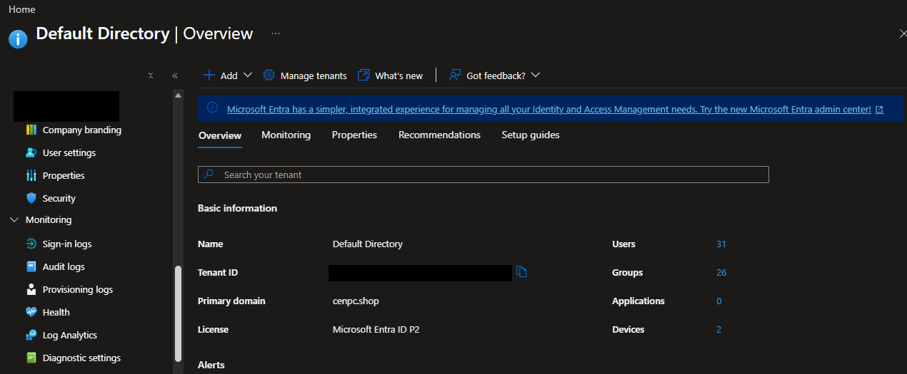
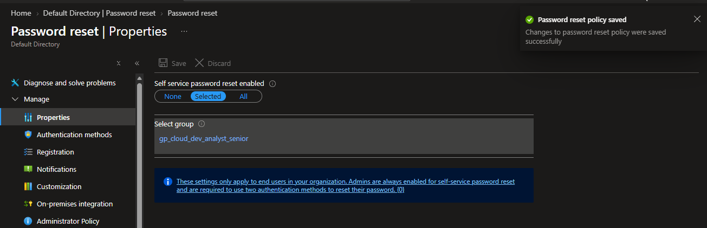
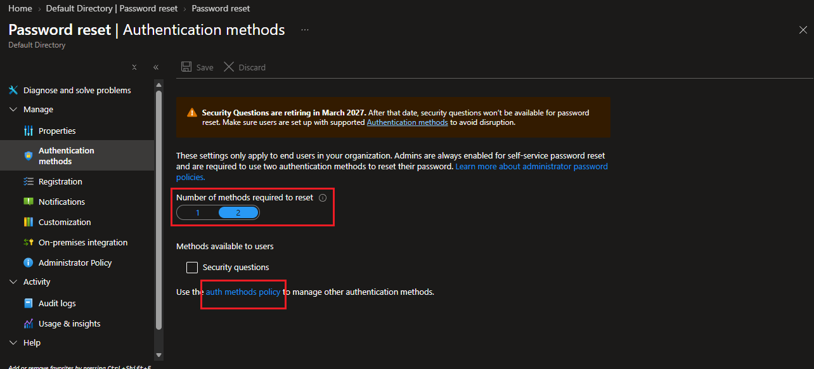
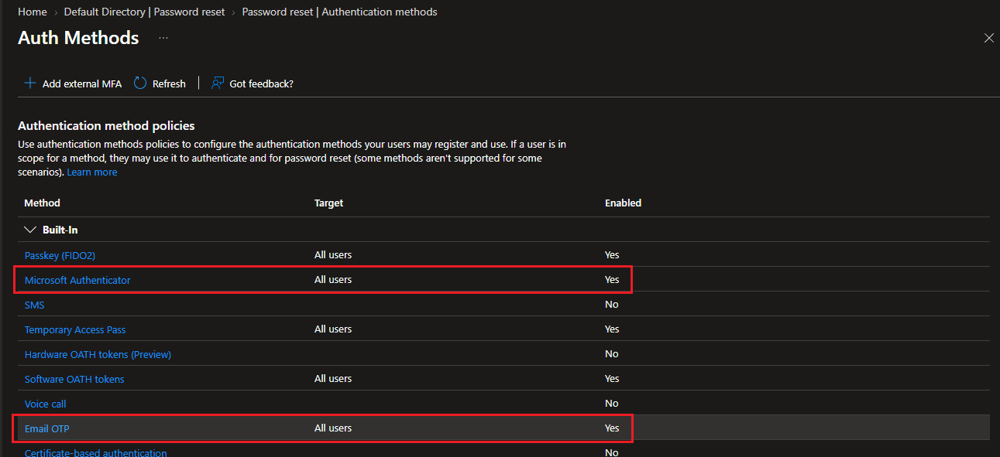
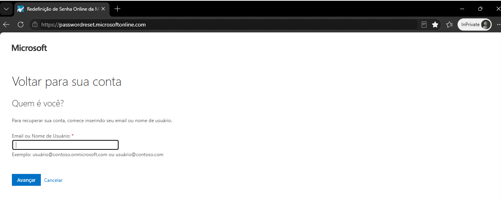
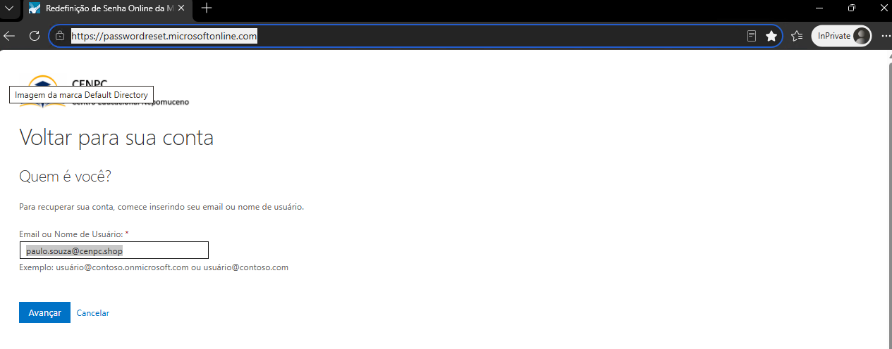
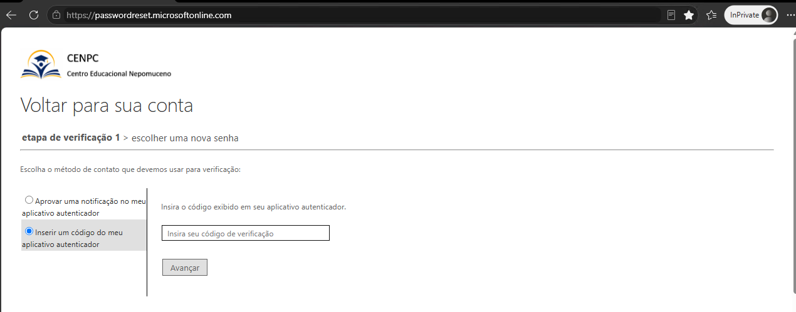
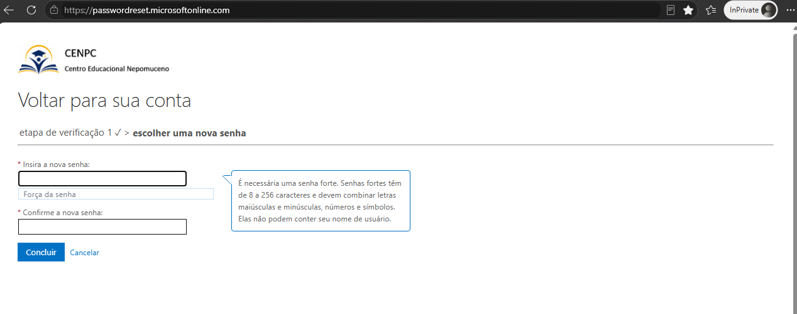
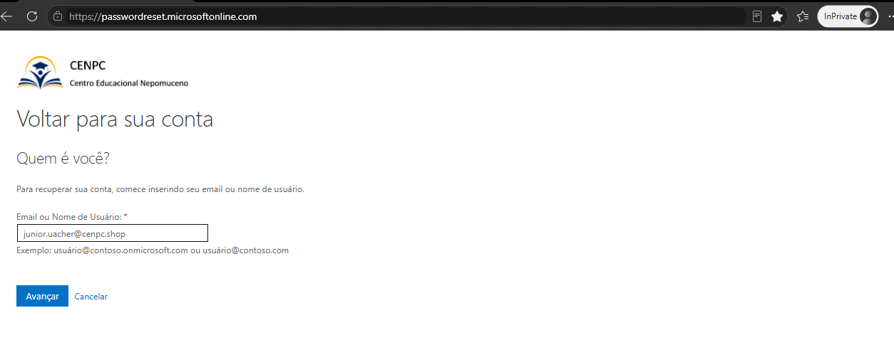
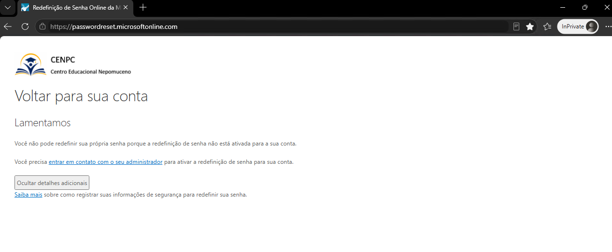

# 🎫 CHAMADO DE ACESSO — SITE P@ssw0rd! 

* Número do chamado: CHG-2026-1025-001.
* Categoria: Cloud Computing | Gestão de Identidades.
* Serviço: Microsoft Entra ID.
* Tipo de solicitação: Mudança | Implantação.
* Prioridade: Média.
* Solicitante: Gerência de Development.
* Equipe responsável: Cloud | Identity and Access Management (IAM).
* Status: 
    ```
    ☑ Em análise
    ☐ Em implementação
    ☐ Aguardando validação
    ☐ Concluído
    ```

# 1. 📌 Descrição.
```
    A equipe de Development solicita a implantação do recurso Self-Service Password Reset (SSPR) no Microsoft Entra ID, permitindo que seus colaboradores de nivel (Analista Senior) redefinam suas próprias senhas ou desbloqueiem o acesso, quando aplicável, sem a necessidade de abrir chamados para a equipe de TI.

    A iniciativa tem como objetivo reduzir o volume de solicitações relacionadas a senhas, aumentar a autonomia dos usuários e melhorar a disponibilidade operacional da equipe de desenvolvimento. 
```
# 2. 📝 Atendimento | 📸 Evidências.

* Com o perfil de Global Admin clique Entra ID > Manage > Password reset.

    

* Selecionado o grupo dos usuários que possuem **JobTitle** *Analista Senior*.

    

* Em **Passoword reset > Properties** > Authentication Methods > **Auth Methods Policy**.

    

* Em **Auth Methods** foram habilitados:

    * Microsoft Authenticator.
    * Email OTP.

        

* Aos colaboradores, foi informado o link da página para acesso ao SSPR **https://passwordreset.microsoftonline.com**

    


# 3. 💻 Comandos / Scripts Utilizados

> Registrar somente os comandos relevantes para reprodução do procedimento.

```
    Nenhum comando foi usando para essa tarefa.
```

# 4. 🔎 Validação dos usuários

* O colaborador **paulo.souza@cenpc.shop** acessou o link *https://passwordreset.microsoftonline.com/* para realizar o teste de SSPR.

    

* Em seguida, os metodos de reset da senha foram exibidos.

    

* Após validação com o autenticator, a tela de inserir uma nova senha foi habilitada com sucesso.

    

* Para usuários que não estão no grupo, a função do SSPR não fica habilitada.

    * Foi realizado o teste com colaborador de outra equipe com o JobTitle diferente.

        
    
    * O sistema retorna que não é possivel realizar o procedimento.

        

# 5. 📸 Evidências

```
📁 REQ-2026-1022-001
└── 📁 img
    ├── 📄 01.png
    ├── 📄 02.png
    ├── 📄 03.png
    ├── 📄 04.png
    ├── 📄 05.png
    ├── 📄 06.png
    ├── 📄 07.png
    ├── 📄 08.png
    ├── 📄 09.png    
    └── 📄 10.png
```
  
# 6.🏁 Encerramento


**Motivo do encerramento:** Solicitação atendida e validada com sucesso.

**Próxima ação:** Nenhuma ação pendente.

* Status:

    ```
    ☐ Em análise
    ☐ Em implementação
    ☐ Aguardando validação
    ☑ Concluído
    ```

* Analista responsável: Fabio Silva

#