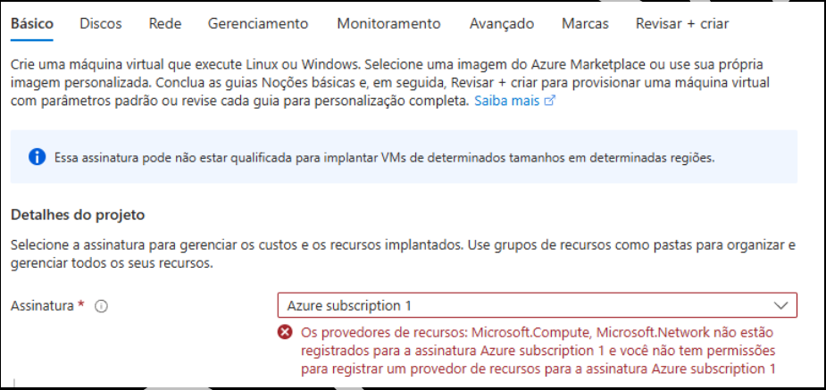
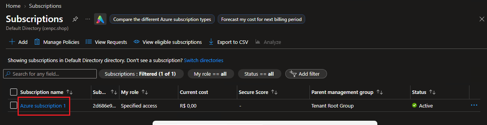
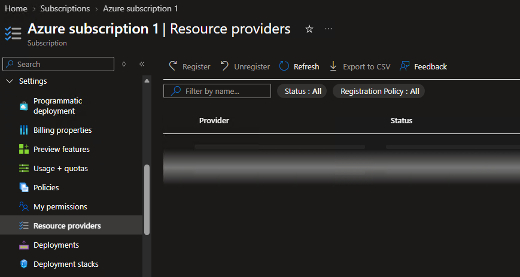
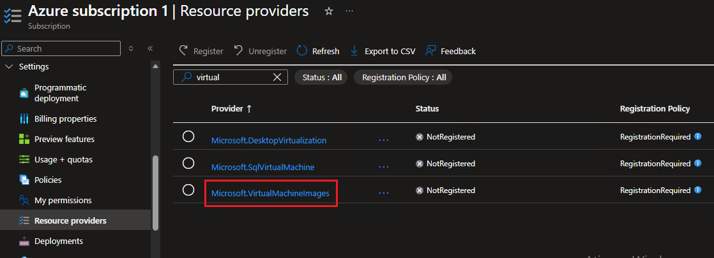
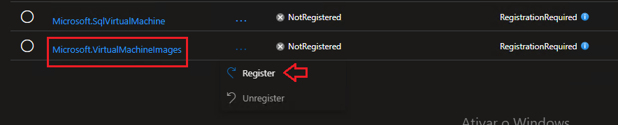
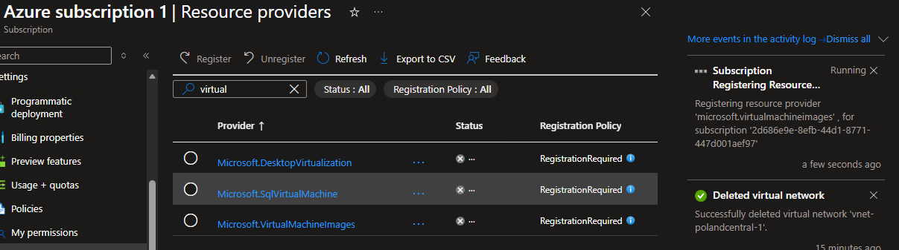
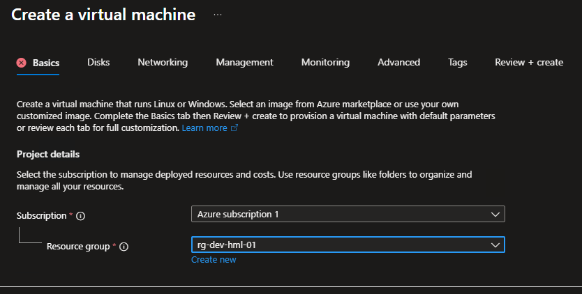

# 🎫 VIRTUAL MACHINE - Falha ao criar uma máquina virtual.

* Número do chamado: INC-2026-1021-001
* Categoria: Virtual Machine | Deploy
* Prioridade: Média
* Solicitante: Development | Paulo Souza
* Equipe responsável: Suporte Técnico
* Status: 

    ```
    ☑ Em análise
    ☐ Em implementação
    ☐ Aguardando validação
    ☐ Concluído
    ```

# 1. 📌 Descrição.

*   O colaborador informou que ao tentar iniciar o deploy de uma máquina virtual o portal retorna o erro conforme a imagem no exemplo abaixo.   

    

# 2. 📝 Atendimento | 📸 Evidências.

* No portal, pesquise **Subscription**.

* Clique no *Link* da subscription 

    

* Em *Settings* > clique em **Resource Provides**.  

    

    * No filtro, digite *virtual* e procure *Microsoft.VirtualMachineImages*

        
    
    * Clique nos **"..."** e selecione a opção *Register*.

        

    * Aguarde o procedimento ser concluído.

        
    
    * Após concluir, a informação trocara para o status de *Registering*.

        


# 3. 💻 Comandos / Scripts Utilizados

> Nenhum comando foi EXECUTADO.

# 4. 🔎 Validação dos usuários

* O usuário *Paulo Souza* conseguiu iniciar o Deploy de uma máquina virtual, sem erros.

    


# 5.🏁 Encerramento


* Status:

    ```
    ☐ Em análise
    ☐ Em implementação
    ☐ Aguardando validação
    ☑ Concluído
    ```

* Analista responsável: Fabio Silva

#
