# POWERSHELL - CONECTANDO NO ENTRA ID USANDO MICROSOFT GRAPH

## 1. 📌 Descrição.

*Procedimento para realizar a conexão entra o Entra ID atraves do Powershell usando a ferramenta Microsoft Graph*

## 2. 📝 Procedimentos | 📸 Evidências | 💻 Comandos / Scripts | 🔎 Análise.

1) Através do *Microsoft Store*, faça o download e instalação do Powershell versão 7.6.6 ou superior.

    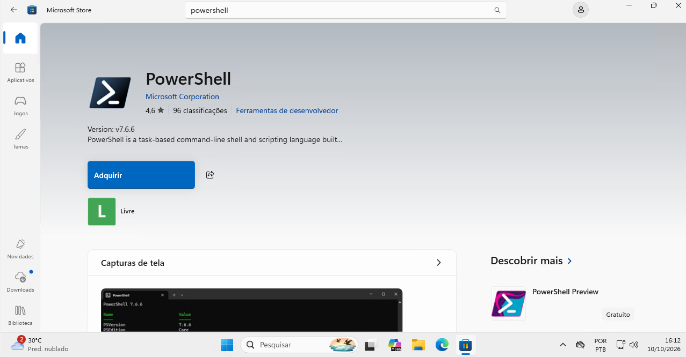

2) Instale o modulo do *Microsoft Graph* / modulo de *autenticação Graph* utilizando o comando abaixo:

    ```powershell
    Install-Module Microsoft.Graph -Scope CurrentUser -verbose
    ```
    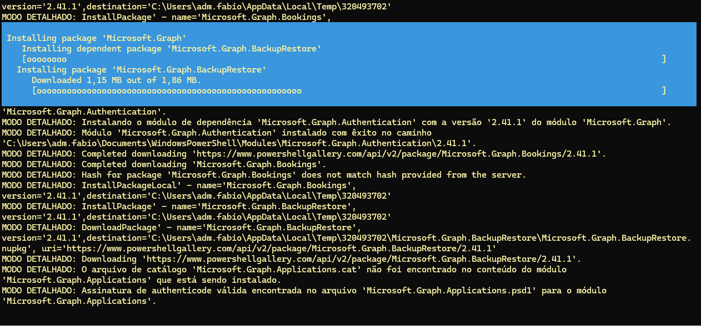

    **Aguarde a conclusão da instalação do modulo.**

    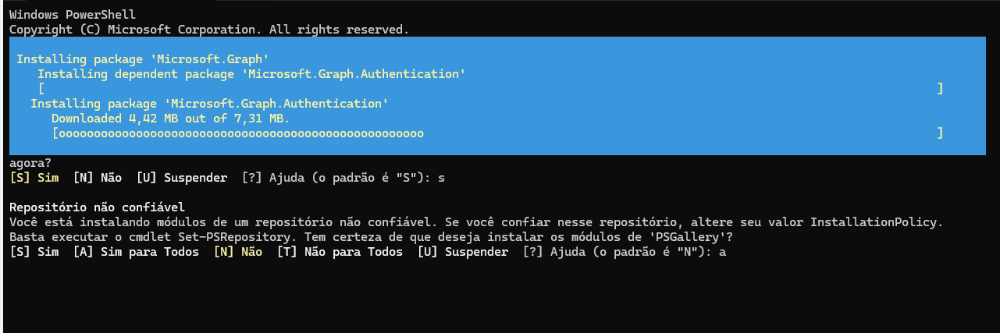

* **Caso precise execute os comandos para carregar apenas os modulos separadamente.**

    * **Autenticação:**

        ```powershell
        Import-Module Microsoft.Graph.Authentication -Verbose
        ```
    * **Users:**

        ```powershell
        Install-Module Microsoft.Graph.Users -Scope CurrentUser -verbose
        ```
    * **Update do modulo:**

        ```powershell
        Update-Module Microsoft.Graph -Force -verbose
        ```
    * **Reiniciando Powershell:**

        ```powershell
        Start-Process powershell
        ```
3) No portal do Azure ou no portal Admin Center copie o **TenantID**.

    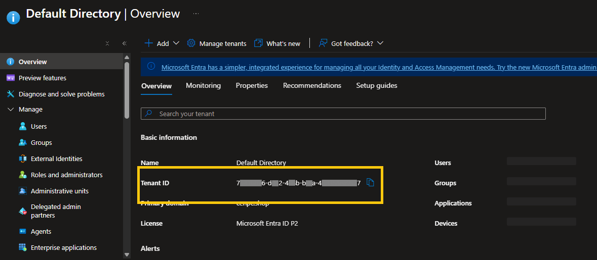

4) Reinicie o Powershell executando o comando abaixo:

    * **Reiniciando Powershell:**

        ```powershell
        Start-Process powershell
        ```

5) Autentique no Entra ID usando o comando abaixo:

    ```powershell
    connect-MGGraph -TenantID "00000000-x000-408b-bxx0x-4x0000xx0007" -Scopes "User.ReadWrite.All","Group.ReadWrite.All","RoleManagement.Read.all","Directory.Read.all"
    ```
* 🔎 Caso ao executar o comando acima e retorne o erro:

     ``Connect-MgGraph : O comando 'Connect-MgGraph' foi encontrado no módulo 'Microsoft.Graph. Authentication', mas não foi possível carregar o módulo. Para obter mais informações, execute 'Import-Module Microsoft.Graph.Authentication'. No linha:1 caractere:1 + Connect-MgGraph -TenantID "00000000-x000-408b-bxx0x-4x0000xx0007" -Sco ...``

    * Execute o comando: 
    
    ```powershell
        Import-Module Microsoft.Graph.Authentication -Force -Verbose 
    ```

* 🔎 Caso ao executar o comando acima retorne o erro conforme a imagem abaixo:

    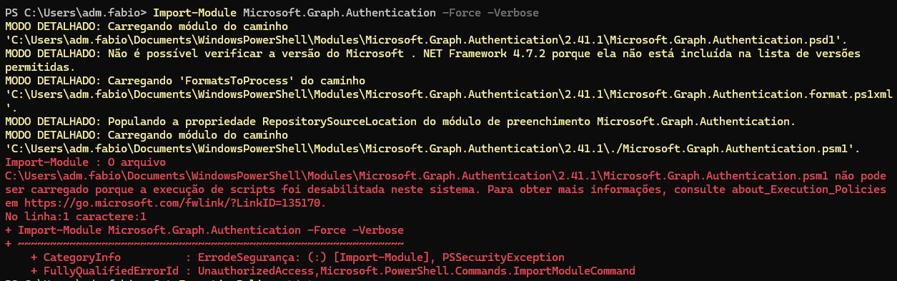

    * Execute o comando:

    ```powershell
        Get-ExecutionPolicy -List
    ```

    * Verifique o que foi impresso.


    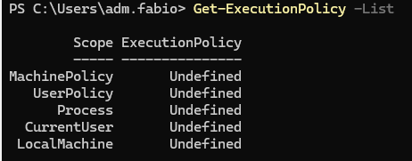


    * Execute o comando: 


    ```powershell
        Set-ExecutionPolicy -Scope CurrentUser -ExecutionPolicy RemoteSigned ``
    ```

    * Verifique o que foi impresso.

    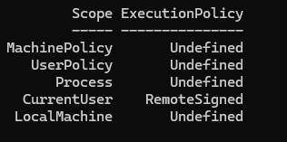    


    * Execute o comando de autenticação novamente:

    ```powershell
    connect-MGGraph -TenantID "00000000-x000-408b-bxx0x-4x0000xx0007" -Scopes "User.ReadWrite.All","Group.ReadWrite.All","RoleManagement.Read.all","Directory.Read.all"
    ```

6) Informe as credenciais de acesso no Entra ID.

    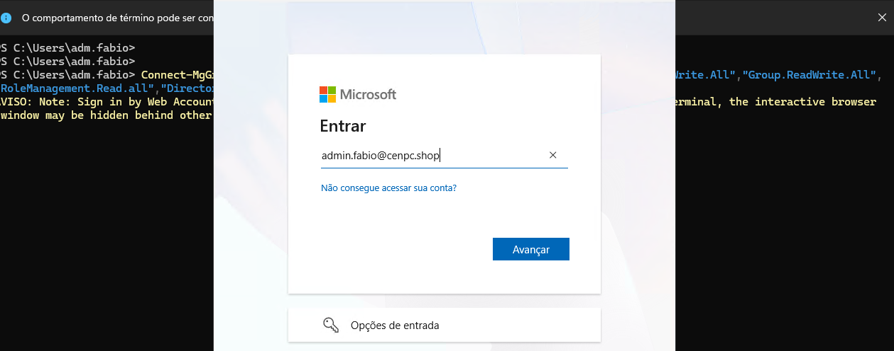


    * Caso queira que o dispositivo seja cadastrado, clique em SIM.


    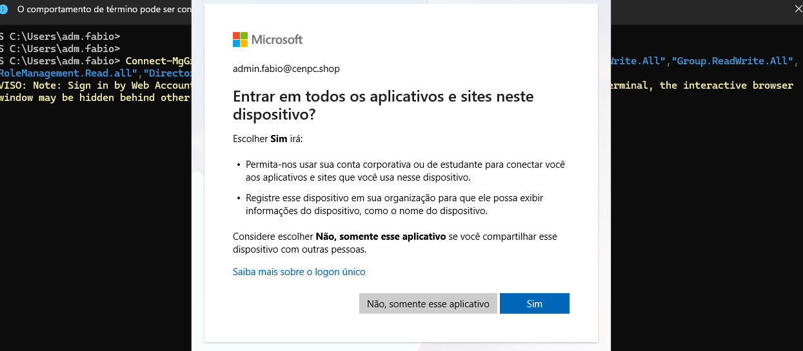

7) Em seguida, a autenticação foi realizada com sucesso.


    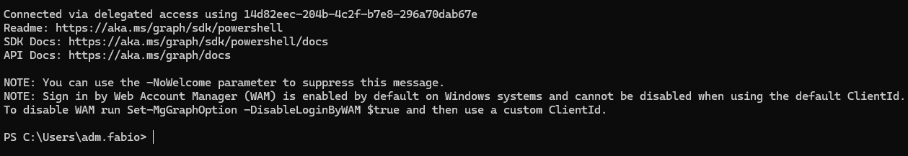


8) Após a autenticação, como teste, execute o comando para verificar as contas cadastradas no Tenant.


    ```powershell
    Select-Object DisplayName,UserPrincipalName,JobTitle,Department
    ```

    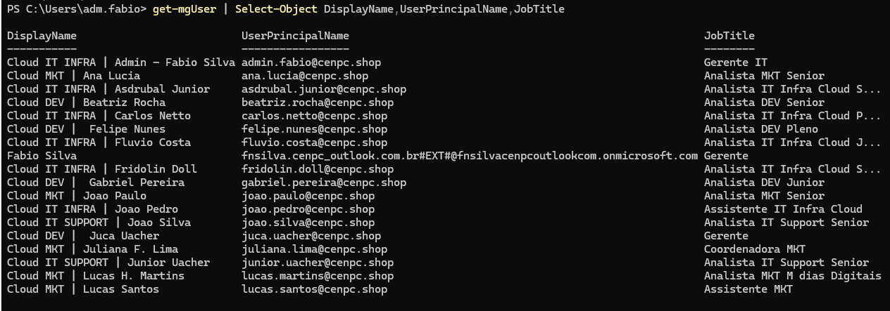


9) Para encerrar a sessão, execute o comando:


    ```powershell
    Disconnect-MgGraph
    ```

    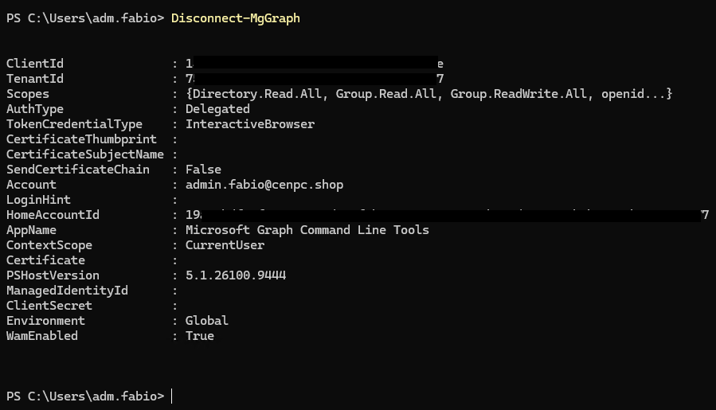


* *Analista responsável*: **Fabio Silva**

#