# 🎫 CHAMADO - Criar função para operação de máquinas virtuais. 

* Número do chamado: REQ-2026-1106-001
* Categoria: Infraestrutura | Computer
* Serviço: Microsoft Entra ID
* Tipo de solicitação: Acessos | Permissão
* Prioridade: Média
* Solicitante: Infraestructure
* Equipe responsável: Suporte Técnico
* Status: 

    ```
    ☑ Em análise
    ☐ Em implementação
    ☐ Aguardando validação
    ☐ Concluído
    ```

# 1. 📌 Descrição.

* A equipe de suporte N1 precisa iniciar, parar, reiniciar e consultar máquinas virtuais, mas não pode excluir VMs, modificar configurações ou administrar redes.

* A máquina virtual está no resource group "rg-ti-infra-hml".

    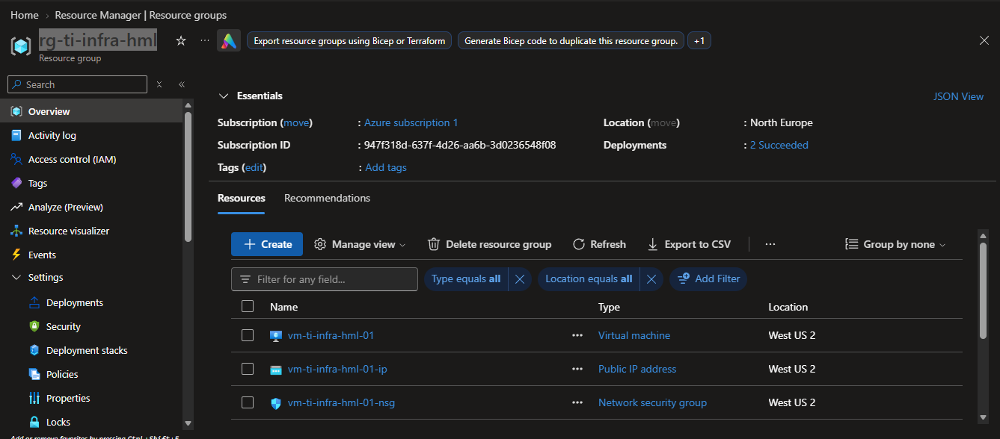.

# 2. 📝 Atendimento | 📸 Evidências.

* Foi verificado que os colaboradores da equipe de IT Support não tem acesso a máquina virtual.

    * O colaborador usado "salustiano.souza@cenpc.shop".

        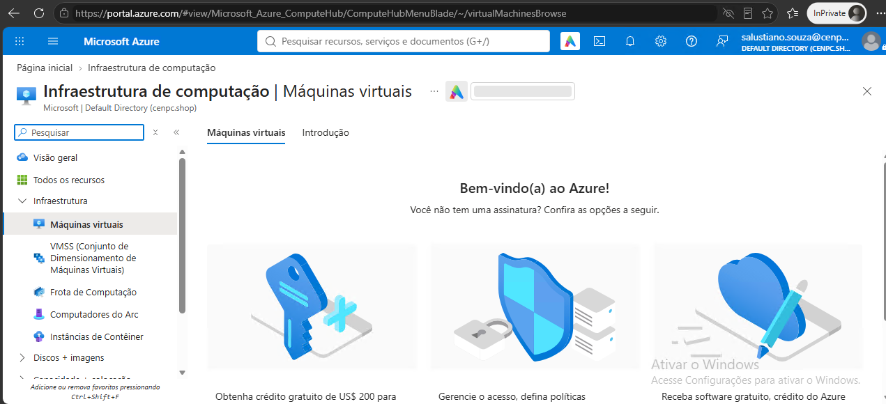

* Foi realizado o procedimento de edição do *".JSON"* para liberar as permissões.

```Json

    "properties": {
        "roleName": "CENPC - Operador de VMs (Custom)",
        "description": "Permite visualizar, iniciar, reiniciar e parar máquinas virtuais no RG-TI-INFRA-HML.",
        "type": "CustomRole",
        "permissions": [
        {
            "actions": [
            "Microsoft.Resources/subscriptions/resourceGroups/read",
            "Microsoft.Compute/virtualMachines/read",
            "Microsoft.Compute/virtualMachines/start/action",
            "Microsoft.Compute/virtualMachines/deallocate/action",
            "Microsoft.Compute/virtualMachines/restart/action",
            "Microsoft.Network/networkInterfaces/read",
            "Microsoft.Compute/disks/read"
            ],
            "notActions": [],
            "dataActions": [],
            "notDataActions": []
        }
        ],
        "assignableScopes": [
        "/subscriptions/idSub/resourceGroups/rg-ti-infra-hml"
        ]
        }
    }

```
* No Portal Azure para adicionar a nova função **Resource Manager > Resource Groups > rg-ti-infra-hml > Access Control (IAM) > Add > Add custom role**.

    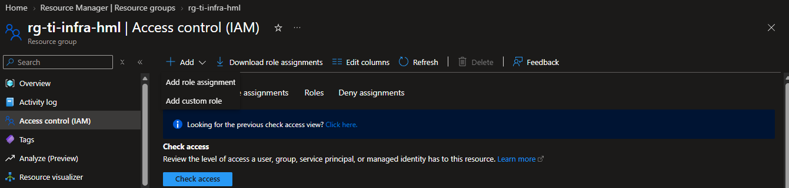.

    * Em **"Baseline permissions"** foi selecionado *"Start from JSON"* e adicionado o arquivo que foi editado.

        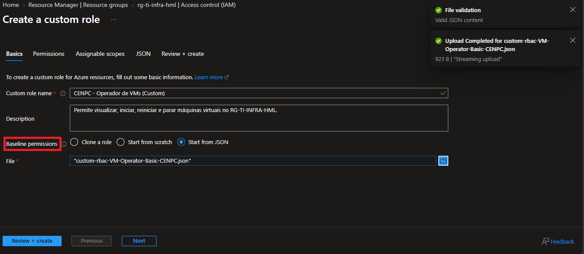.

    * Após aprovar todos os passos anteriores, foi clicado em CREATE para adicionar a função.

    * A função foi adicionada com sucesso.

        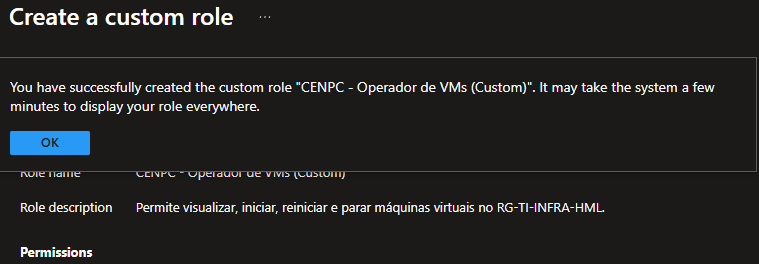.


* Em seguida, foi associada a função criada ao grupo N1 "gp_cloud_support_analyst_junior" **ADD > ADD ROLE ASSIGNMENT**.

    * Em Role > Job function roles > TYPE > "custom role" onde foi selecionada a função que foi criada.

        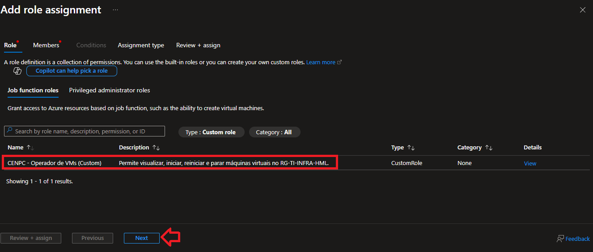.

    * Selecionado o grupo que terá a função associada.

        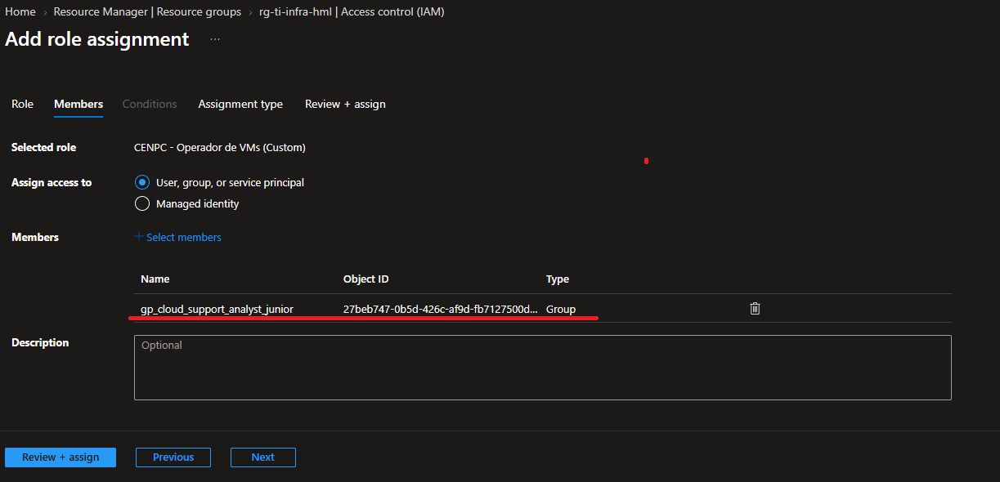.

    * Em seguida, colocado a função associada como permanente.

        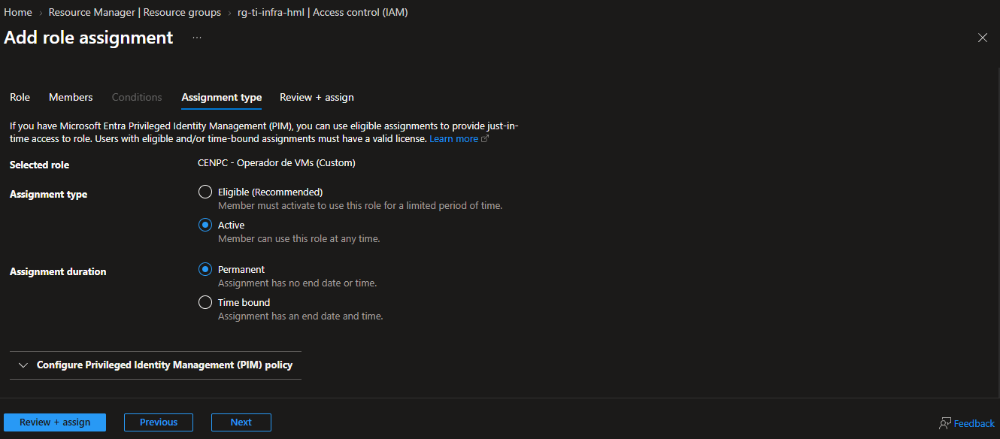.

    * Executando o procedimento de associar a Role ao Grupo.

        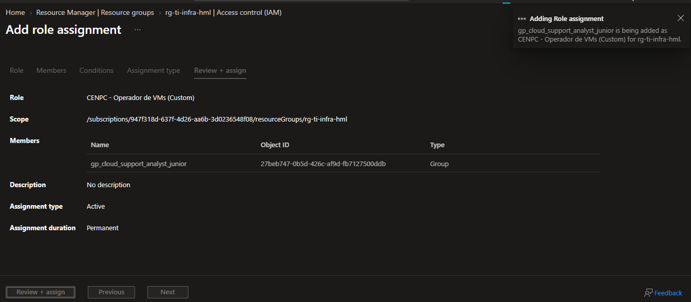.

    * Role associada com sucesso.

        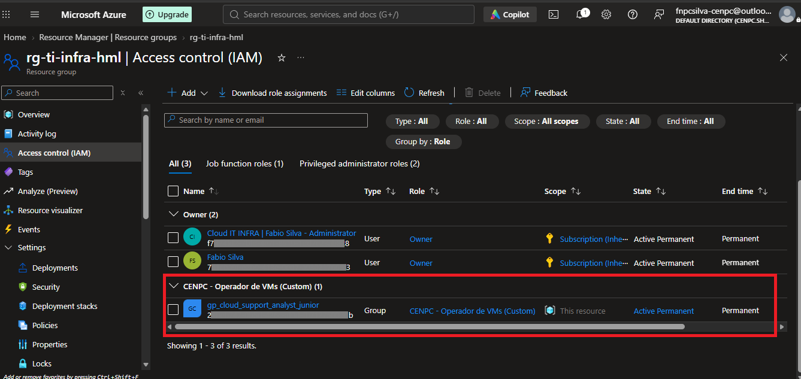.
    

# 3. 💻 Comandos / Scripts Utilizados

> Registrar somente os comandos relevantes para reprodução do procedimento.

```powershell

    Não foi utiizados comandos.

```
# 4. 🔎 Validação dos usuários

* Acessando o resource group **rg-ti-infra-hml** com o perfil do usuário **"salustiano.souza@cenpc.shop"**.

    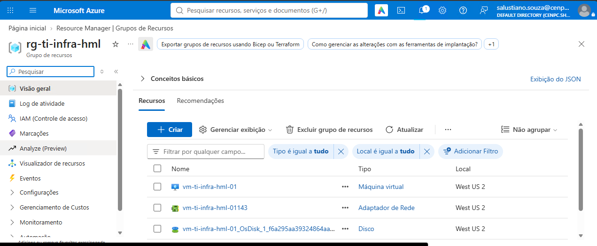.

* Foi realizado o procedimento de iniciar a VM que foi criada.

    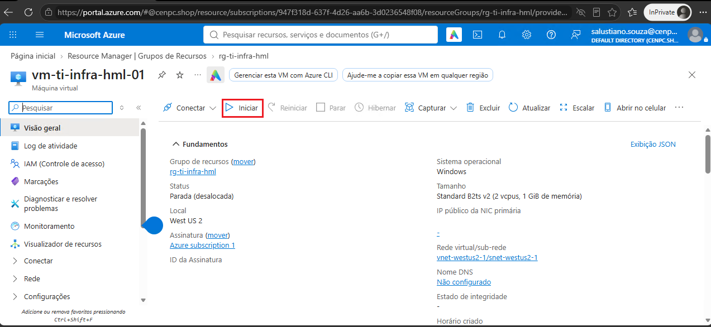.

* A VM foi iniciada com sucesso.

    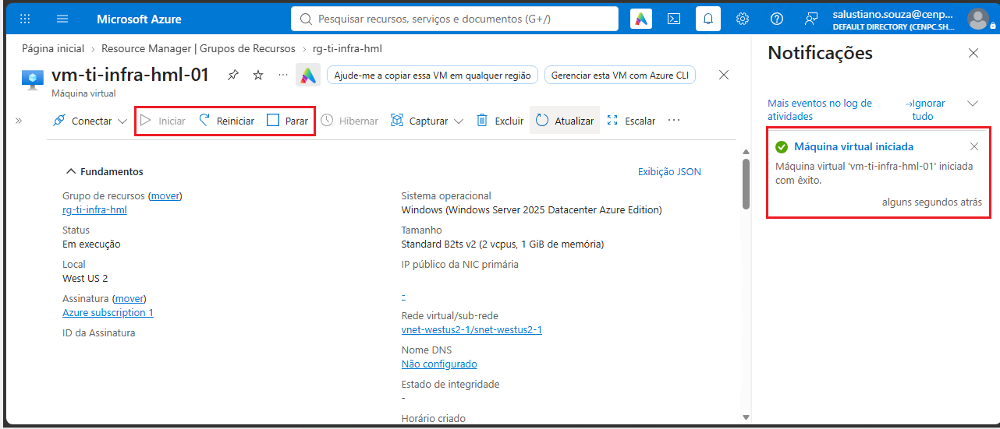.

* Após o procedimento "de ligar a VM" agora a VM será desligada "desalocada".

    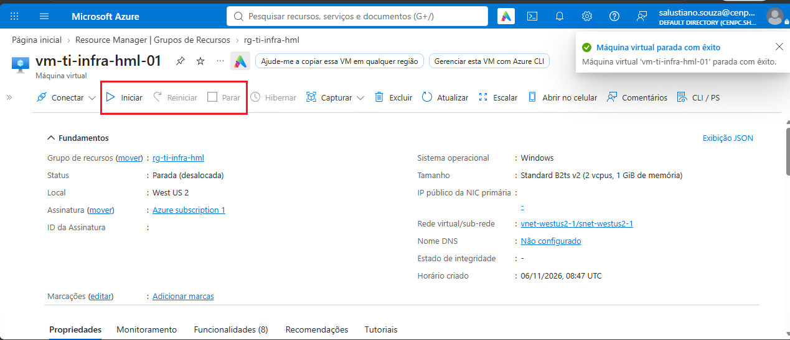.

# 5. 📸 Evidências

```
📁 REQ-2026-1106-001
└── 📁 img
    ├── 📄 01.png
    ├── 📄 02.png
    ├── 📄 03.png
    ├── 📄 04.png
    ├── 📄 05.png
    ├── 📄 06.png
    ├── 📄 07.png
    ├── 📄 08.png
    ├── 📄 09.png
    ├── 📄 10.png
    ├── 📄 11.png
    ├── 📄 12.png
    ├── 📄 13.png
    └── 📄 14.png
```
   
# 6.🏁 Encerramento

* **Motivo do encerramento:** As permissões foram liberadas para os colaboradores que fazem parte do grupo N1 "gp_cloud_support_analyst_junior" .

* **Próxima ação:** Nenhuma ação pendente.

* Status:

    ```
    ☐ Em análise
    ☐ Em implementação
    ☐ Aguardando validação
    ☑ Concluído
    ```

* Analista responsável: Fabio Silva

#