# 🎫 CHAMADO -  IMPLEMENTAÇÃO DE POLÍTICA DE RESTRIÇÃO DE REGIÕES PARA MÁQUINAS VIRTUAIS AZURE

* Número do chamado: REQ-2026-1118-001
* Categoria: Azure Policy / Compute / Governança
* Serviço: Microsoft Entra ID
* Tipo de solicitação: Requisição de Serviço – Cloud / Governança Azure
* Prioridade: Média
* Solicitante: Equipe de Infraestrutura Cloud
* Equipe responsável: Administrador Cloud
* Status: 

    ```
    ☑ Em análise
    ☐ Em implementação
    ☐ Aguardando validação
    ☐ Concluído
    ```

# 1. 📌 Descrição.

* Solicitamos a criação e implementação de uma Azure Policy personalizada para restringir a criação de máquinas virtuais (Virtual Machines) exclusivamente às regiões geográficas previamente autorizadas pela administração do ambiente Azure.

* A iniciativa tem como objetivo estabelecer controles de governança, padronização e conformidade na utilização dos recursos computacionais, evitando implantações em regiões não homologadas pela organização. 

````
    |   SKU     |   vCPU    |   RAM     |
    -------------------------------------
    |  B2ls_v2  |     2     |     4     |
    |  B2ts_v2  |     2     |     1     |
    |  B2ls_v2  |     2     |     4     |
    |  B2ts_v2  |     2     |     1     |
````

# 2. 📝 Atendimento | 📸 Evidências.

* Criado um script para saber quais regiões aceitam a criação de VMs com os SKUS informados.

    * Executando o terminal do Windows.

    * Autenticando no Azure.  
        
        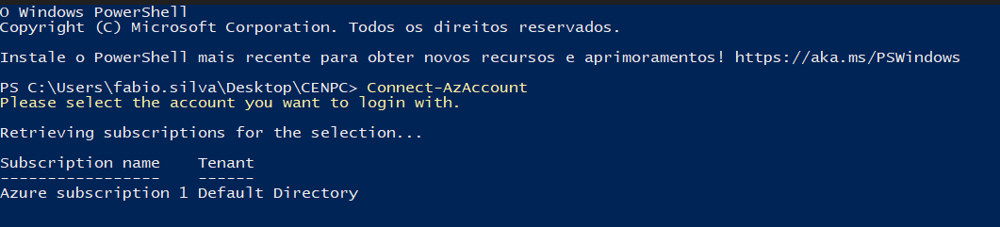

    * Executando o Script para verificar quais regiões aceitam a criação de VMs com os SKUS informados.

        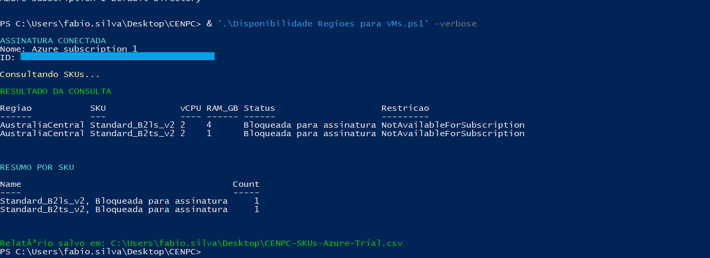

* Após verificar as regiões, foram criadas VMs de teste para validação.

    * West US 2
    * West Central US
    * Mexico Central
    * Spain Central
    * Chile Central
    * Canada East  

* Autenticando no portal Azure > Policy > Definitions > **search** > *Allowed locations.*

    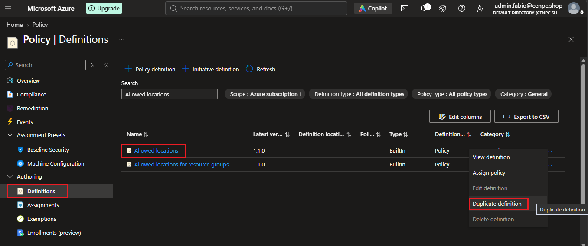

* Incluindo o JSON com as regiões permitidas.

````json
    {
        "displayName": "CENPC - Allowed VM Locations",
        "policyType": "Custom",
        "mode": "Indexed",
        "description": "Restricts the deployment of Azure Virtual Machines to approved regions.",
        "metadata": {
        "category": "Compute",
        "version": "1.0.0"
        },
        "parameters": {
        "listOfAllowedLocations": {
            "type": "Array",
            "metadata": {
            "displayName": "Regioes Permitidas",
            "description": "Lista de regioes autorizadas para criacao de VMs.",
            "strongType": "location"
            },
            "defaultValue": [
            "westus2",
            "westcentralus",
            "mexicocentral",
            "spaincentral",
            "chilecentral",
            "canadaeast"
            ]
        },
        "effect": {
            "type": "String",
            "defaultValue": "Deny",
            "allowedValues": [
            "Deny",
            "Audit",
            "Disabled"
            ],
            "metadata": {
            "displayName": "Effect"
            }
        }
        },
        "policyRule": {
        "if": {
            "allOf": [
            {
                "field": "type",
                "equals": "Microsoft.Compute/virtualMachines"
            },
            {
                "field": "location",
                "notIn": "[parameters('listOfAllowedLocations')]"
            }
            ]
        },
        "then": {
            "effect": "[parameters('effect')]"
        }
        }
    
    }
````

* Editando a politica.

    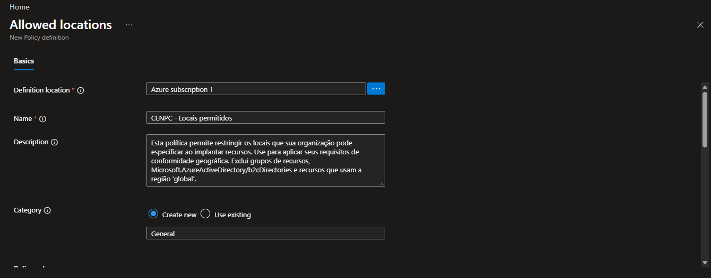

* Incluindo o .JSON editado e salvando as alterações.

    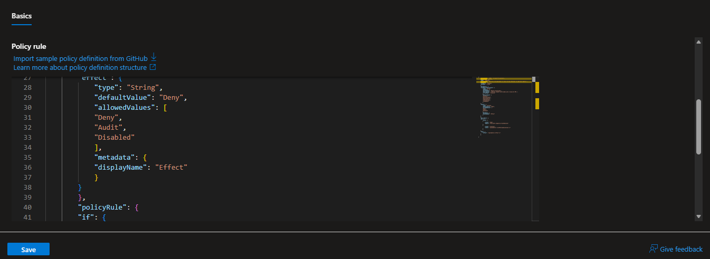

* Em seguida associando a politica em POLICY > ASSIGNMENTS > ASSIGN POLICY > 

    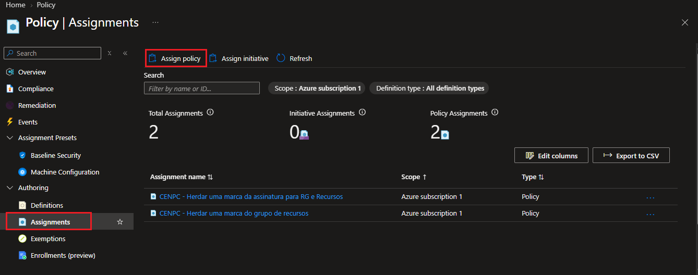

    * Basic - Incluindo a policy na Subscription.

        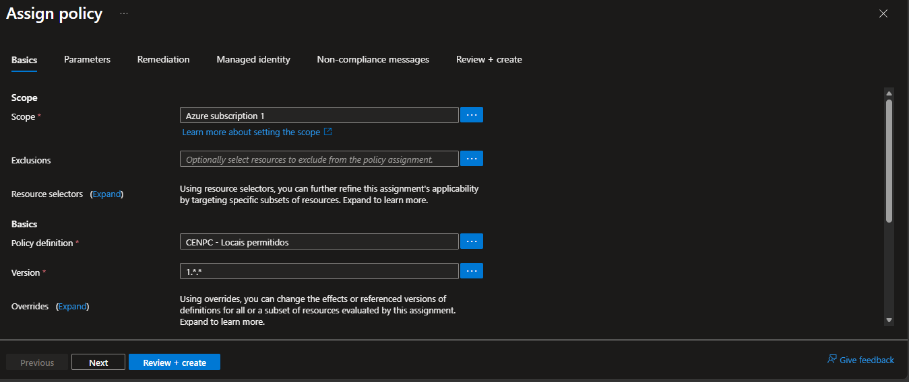
    
    * Em Managed Identity, permitir que o sistema gerencie.

        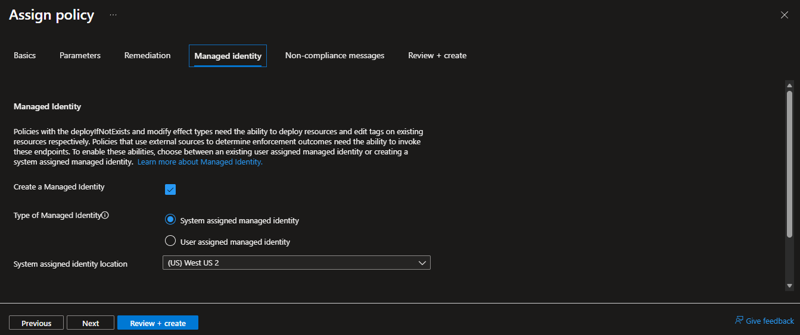.

    * Em Review + Create, crie a associação da politica.

        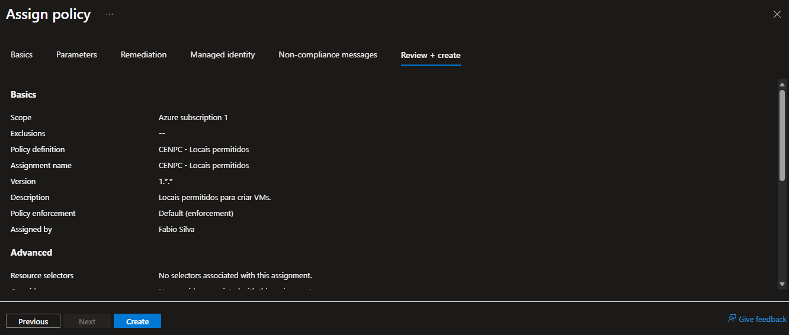.
    
* Policy associada com sucesso.

    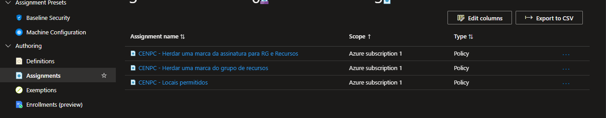


# 3. 💻 Comandos / Scripts Utilizados

> Registrar somente os comandos relevantes para reprodução do procedimento.

```powershell
# Iniciando o processo do Powershell.

Start-Process powershell

# Autenticando no Azure

Connect-AzAccount

```
```Powershell
    # ==========================================================
    # CENPC - DISPONIBILIDADE DE SKUs NA ASSINATURA AZURE TRIAL
    # ==========================================================

    # 1. Validar assinatura conectada
    $Contexto = Get-AzContext

    if (-not $Contexto) {
        Connect-AzAccount
        $Contexto = Get-AzContext
    }

    Write-Host "`nASSINATURA CONECTADA" -ForegroundColor Cyan
    Write-Host "Nome: $($Contexto.Subscription.Name)"
    Write-Host "ID: $($Contexto.Subscription.Id)"

    # 2. Consultar catálogo da assinatura
    Write-Host "`nConsultando SKUs..." -ForegroundColor Yellow

    $Catalogo = Get-AzComputeResourceSku -ErrorAction Stop

    # 3. SKUs solicitadas
    $SKUs = @(
        "Standard_B2ls_v2",
        "Standard_B2ts_v2"
    )

    # 4. Gerar relatório
    $Resultado = foreach ($NomeSKU in $SKUs) {

        $Item = $Catalogo | Where-Object {
            $_.ResourceType -eq "virtualMachines" -and
            $_.Name -eq $NomeSKU
        } | Select-Object -First 1

        if (-not $Item) {
            [PSCustomObject]@{
                Regiao = "-"
                SKU = $NomeSKU
                vCPU = "-"
                RAM_GB = "-"
                Status = "SKU não encontrada"
                Restricao = "-"
            }
            continue
        }

        $vCPU = ($Item.Capabilities |
            Where-Object Name -eq "vCPUs").Value

        $RAM = ($Item.Capabilities |
            Where-Object Name -eq "MemoryGB").Value

        foreach ($Regiao in $Item.Locations) {

            # Verificar restrições de localização
            $RestricoesLocais = @(
                $Item.Restrictions | Where-Object {
                    $_.Type -eq "Location" -and
                    (
                        $_.Values -contains $Regiao -or
                        $_.RestrictionInfo.Locations -contains $Regiao
                    )
                }
            )

            # Verificar restrições de zona
            $RestricoesZona = @(
                $Item.Restrictions | Where-Object {
                    $_.Type -eq "Zone" -and
                    (
                        $_.Values -contains $Regiao -or
                        $_.RestrictionInfo.Locations -contains $Regiao
                    )
                }
            )

            if ($RestricoesLocais.Count -gt 0) {

                $Motivo = ($RestricoesLocais.ReasonCode |
                    Select-Object -Unique) -join ", "

                $Status = if ($Motivo -match "NotAvailableForSubscription") {
                    "Bloqueada para assinatura"
                }
                elseif ($Motivo -match "QuotaId") {
                    "Restrição de quota"
                }
                else {
                    "Restrição regional"
                }
            }
            elseif ($RestricoesZona.Count -gt 0) {
                $Status = "Disponível com restrição de zona"
                $Motivo = "Verificar zonas permitidas"
            }
            else {
                $Status = "Liberada no catálogo"
                $Motivo = "Sem restrições identificadas"
            }

            [PSCustomObject]@{
                Regiao = $Regiao
                SKU = $NomeSKU
                vCPU = $vCPU
                RAM_GB = $RAM
                Status = $Status
                Restricao = $Motivo
            }
        }
    }

    # 5. Exibir tabela
    Write-Host "`nRESULTADO DA CONSULTA" -ForegroundColor Green

    $Resultado |
        Sort-Object SKU, Regiao |
        Format-Table -AutoSize

    # 6. Resumo por SKU
    Write-Host "`nRESUMO POR SKU" -ForegroundColor Cyan

    $Resultado |
        Group-Object SKU, Status |
        Select-Object Name, Count |
        Format-Table -AutoSize

    # 7. Exportar relatório
    $Arquivo = "$env:USERPROFILE\Desktop\CENPC-SKUs-Azure-Trial.csv"

    $Resultado | Export-Csv `
        -Path $Arquivo `
        -NoTypeInformation `
        -Encoding UTF8

    Write-Host "`nRelatório salvo em: $Arquivo" -ForegroundColor Green

```
# 4. 🔎 Validação dos usuários

* Foram realizados testes criando VMs em regiões liberadas e não liberadas.

    * Locais não permitidos, o sistema retorna uma critica bloqueando a criação da VMs.

        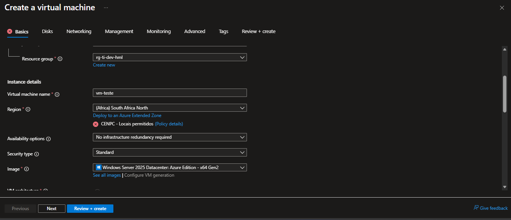
    
    * Locais permitidos, o sistema continua com as configurações.

        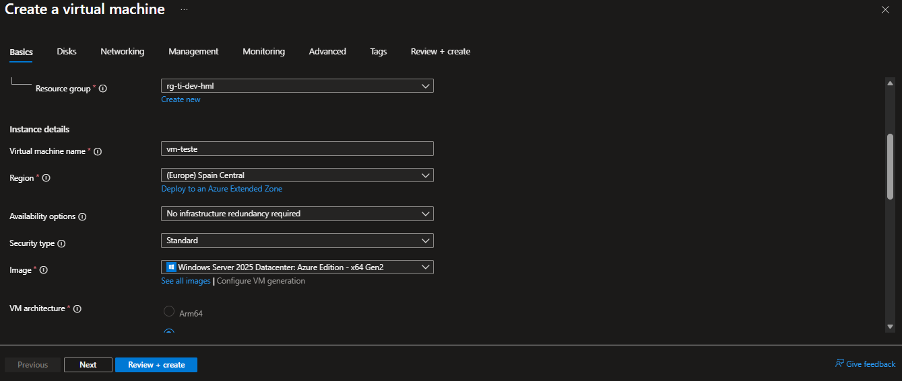


# 5. 📸 Evidências

```
📁 REQ-2026-1118-001
└── 📁 img
    ├── 📄 01.png
    ├── 📄 02.png
    ├── 📄 03.png
    ├── 📄 04.png
    ├── 📄 05.png
    ├── 📄 06.png
    ├── 📄 07.png
    ├── 📄 08.png
    ├── 📄 09.png
    ├── 📄 10.png                
    ├── 📄 11.png
    └── 📄 12.png
```
    
# 6.🏁 Encerramento


* **Motivo do encerramento:** Solicitação atendida e validada com sucesso.

* **Próxima ação:** Nenhuma ação pendente.

* Status:

    ```
    ☐ Em análise
    ☐ Em implementação
    ☐ Aguardando validação
    ☑ Concluído
    ```

* Analista responsável: Fabio Silva

#