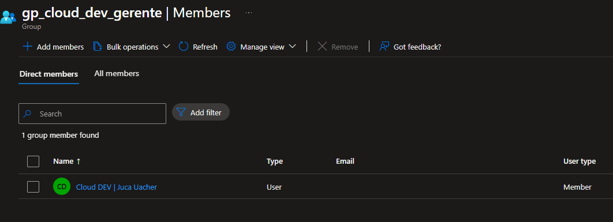
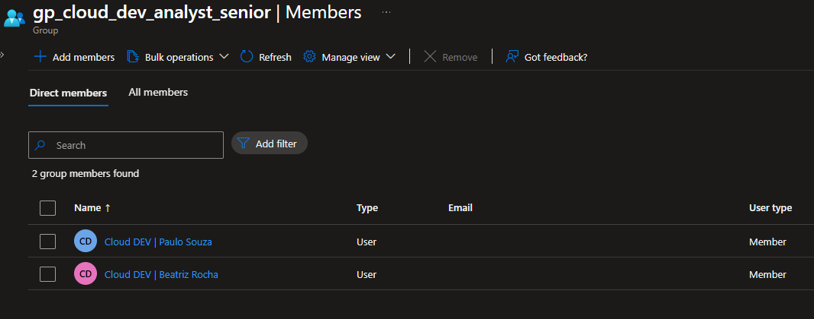
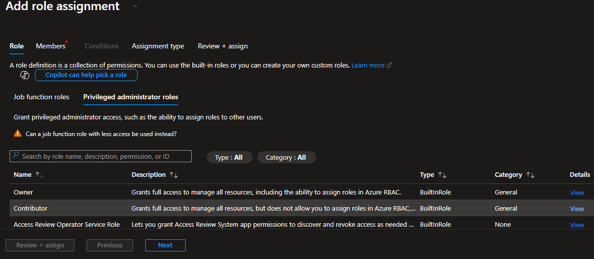
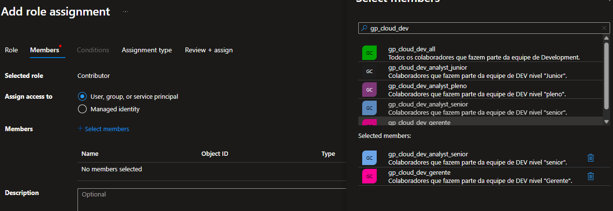
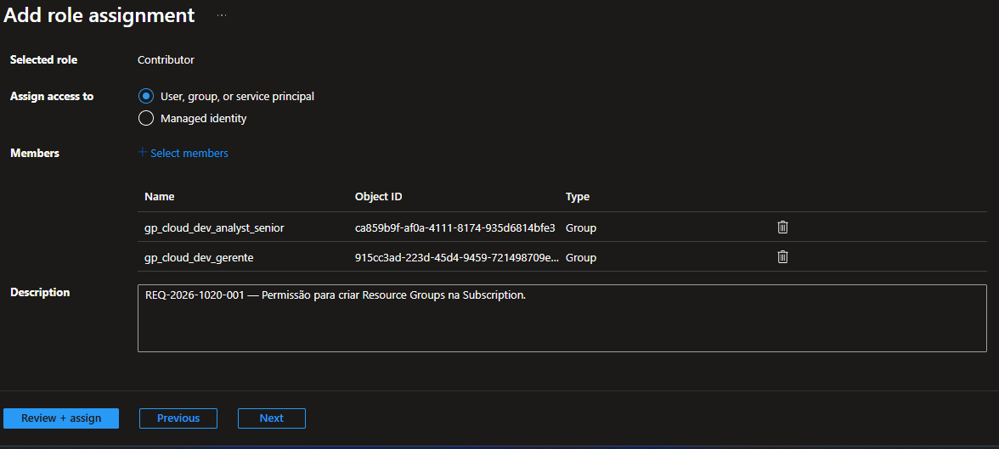
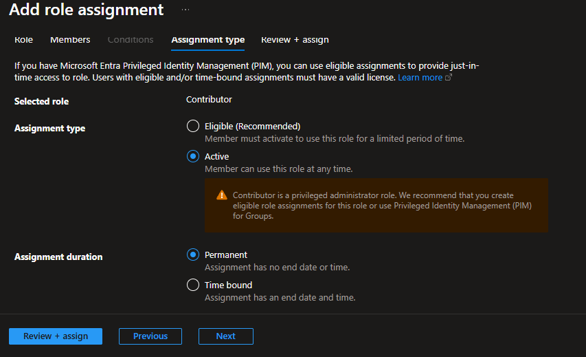
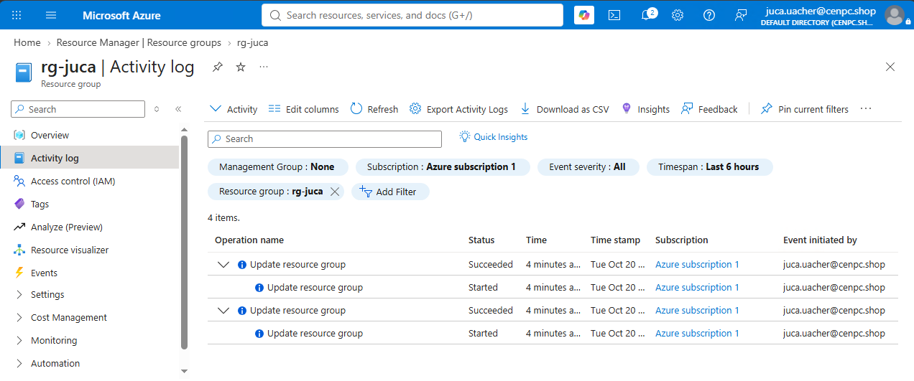
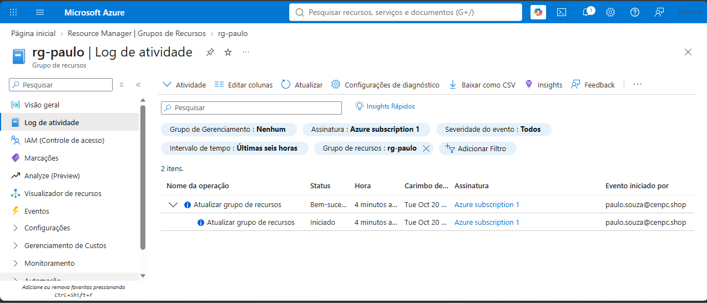
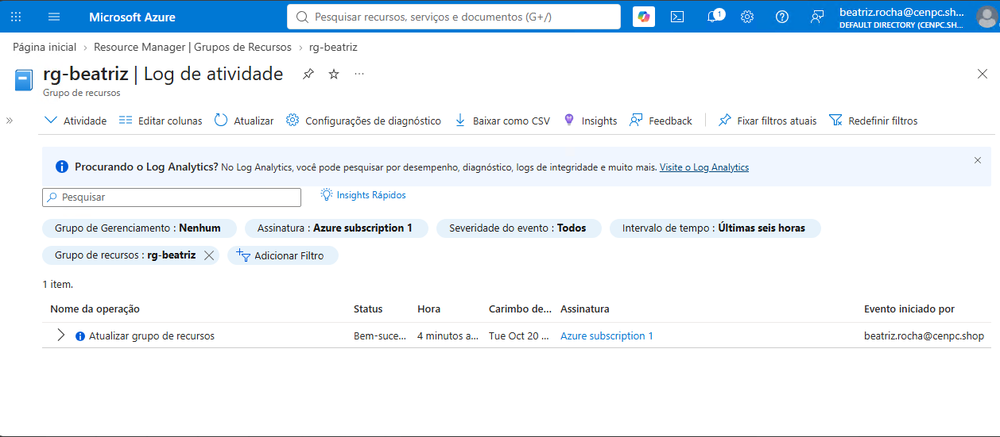

# CHAMADO DE ACESSO — Permissão para criar Resource Groups na Subscription

* Número do chamado: REQ-2026-1020-001
* Categoria: Permissão | RBAC | Resource Groups
* Prioridade: Média
* Solicitante: TI Development
* Equipe responsável: Suporte Técnico
* Status:

    ```
    ☑ Em análise
    ☐ Em implementação
    ☐ Aguardando validação
    ☐ Concluído
    ```
# 1. 📌 Descrição.

* Solicito que os colaboradores com o perfil de *Analista Sênior* e os *Gerentes* da equipe de **Development** possam ter permissão de criar Resources Groups na Subscription.

# 2. 📝 Atendimento | 📸 Evidências.

* Consultando os usuários que estão nos grupos de gerente e analista senior.

    * Gerente: 

        

    * Analista Senior:

        

* Portal Azure > Subscription > Access Control (IAM) > Add > Add role assignment.

* Em *Privileged Administrator Roles* selecionada permissão de *Contributor* > Next.

    

* Em Members > *Members* > selecionado os grupos que foram solicitados no chamado.  

    

* Colocada uma descrição por questões de auditoria.

    

* Em **Assignment type** selecionado *Ativo* e **Assignment duration** selecionado *Permanente*.

    

* Salvadas as alterações com sucesso.

# 3. 💻 Comandos / Scripts Utilizados

> Registrar somente os comandos relevantes para reprodução do procedimento.

* Nenhum comando foi realizado para este atendimento.

```powershell
# Exemplo
```

# 4. 🔎 Validação dos usuários

* Os usuários dos grupos autorizados realizam logon no portal do Azure.

    * Gerente - (juca.uacher@cenpc.shop):

         

    * Analistas Sênior :
    
    - (beatriz.rocha@cenpc.shop).

        
        
    - (paulo.souza@cenpc.shop).

        

    
# 5.🏁 Encerramento

* *Solicitação atendida e validada com sucesso.*

* Próxima ação: *Nenhuma ação pendente.*

* Status: 

```text
    
    ☐ Em análise
    ☐ Em implementação
    ☐ Aguardando validação
    ☑ Concluído

```
* Analista responsável: Fabio Silva

#