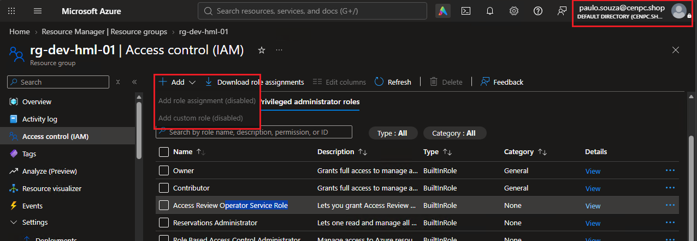
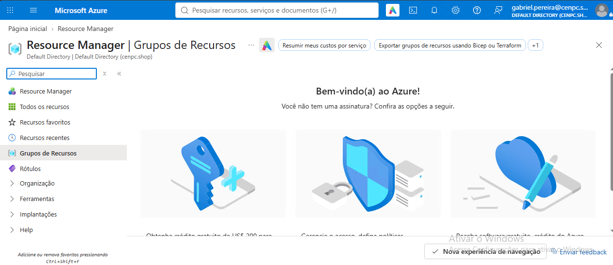
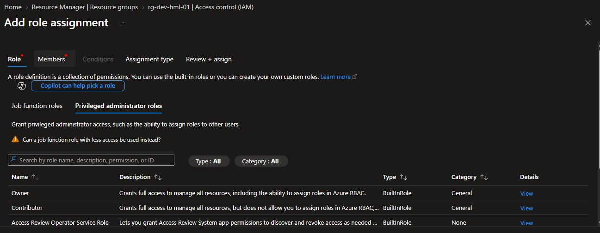
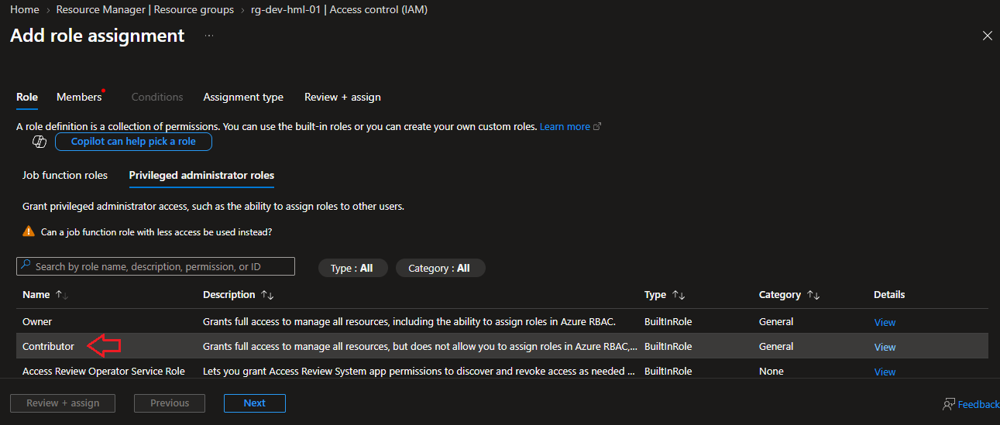
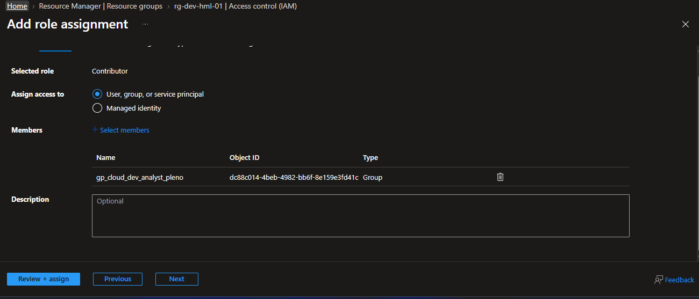
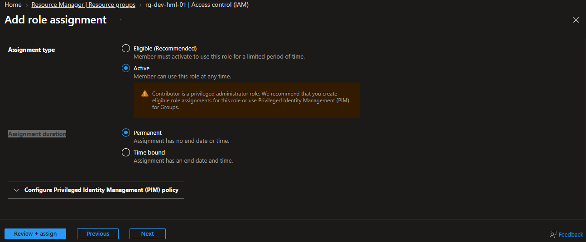
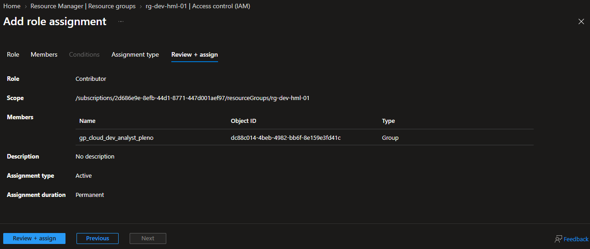
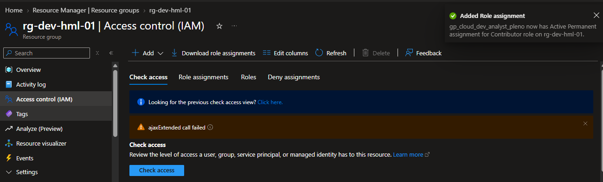
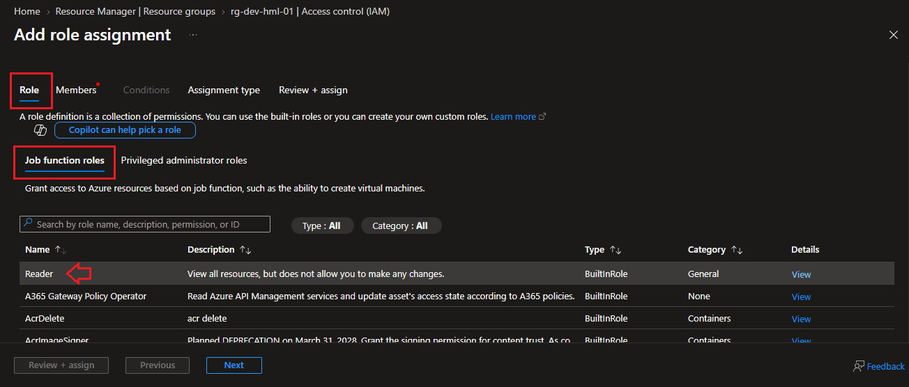
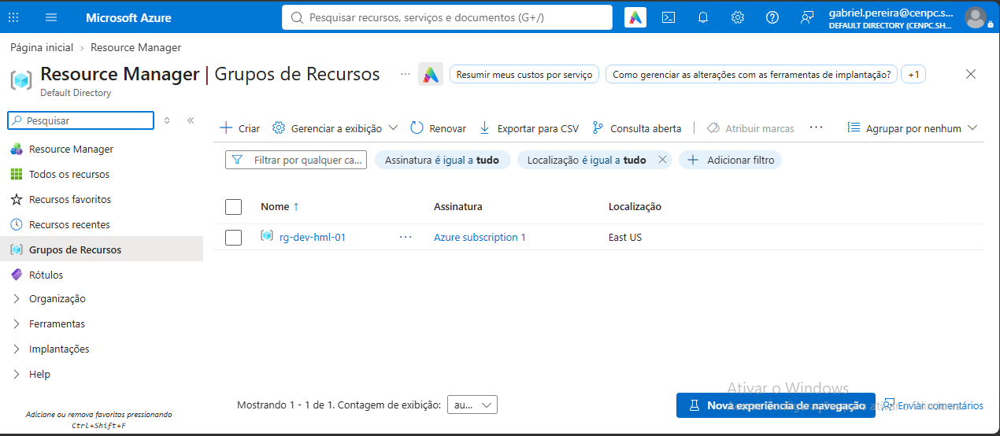

# 🎫 CHAMADO DE ACESSO — LIBERAÇÃO NO RESOURCE GROUP HML

* Número do chamado: INC-2026-0929-002
* Categoria: RBAC | RESOURCE GROUP | Permissões
* Prioridade: Média
* Solicitante: Development | Juca Uacher
* Equipe responsável: Suporte Técnico
* Status: 

    ```
    ☑ Em análise
    ☐ Em implementação
    ☐ Aguardando validação
    ☐ Concluído
    ```

# 1. 📌 Descrição.

* O colaborador Juca Uacher solicitou que fossem atribuida a função RBAC no Resource Group **rg-dev-hml-01**:
    
    * **Contributor**: Para colaboradores com **JobTitle** *Analista Pleno*.
    * **Reader**: Para colaboradores com **Jobtitle** *Analista Junior e Tech Lead*. 

 Já que o colaborador *Paulo Souza* tem permissão de *Contributor* e não consegue atribuir funções para outros colaboradores da equipe.

 

 # 2. 📝 Atendimento | 📸 Evidências.

* Os usuários com nivel de *Analista Pleno* e *Analista Junior* não tem acesso ao Resource Group **rg-dev-hml-01** exemplo: gabriel.pereira@cenpc.shop - Analista Junior.

    

* Com perfil de Owner na subscription, foi acessado o Resource Group informado pelo usuário.

* Access Control (IAM) > ADD > ADD role Assignment > Role > Privileged Administrator Role.

    

    * Para os colaboradores com nivel *Analista Pleno*, selecionado a opção **Contributor** em seguida *Avançar*.

        

    * Localize o grupo ou usuários com o nivel de *Analista Pleno*.

        

    * Na tela seguinte, **Assignment type** > *Assignment type* foi selecionada a opção *Active* e **Assignment duration** selecionada *Permanent*.

        
    
    * Após as verificações finais, clicado em *Review + Assign*.

        
    
    * Procedimento realizado com sucesso.

        

* O mesmo procedimento foi realizado para os colaboradores com perfil *Analista Junior* e *Tech Lead*. porém em **Role > Job Funcion Role** foi selecionada a opção *Reader*.

    

# 3. 💻 Comandos / Scripts Utilizados

> Registrar somente os comandos relevantes para reprodução do procedimento.

```powershell

    Nenhum comando foi realizado.

```
# 4. 🔎 Validação dos usuários

* Como amostragem, foi verificado que o colaborador *gabriel.pereira@cenpc.shop* estava com acesso ao Resource Group **rg-dev-hml-01**.

    
   
# 5.🏁 Encerramento

* Status:

    ```
    ☐ Em análise
    ☐ Em implementação
    ☐ Aguardando validação
    ☑ Concluído
    ```

* **Analista responsável:** Fabio Silva

#