# 🎫 CHAMADO - Criação de função RBAC

* Número do chamado: REQ-2026-1101-001
* Categoria: IAM | RBAC
* Serviço: Azure IAM
* Tipo de solicitação: Criação de função RBAC
* Prioridade: Média
* Solicitante: Auditoria
* Equipe responsável: TI Cloud
* Status: 

    ```
    ☑ Em análise
    ☐ Em implementação
    ☐ Aguardando validação
    ☐ Concluído
    ```

# 1. 📌 Descrição.

* A equipe de auditoria precisa consultar os recursos existentes no Resource Group *rg-dev-portal-prd*, mas não pode realizar alterações, exclusões ou implantações. 

# 2. 📝 Atendimento | 📸 Evidências.

* Foi criado um grupo exclusivo para equipe de auditoria *gp_cloud_dev_audit*.

    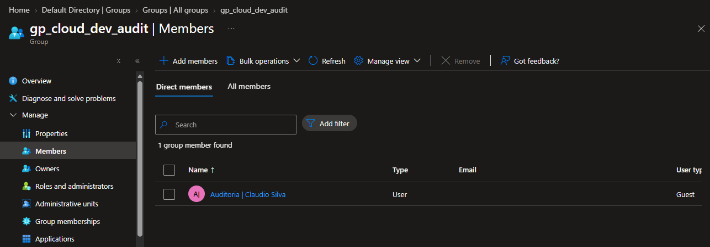

## Criando uma função customizada chamada **CENPC - Audit Cloud Resource Reader**.

* Foi criado um arquivo *Custom_RBAC_Reader_Adudit_CENPC.JSON*.

```
# Arquivo JSON.

{
    "properties": {
        "roleName": "CENPC - Audit Cloud Resource Reader (Custom Role)",
        "description": "Permite visualizar propriedades, configurações e status das máquinas virtuais no Azure.",
        "assignableScopes": [
            "/subscriptions/idSub"
        ],
        "permissions": [
            {
                "actions": [
                    "Microsoft.Compute/virtualMachines/read",
                    "Microsoft.Compute/virtualMachines/instanceView/read",
                    "Microsoft.Compute/virtualMachines/extensions/read",
                    "Microsoft.Compute/virtualMachines/vmSizes/read",
                    "Microsoft.Compute/disks/read",
                    "Microsoft.Network/networkInterfaces/read",
                    "Microsoft.Network/publicIPAddresses/read",
                    "Microsoft.Network/virtualNetworks/read",
                    "Microsoft.Network/networkSecurityGroups/read",
                    "Microsoft.Resources/subscriptions/resourceGroups/read"
                ],
                "notActions": [],
                "dataActions": [],
                "notDataActions": []
            }
        ]
    }
}

```

* No portal **Resource Group > rg-dev-portal-prd  > IAM > ADD > ADD custom role**.

    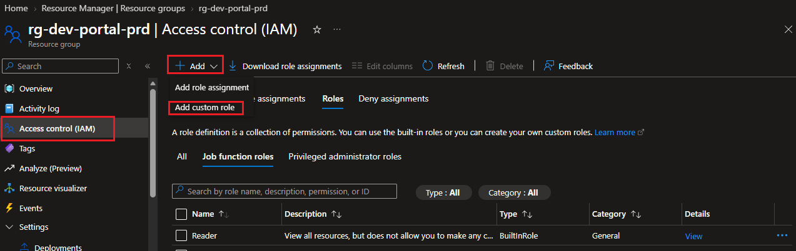

    * Em **BASIC**, na opção "**Baseline permissions**" selecione "*Start from JSON*".

        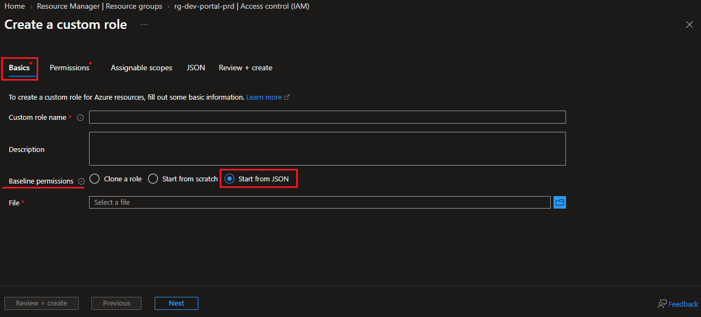

        * Em *File* foi realizado o Upload do arquivo **.JSON** que foi editado.

            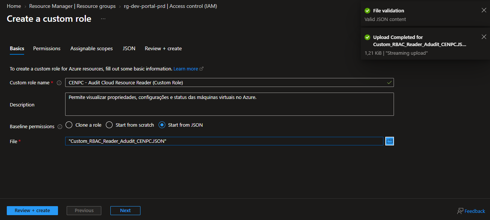

    * Em **PERMISSIONS** mantenha o padrão e clique em *PRÓXIMO*.

        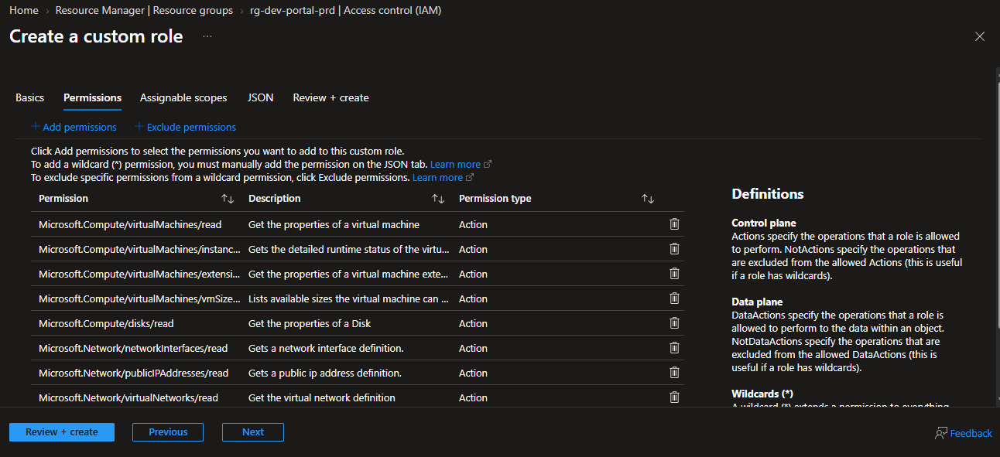
    
    * Em **Assignable scopes** mantenha o padrão e clique em *Próximo*.

        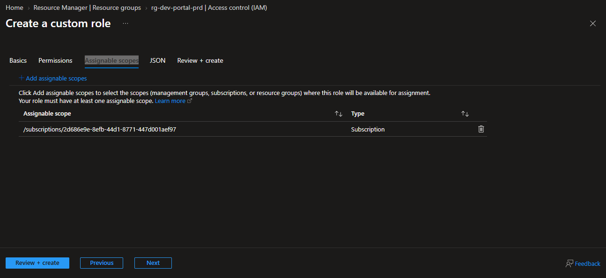
    
    * Na guia *JSON* clique em *Próximo*.
        
    * Para finalizar, clique em **CREATE**.
        
        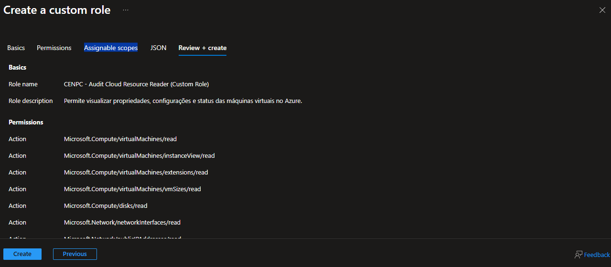

* A função customizada foi importada com sucesso.

    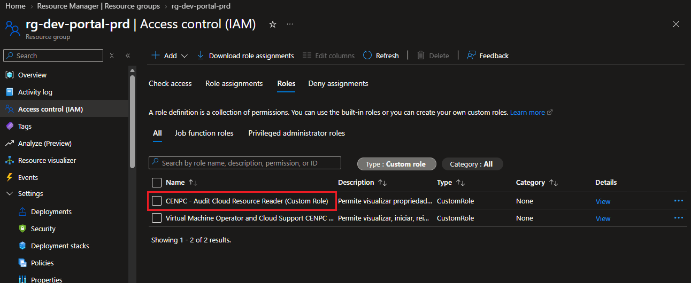

## Associando a função customizada ao Resource Group (rg-dev-portal-prd).

* No portal Resource Group > (rg-dev-portal-prd) > Access Control (IAM) > ADD > ADD role Assignment.

    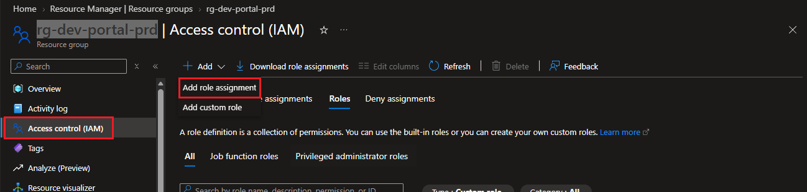
    
    * Em **ROLE** foi selecionada a função que foi customizada.
    
       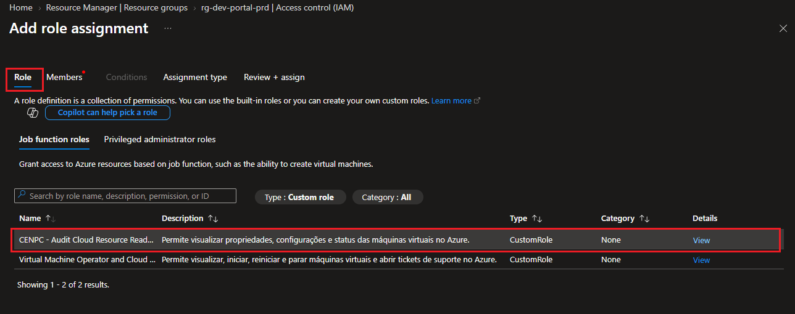
    
    * Foi selecionado o grupo que foi criado de auditoria. 

       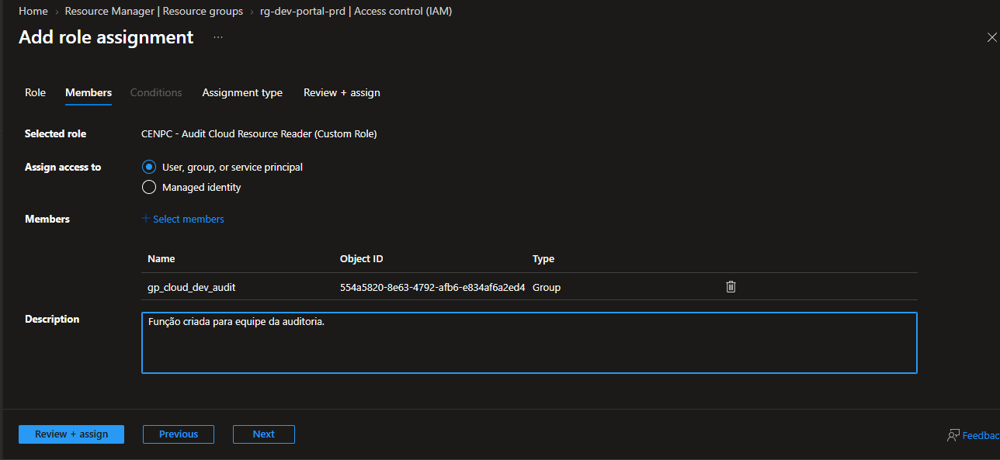

    * Em **Assignment TYPE** foi selecionada a opção *ACTIVE* com duração *PERMANENTE*.

       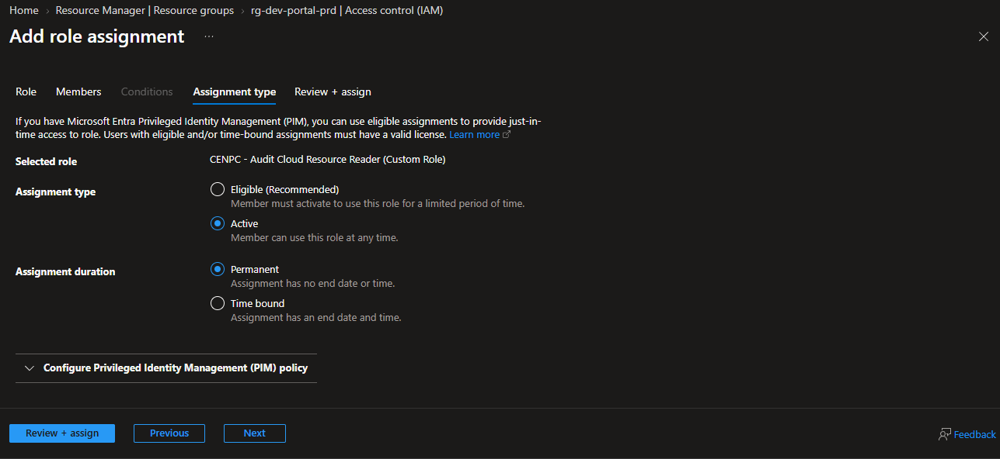

    * Para concluir foi clicado na opção **REVIEW + ASSIGN**.

       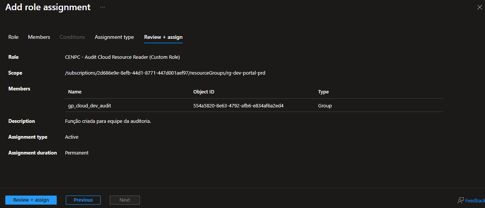

* Concluido o procedimento.

    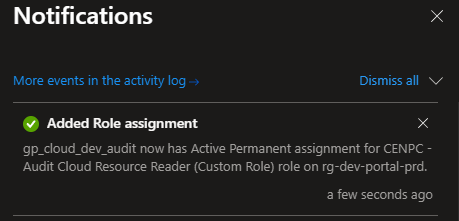

# 3. 💻 Comandos / Scripts Utilizados

> Registrar somente os comandos relevantes para reprodução do procedimento.

```Powershell

    Não foi utilizado para está tarefa.

```
# 4. 🔎 Validação dos usuários

* Acessando o portal com o perfil do coladorador da equipe de Auditoria.

    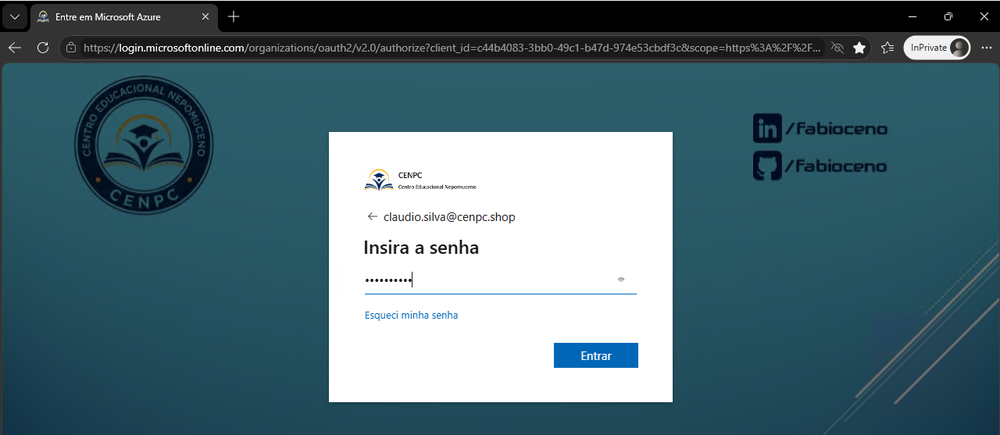

    * O colaborador tem acesso ao resource group.

        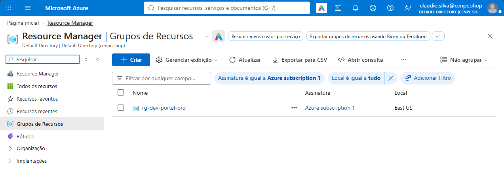

    * O colaborador tem permissão para visualizar os recursos criados.

        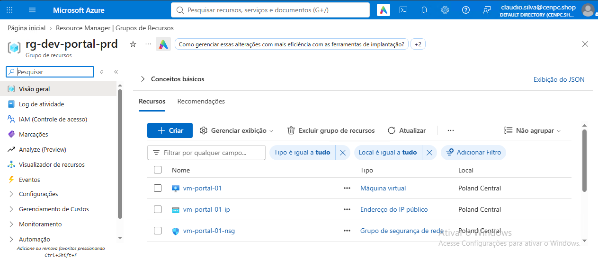

    * O colaborador não consegue iniciar a máquina virtual.

        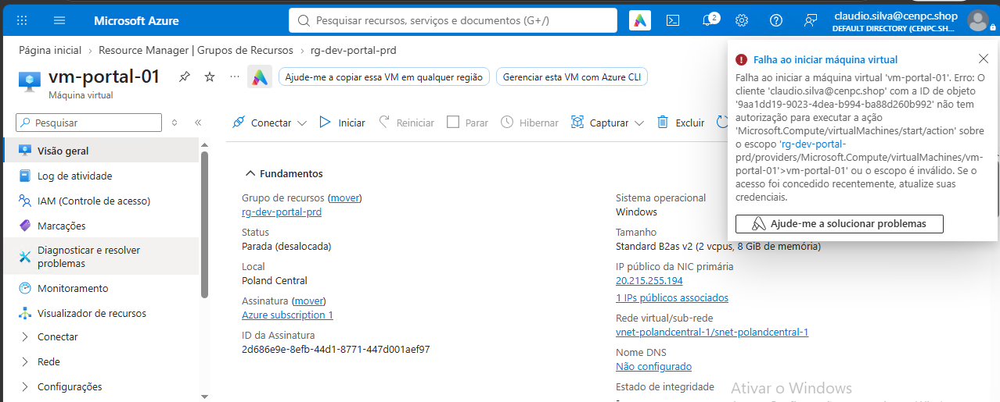

# 5. 📸 Evidências

```
📁 REQ-2026-1101-001
└── 📁 img
    ├── 📄 01.png
    ├── 📄 02.png
    ├── 📄 03.png
    ├── 📄 04.png
    ├── 📄 05.png
    ├── 📄 06.png
    ├── 📄 07.png
    ├── 📄 08.png
    ├── 📄 09.png
    ├── 📄 10.png
    ├── 📄 11.png
    ├── 📄 12.png
    ├── 📄 13.png
    ├── 📄 14.png
    ├── 📄 15.png
    ├── 📄 16.png
    ├── 📄 17.png
    └── 📄 18.png
```
  
# 6.🏁 Encerramento

* **Motivo do encerramento:** *Solicitação atendida e validada com sucesso.*

* **Próxima ação:** *Nenhuma ação pendente.*

* Status:

    ```
    ☐ Em análise
    ☐ Em implementação
    ☐ Aguardando validação
    ☑ Concluído
    ```

* Analista responsável: Fabio Silva

#