# 🎫 CHAMADO - Criar função para gerenciamento de Storage Account

* Número do chamado: REQ-STG-2026-0711-001
* Categoria: Storage
* Serviço: IAM
* Tipo de solicitação: Permissões de armazenamento
* Prioridade: Média
* Solicitante: Desenvolvimento
* Equipe responsável: Suporte Técnico
* Status: 

    ```
    ☑ Em análise
    ☐ Em implementação
    ☐ Aguardando validação
    ☐ Concluído
    ```

# 1. 📌 Descrição.

* A equipe de desenvolvimento precisa administrar Storage Accounts, incluindo configurações, mas não pode excluir contas de armazenamento.

* Aplicar os procedimentos no resource group **rg-ti-dev-hml**.

* Grupo que precisam dessa permissão: *gp_cloud_dev_gerente* e *gp_cloud_dev_analyst_senior*.

* Permitir visualizar e configurar Storage Accounts.

* Permitir consultar propriedades e configurações.

* Bloquear exclusão de Storage Accounts.

# 2. 📝 Atendimento | 📸 Evidências.

* Criando um arquivo *.JSON* para realizar as liberações.

```Json
    {
  "properties": {
    "roleName": "CENPC - Storage Account Operator (Custom)",
    "description": "Permite visualizar e configurar Storage Accounts, sem permitir sua exclusão.",
    "type": "CustomRole",
    "permissions": [
      {
        "actions": [
            "Microsoft.Resources/subscriptions/resourceGroups/read",
            "Microsoft.Resources/deployments/read",
            "Microsoft.Resources/deployments/write",
            "Microsoft.Resources/deployments/validate/action",
            "Microsoft.Resources/deployments/operations/read",
            "Microsoft.Resources/deployments/operationstatuses/read",
            "Microsoft.Storage/storageAccounts/read",
            "Microsoft.Storage/storageAccounts/write",
            "Microsoft.Storage/storageAccounts/fileServices/read",
            "Microsoft.Storage/storageAccounts/fileServices/write"
        ],
        "notActions": [
          "Microsoft.Storage/storageAccounts/delete"
        ],
        "dataActions": [],
        "notDataActions": []
      }
    ],
    "assignableScopes": [
      "/subscriptions/"subscriptionID"/resourceGroups/rg-cloud-ti-dev"
    ]
  }
}

```
* Em seguida, a autenticação no portal Azure foi realizada.

* Para adicionar a função que foi criada no arquivo .JSON **Resource Manager > Resource Group > rg-ti-dev-hml > Access Control (IAM) > ADD > ADD custom Assignment**.

    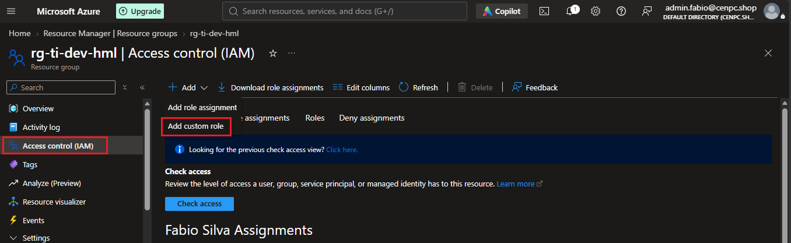

    * *BASIC > Baseline permissions*, foi selecionado **"Start from JSON"**.

    * Adicionado com sucesso o arquivo **.JSON** que foi criado.

        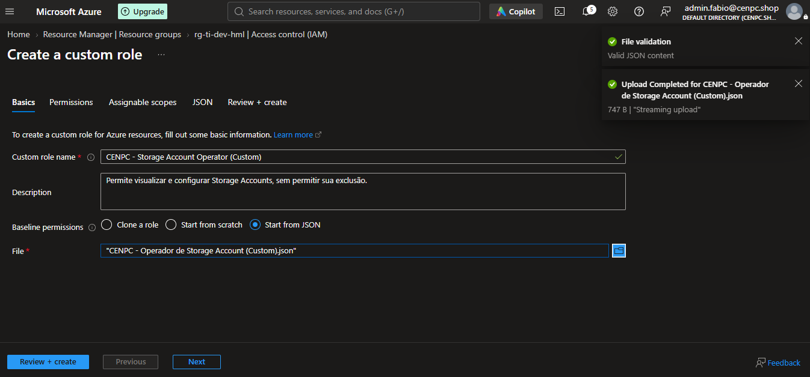
    
    * Permissões foram impressas para analise.

        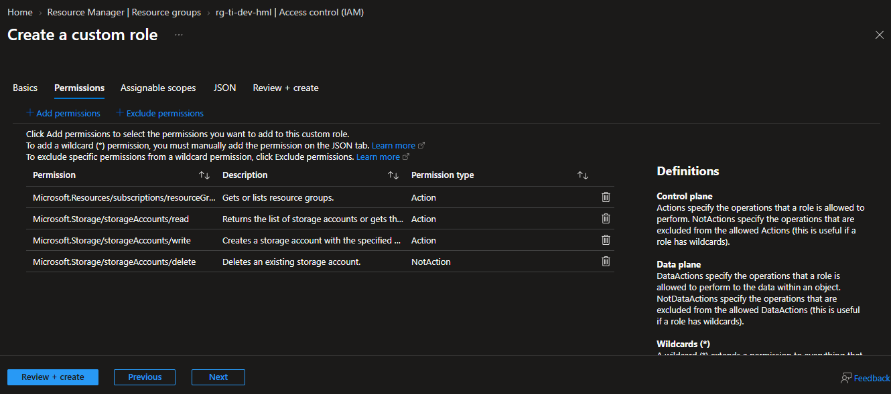
    
    * Após avançar nas guias *Assignable Scope* e *JSON* na opção *Review + Create* foi clicado em CREATE para adicionar as informações do arquivo **.JSON**.

        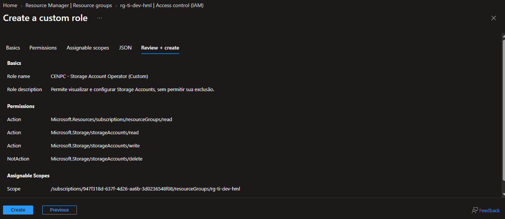
    
    * Concluido com sucesso o Upload.

        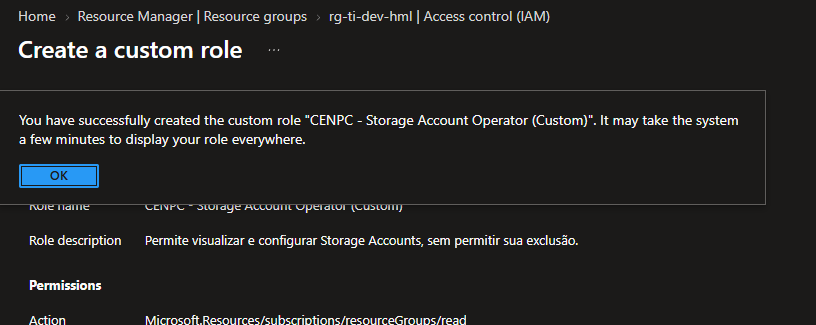
   
* Associando a função que foi criada aos grupos *gp_cloud_dev_gerente* e *gp_cloud_dev_analyst_senior* no resource group *rg-ti-dev-hml*.

    * Em *Role* > Job Function role > Type: **Custom role** foi selecionada a função que foi customizada.

        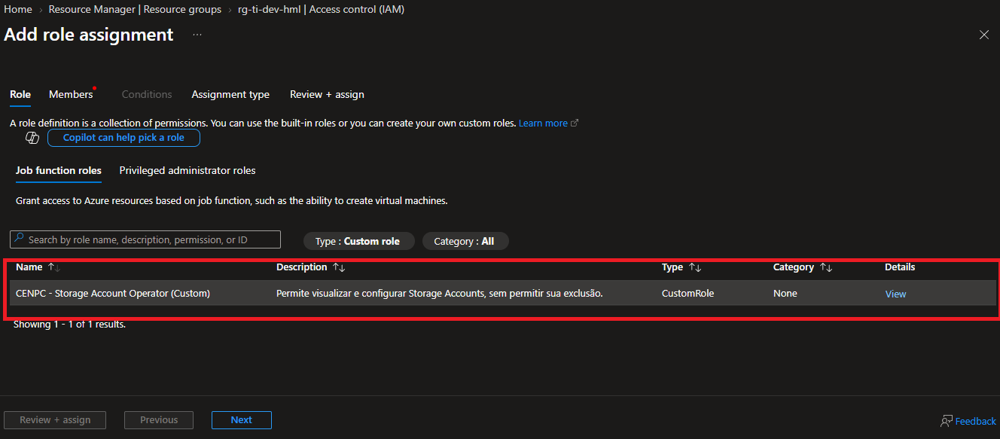

    * Em *Membros* foram adicionados os grupos "*gp_cloud_dev_gerente* e *gp_cloud_dev_analyst_senior*".

        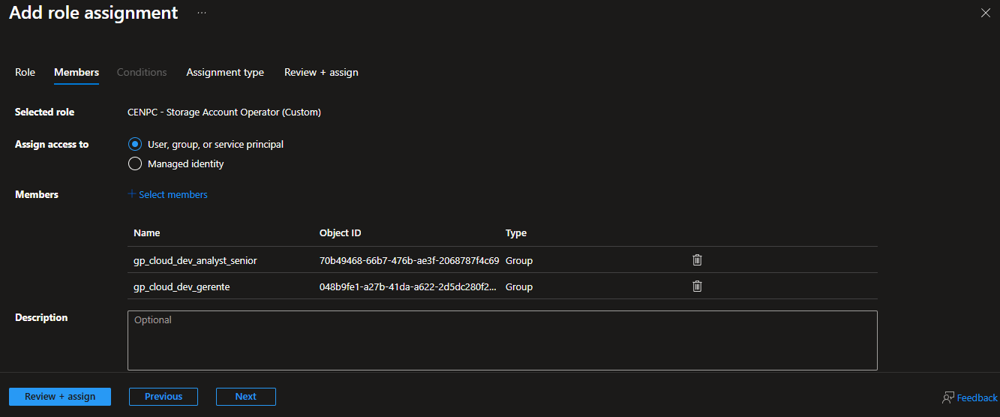

    * Em *Assignment type* foi selecionada a opção **Active** com duração **Permanente**.

        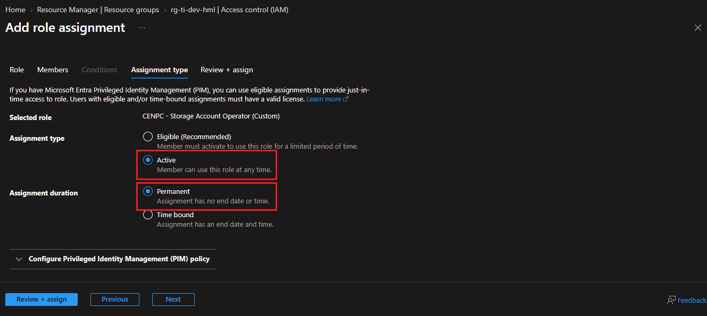

    * Finalizando clicando em Review + Assign.

        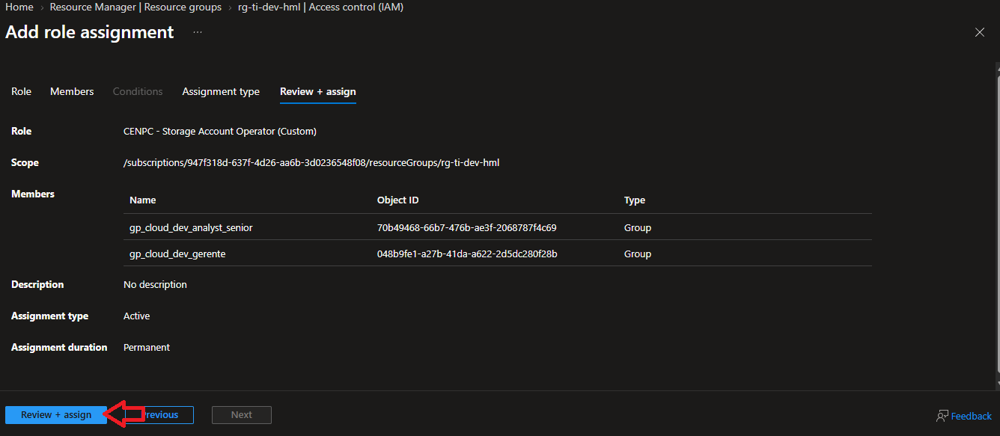

    * Função adicionada com sucesso.

        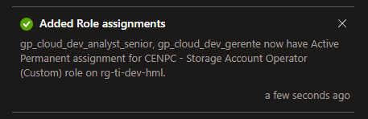


# 3. 💻 Comandos / Scripts Utilizados

> Registrar somente os comandos relevantes para reprodução do procedimento.

```powershell
    
    Nenhum comando foi utilizado.

```
# 4. 🔎 Validação dos usuários

* Foi realizado o acesso ao portal com o perfil do colaborador *paulo.souza@cenpc.shop | Analista IT DEV Senior* 

    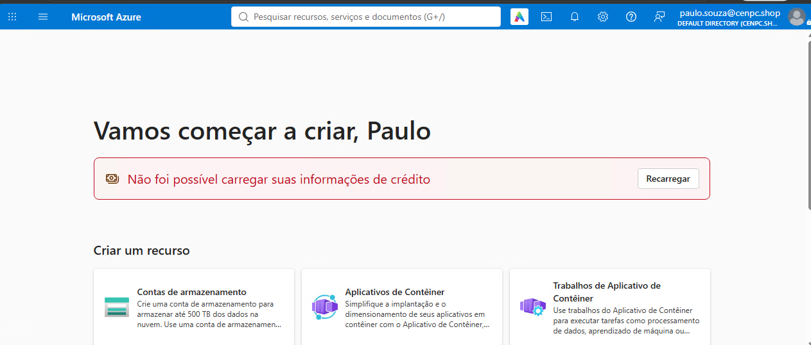

* Foi feito o procedimento de criar uma *conta de armazenamento - storage account*

    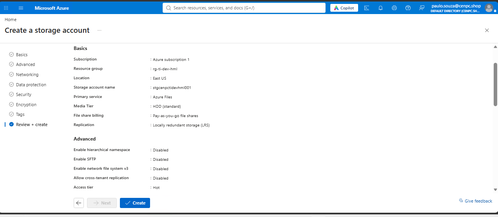

* O storage account foi criado com sucesso.

    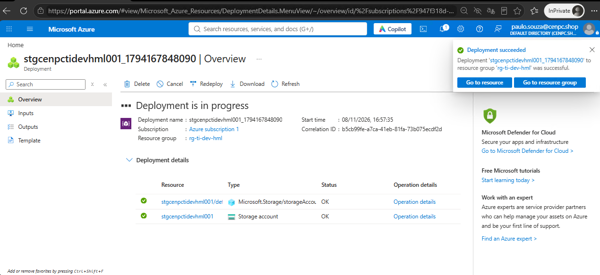

* Acessando as propriedades do Storage Account.

    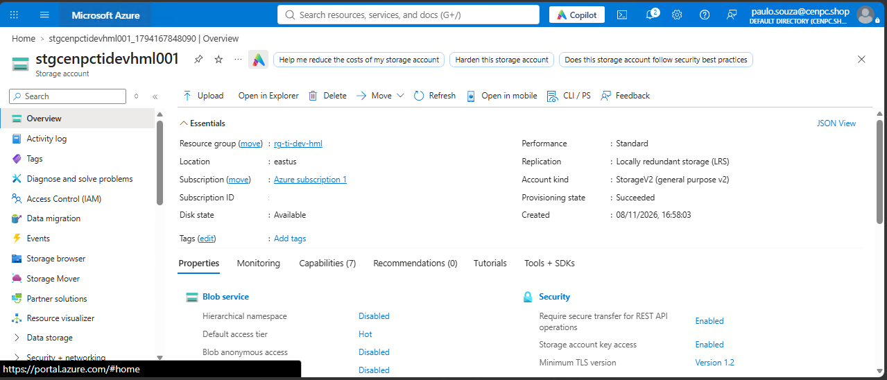

* Após criar o Storage Account o usuário não tem permissão para deleta-lo.

    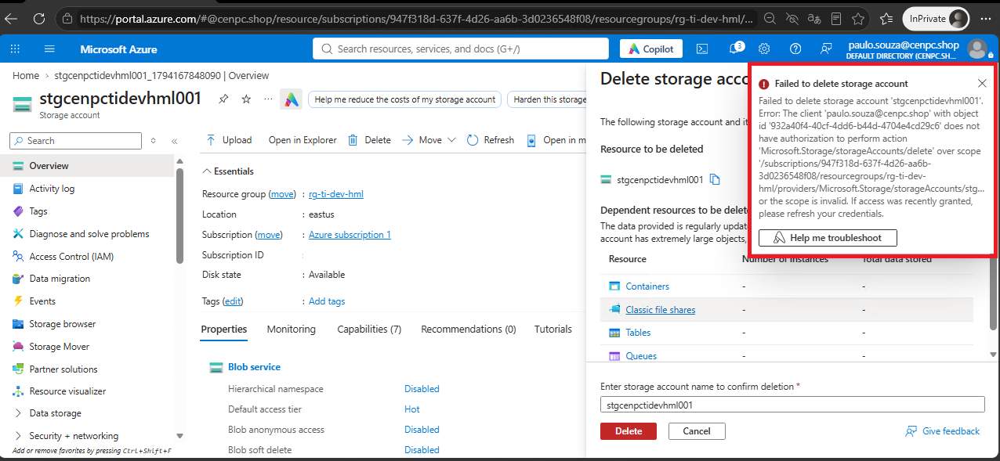

# 5. 📸 Evidências

```
📁 REQ-STG-2026-0711-001
└── 📁 img
    ├── 📄 01.png
    ├── 📄 02.png
    ├── 📄 03.png
    ├── 📄 04.png
    ├── 📄 05.png
    ├── 📄 06.png
    ├── 📄 07.png
    ├── 📄 08.png
    ├── 📄 09.png
    ├── 📄 10.png
    ├── 📄 11.png
    ├── 📄 12.png
    ├── 📄 13.png
    ├── 📄 14.png
    └── 📄 15.png
```
   
# 6.🏁 Encerramento

* **Motivo do encerramento:** Solicitação atendida e validada com sucesso.

* **Próxima ação:** Nenhuma ação pendente.

* Status:

    ```
    ☐ Em análise
    ☐ Em implementação
    ☐ Aguardando validação
    ☑ Concluído
    ```

* Analista responsável: Fabio Silva

#