# 🎫 CHAMADO ADMINISTRATIVE UNITS — Reset de Senha ( Suporte Técnico)

* Número do chamado: REQ-2026-1022-001
* Categoria: Delegação | reset de senha | Suporte técnico
* Prioridade: Média
* Solicitante: Financeiro
* Equipe responsável: Suporte Técnico
* Status: 
    ```
    ☑ Em análise
    ☐ Em implementação
    ☐ Aguardando validação
    ☐ Concluído
    ```

# 1. 📌 Descrição.

* Criar uma Administrative Units para equipe do **Support** com foco na delegação de controlar operações relacionadas à "reset de senha da equipe" **Marketing**.

```
* A delegação em uma Administrative Units "Usuários" e "Grupos" administrados de forma diferente.
    
    * Para "Usuarios - Users" a administração ex.(troca de senha) é feita diretamente no usuário e a inclusão realizada "um por um". Caso precise gerenciar mais usuários, importe via "Bulk Operation".

    * Para "Grupos - Groups" a administração ex.(Inclusão de usuários) é realizada nesse campo.

```

# 2. 📝 Atendimento | 📸 Evidências.

* Com perfil de *Global Administrator* no **Portal Azure** > Entra ID > Manage > *Administrative Units*.

    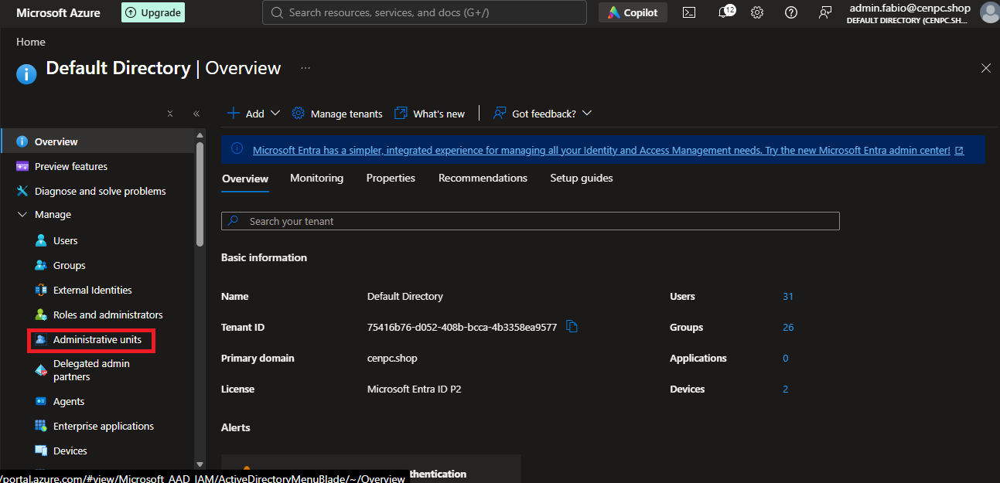

* Em *Administrative Units* > ADD .

    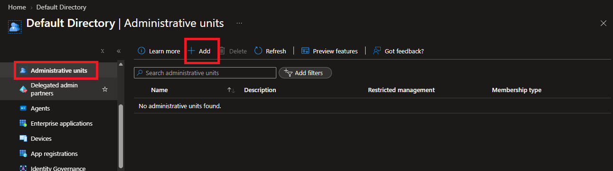

    * **Properties**:

        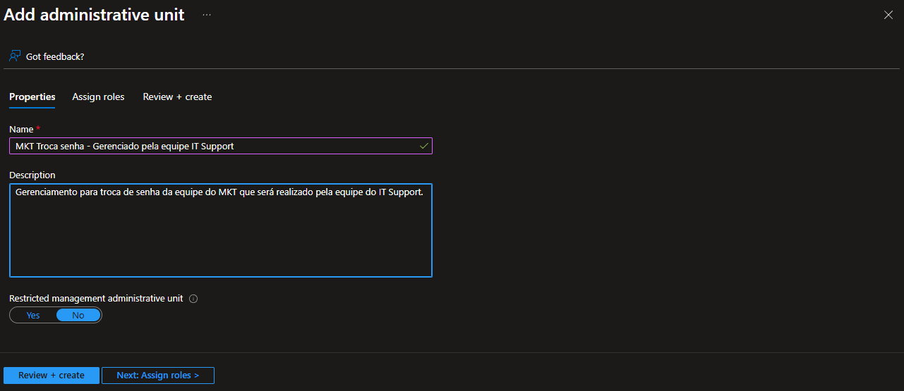

    * **Assign roles**: Selecionada a opção **Password Administrator**.

        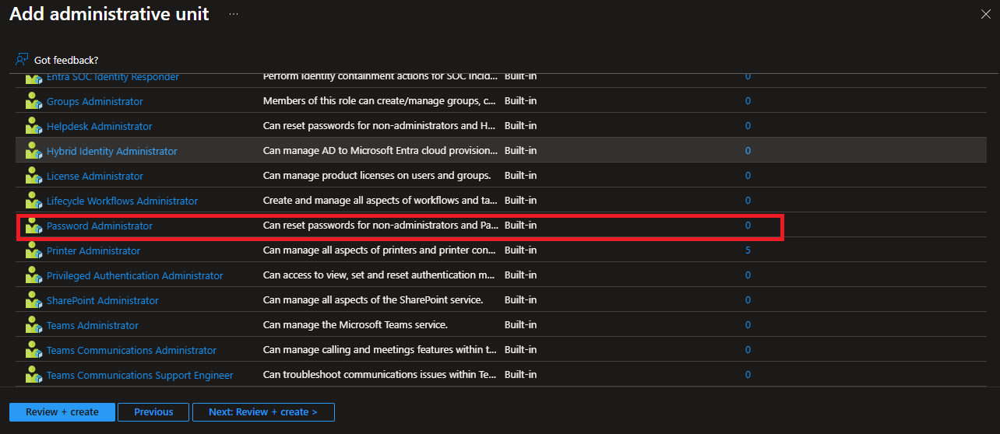

        * Adicionados os usuários da equipe do suporte técnico.

            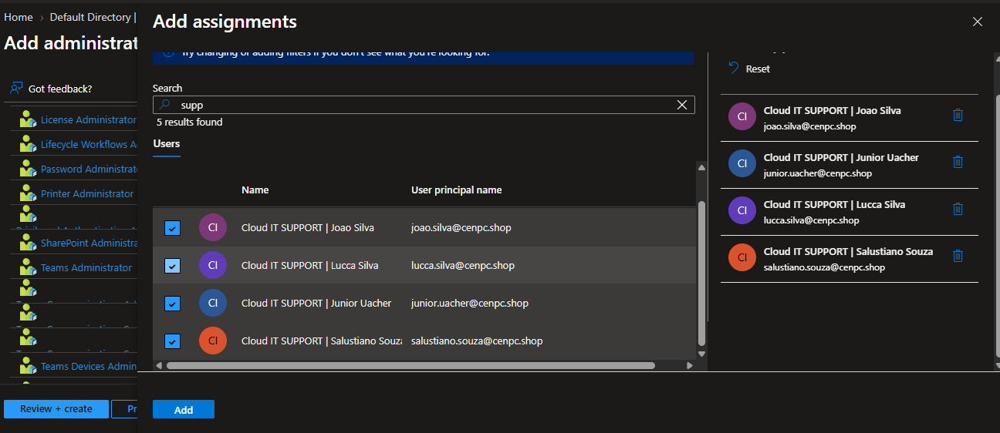

    * **Review + Create**

        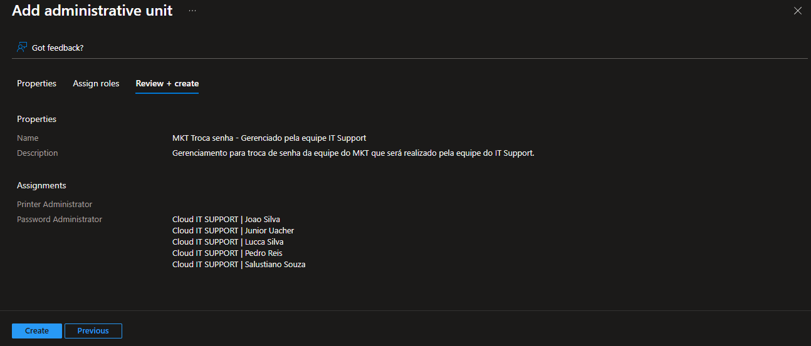

* Administrative criada com sucesso.

    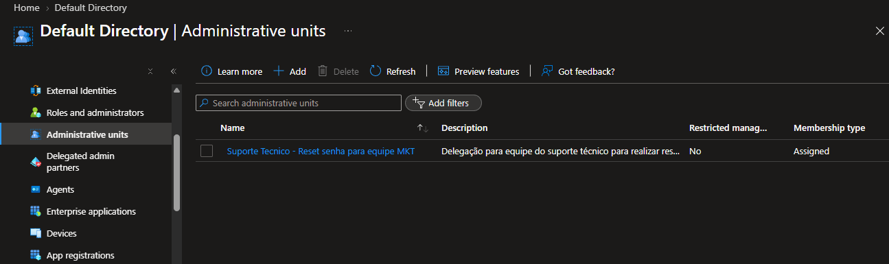

* Após acessar a unidade administrativa que foi criada, em *Manage > Users > ADD Member* ou como são vários usuários, clique em **Bulk Operation** > *Bulk add Members* .  
    
    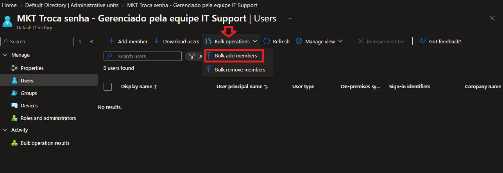

    * Clique em **Download** para baixar o template *.csv*.

        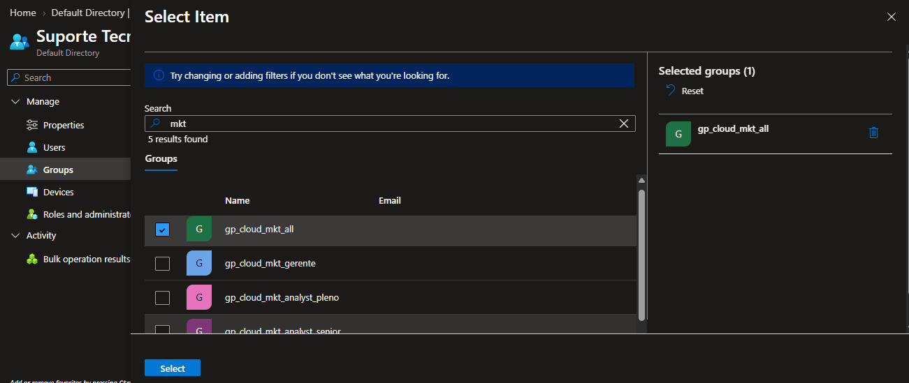

    * Edite as informações que estão no arquivo que foi baixado.

        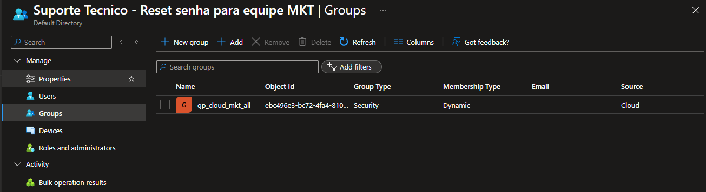

    ```Text

       * É necessário copiar o ID de cada usuário, ou seja será necessário fazer o Download de todos os usuários que pertencem a equipe de Marketing.

    ```
    * Abra outra guia e acesse o Entra ID e filtre os usuários do grupo de MKT.

        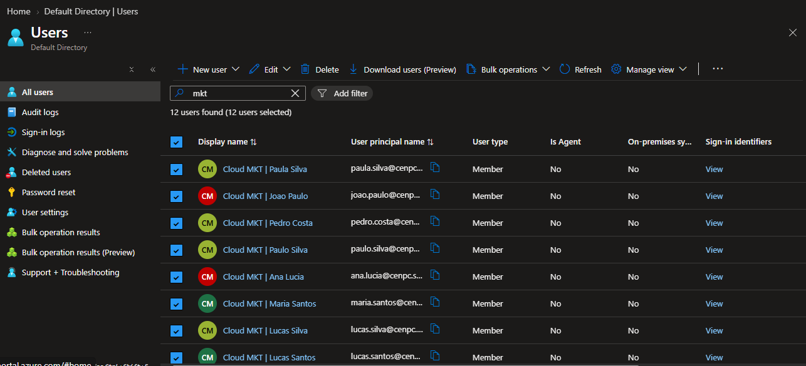

    * Clique em **Download Users**.

        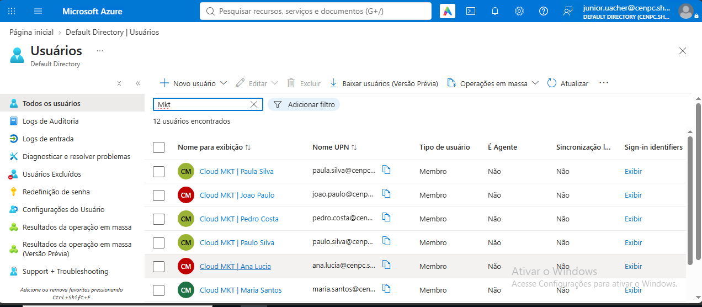

    * Clique em *Start bulk operation* para exportar dos dados.

        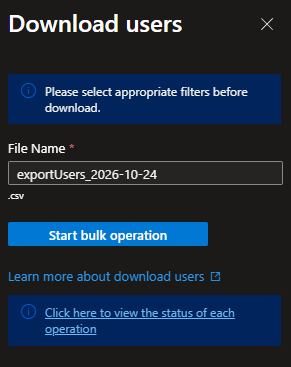    
    
    * Em seguida *click* no link para ver o status da operação.

        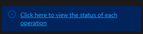

    * Click no link para o Download do arquivo.

        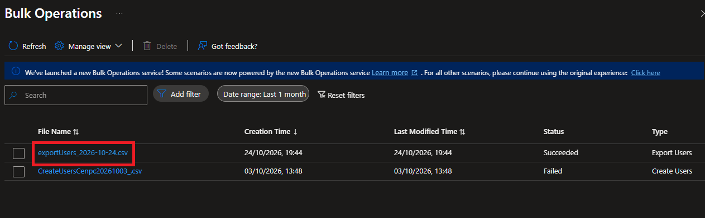

    * Donwload concluido com sucesso.

        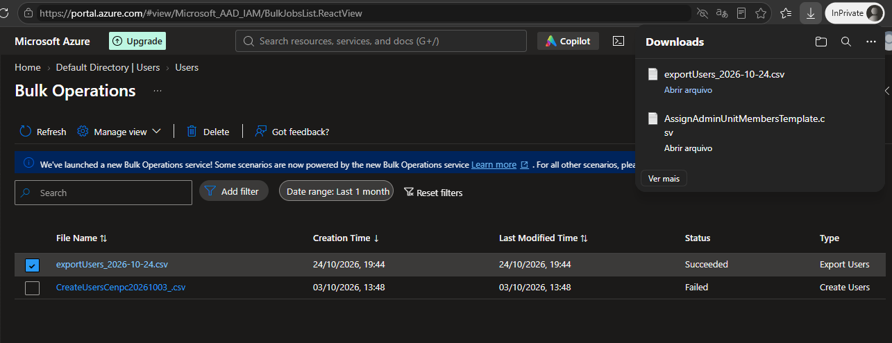

    * Formatada a planilha para exibir as informações e copiar o ID dos colaboradores.

        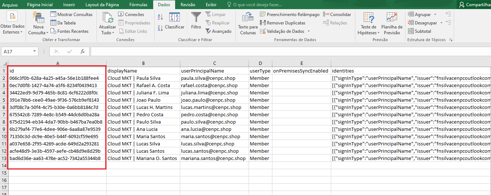

    * Colocada as informações no arquivo *.csv*.

        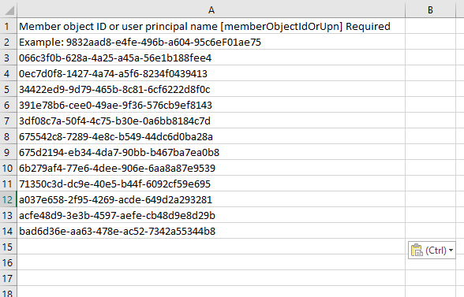
    
    * Planilha salva e em seguida, importada para o portal Azure.

        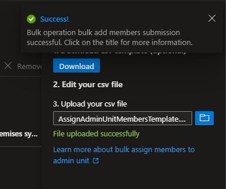

    * Após a atualização da pagina, os usuários foram carregados.

        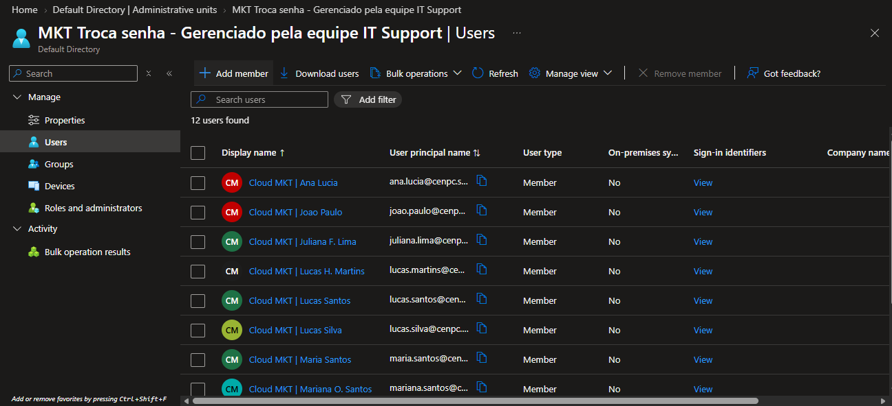
  

# 3. 💻 Comandos / Scripts Utilizados

> Registrar somente os comandos relevantes para reprodução do procedimento.

```powershell

    Nenhum comando foi executado.

```
# 4. 🔎 Validação dos usuários

* Autenticando com o usuário *junior.uacher@cenpc.shop* da equipe do **IT Support** para validar os procedimentos que foram realizados.

    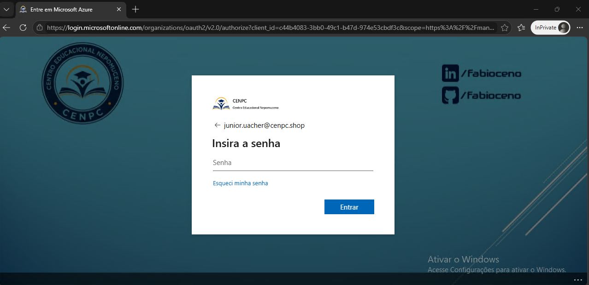

* Em seguida **ENTRA ID > Gerenciar > Usuários** foi selecionado um colaborador da equipe de MKT para realizar a alteração da senha.

    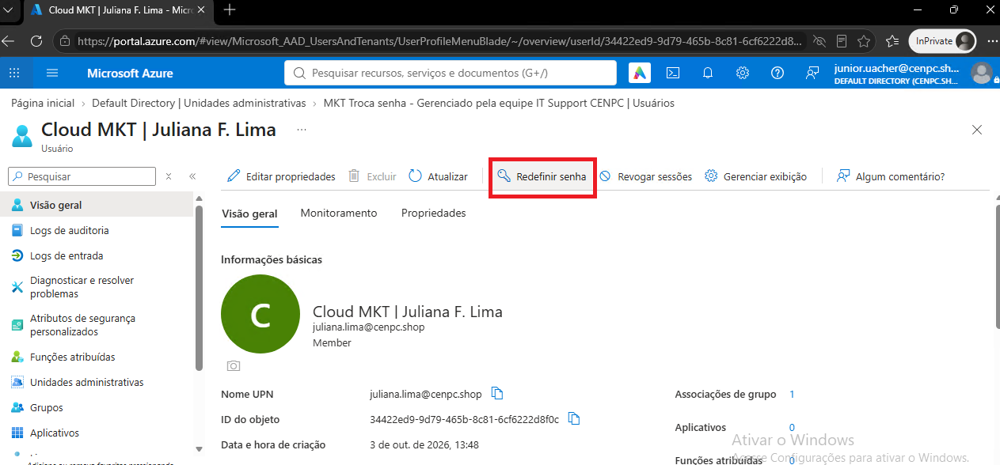

* Após escolher a colaboradora, a opção para redefinir a senha estava habilitada.

    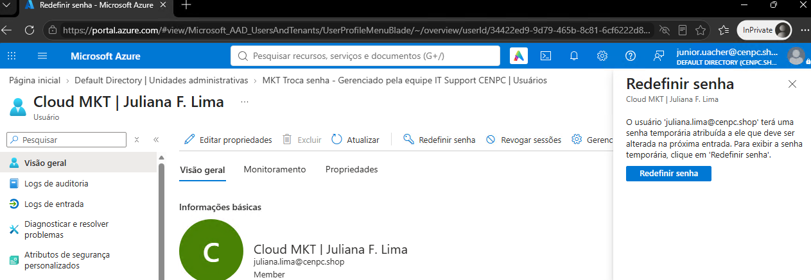

* A senha foi redefinida com sucesso.

    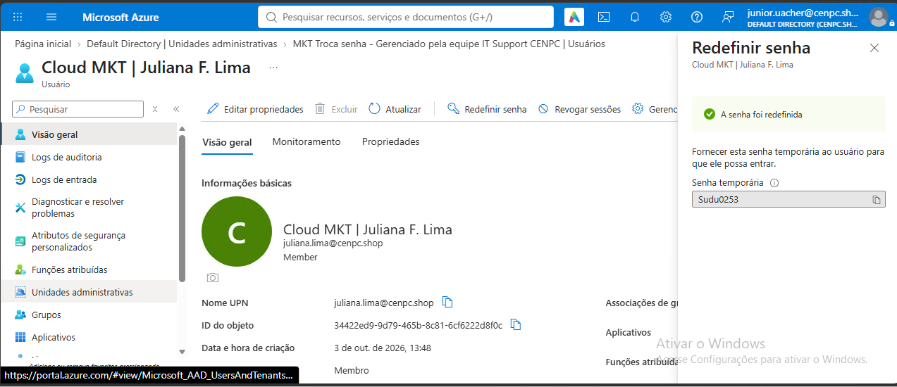

# 5. 📸 Evidências

```
📁 REQ-2026-1022-001
└── 📁 img
    ├── 📄 01.png
    ├── 📄 02.png
    ├── 📄 03.png
    ├── 📄 04.png
    ├── 📄 05.png
    ├── 📄 06.png
    ├── 📄 07.png
    ├── 📄 08.png
    ├── 📄 09.png
    ├── 📄 10.png
    ├── 📄 11.png
    ├── 📄 12.png
    ├── 📄 13.png
    ├── 📄 14.png
    ├── 📄 15.png
    ├── 📄 16.png
    ├── 📄 17.png
    ├── 📄 18.png
    ├── 📄 19.png
    ├── 📄 20.png
    ├── 📄 21.png
    ├── 📄 22.png
    └── 📄 23.png
```
    
# 6.🏁 Encerramento

* Status:

    ```
    ☐ Em análise
    ☐ Em implementação
    ☐ Aguardando validação
    ☑ Concluído
    ```

* Analista responsável: Fábio Silva

#