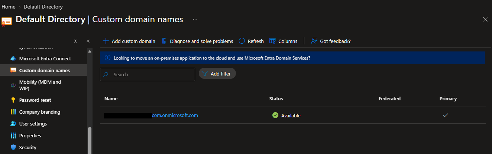
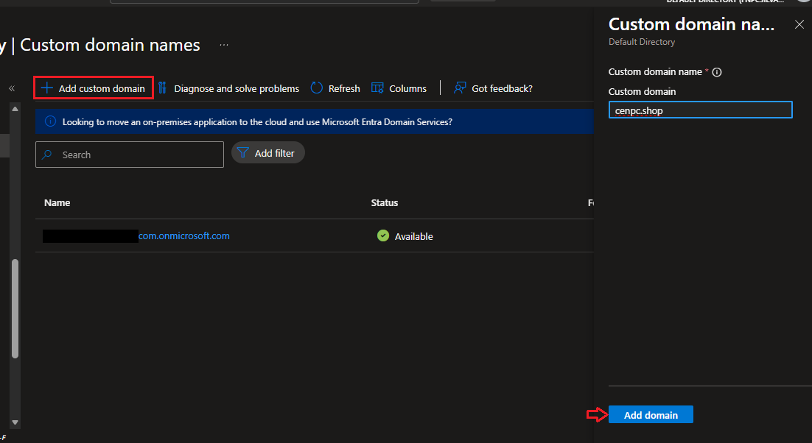
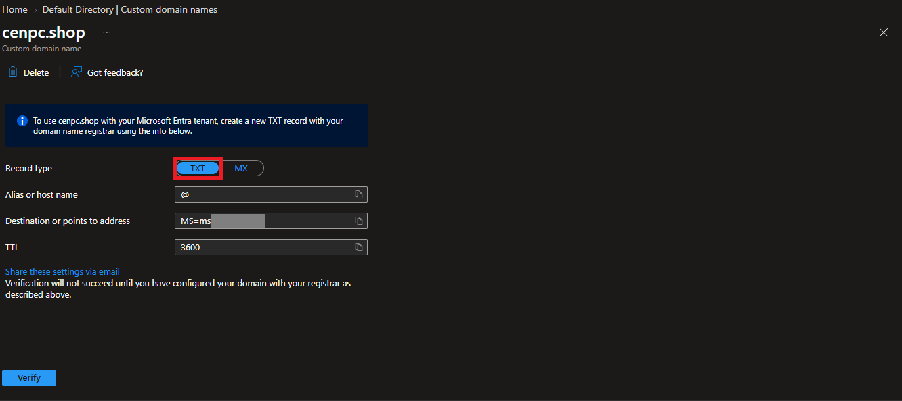
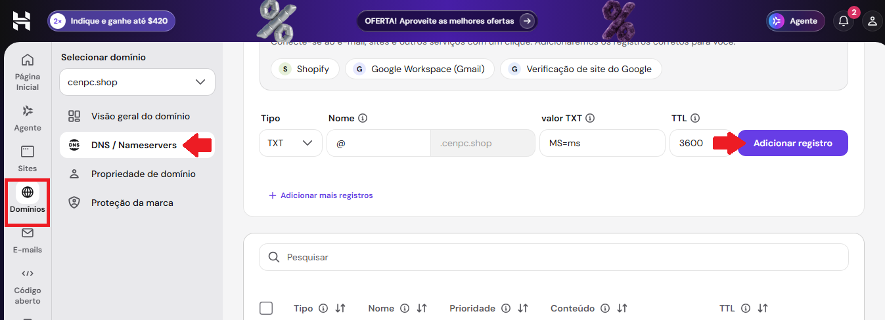
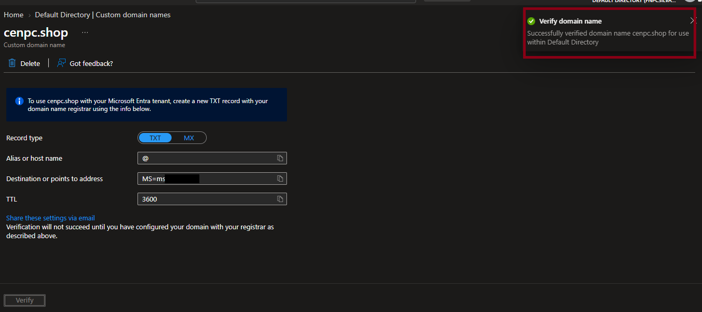
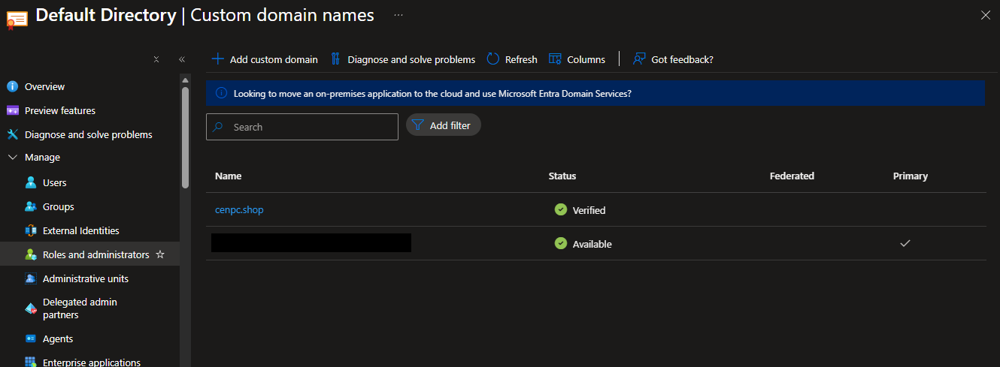
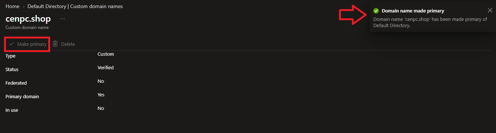
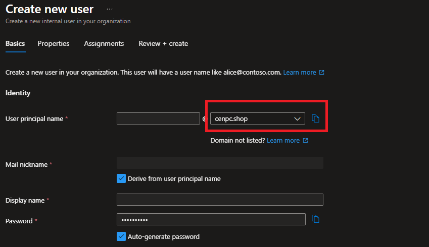

# 🎫 CHAMADO DE : Solicitação de inclusão e verificação de domínio personalizado no Microsoft Entra ID

* Número do chamado: INC-2026-1102-001
* Categoria: Identity and Access Management (IAM) | Custom Domain Names
* Serviço: Microsoft Entra ID
* Tipo de solicitação: Mudança / Implantação
* Prioridade: Média
* Solicitante: Financeiro
* Equipe responsável: IT Cloud Infraestructure
* Status: 

    ```
    ☑ Em análise
    ☐ Em implementação
    ☐ Aguardando validação
    ☐ Concluído
    ```

# 1. 📌 Descrição.

* Solicito a inclusão do domínio **cenpc.shop** no Microsoft Entra ID, incluindo a configuração do registro DNS necessário para comprovação de propriedade e posterior verificação do domínio.

# 2. 📝 Atendimento | 📸 Evidências.

* Após autenticado no Azure com uma conta Global Administrator, foi realizado o acesso ENTRA ID > MANAGE > CUSTOM DOMAIN NAMES

    

* Em seguida *ADD Custom Domain* para adicionar o novo domínio no Azure.

    

    * Após clicar em *ADICIONAR* foram os registros TXT para serem inseridos no provedor do domínio DNS contratado.

        
    
    * No provedor do DNS contratado foram inseridas as informações **TXT** passadas pelo Azure.

        

    * Depois do procedimento realizado, no Azure, após clicar em **VERIFICAR** o sistema confirmou a autenticidade do dominio cadastrado.

        

* Atualizado o navegador, o DNS customizado foi dispomibilizado.

    

* O domínio foi colocado como primário.

    


# 3. 💻 Comandos / Scripts Utilizados

> Registrar somente os comandos relevantes para reprodução do procedimento.

```powershell
# Exemplo
    Nenhum comando foi utilizado.
```
# 4. 🔎 Validação dos usuários

* Ao criar um novo usuário o domínio estava disponível. 

    

# 5. 📸 Evidências

```
📁 REQ-2026-1022-001
└── 📁 img
    ├── 📄 01.png
    ├── 📄 02.png
    ├── 📄 03.png
    ├── 📄 04.png
    ├── 📄 05.png
    ├── 📄 06.png
    ├── 📄 07.png
    └── 📄 08.png
```
   
# 6.🏁 Encerramento

* **Motivo do encerramento:** Solicitação atendida e validada com sucesso.

* **Próxima ação:** Nenhuma ação pendente.

* Status:

    ```
    ☐ Em análise
    ☐ Em implementação
    ☐ Aguardando validação
    ☑ Concluído
    ```

* Analista responsável: Fabio Silva

#