# CHAMADO DE ACESSO — Bloqueio para envio de convites para usuários externos

* Número do chamado: REQ-2026-1019-001
* Categoria: Solicitação | Bloqueio | Invites
* Prioridade: Média
* Solicitante: Diretoria | Aline.Paixao
* Equipe responsável: Suporte Técnico
* Status: 
    ```
    ☑ Em análise
    ☐ Em implementação
    ☐ Aguardando validação
    ☐ Concluído
    ```
# 1. 📌 Descrição.

* Realizar o bloqueio de envio de invites para colaboradores externos.

* Somente os colaboradores com perfil de analista senior ou gerente tem a permissão enviar convites para colaboradores externos. 

# 2. 📝 Atendimento | 📸 Evidências.

* **Bloqueando os colaboradores de enviar invites para outros colaboradores externos**

    * Entra ID > Manager > User Settings > Manage External collaboration Settings.
            
        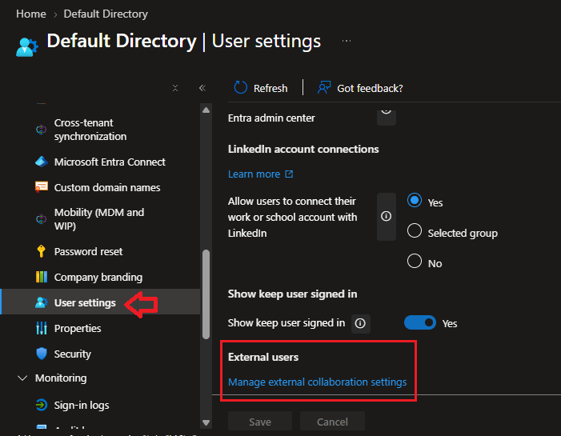

    * Em seguida, foi selecionada a opção "*Only users assigned to specific admin roles can invite guest users - Somente usuários atribuídos a funções administrativas específicas podem convidar usuários convidados.*"

        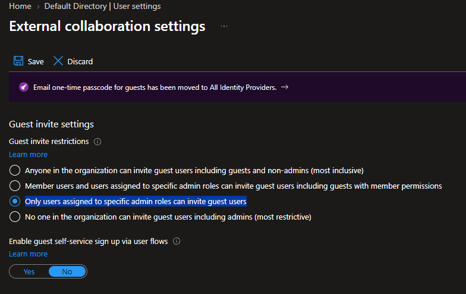

    * Após selecionar a opção, a alteração foi salva.

        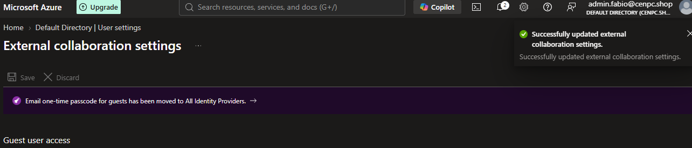

* **Criando grupo para incluir os colaboradores com perfis de *Gerente* e *Analista Senior***.

    ```
        Para incluir funções administrativas o grupo deve ser criado como tipo de associação Estática | Assigned. 
    ```

    * Entra ID > Manage > Groups > ADD > New Group

        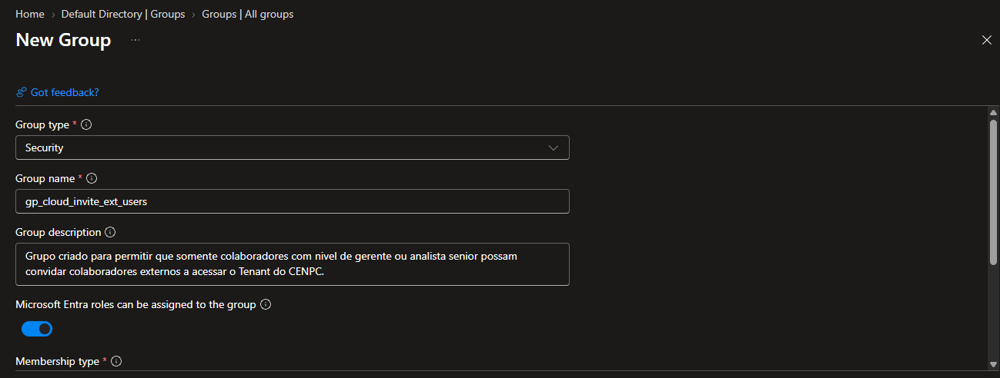
    
    * Nenhum colaborador foi incluido como membro no momento.

    * Em seguida para atribuir as funções, clique no link *Roles*.

        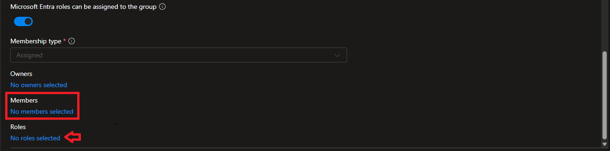
    
    * Em *Roles - Funções* foi adicionada a função *Guest Inviter*. 
        
        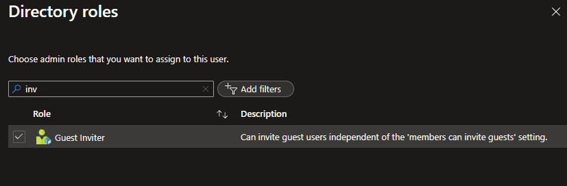

    * Após o procedimento a criação do grupo foi realizada.

        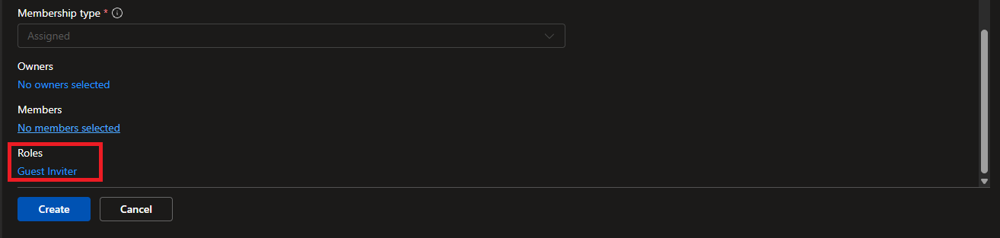

    * Foi incluido usuários com perfil de Owners do grupo para ser possivel adicionar usuários.

        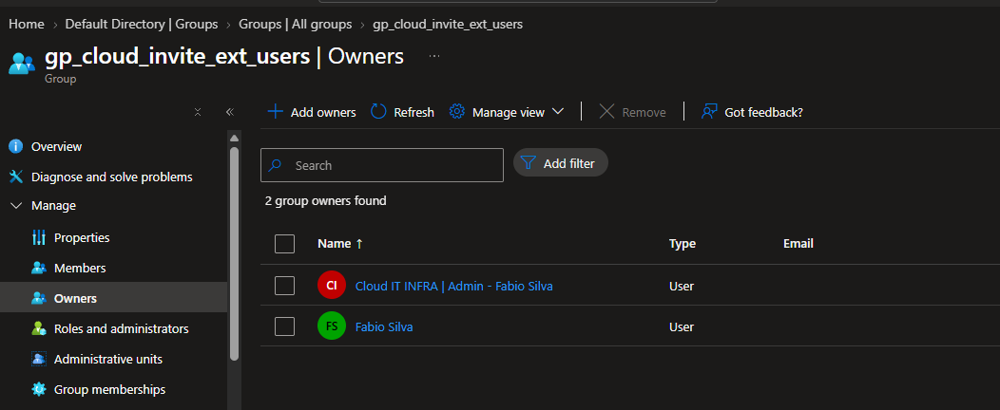
    
    * Nenhum usuário foi adicionado como membro.

        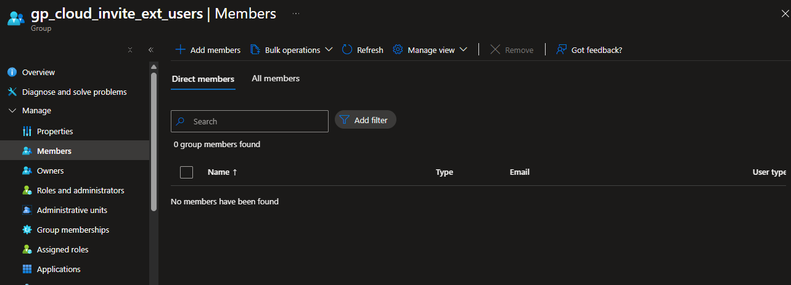


* **Conectando no Entra ID usando o Powershell usando o Microsoft Graph para realizar consultas, exportar usuários e incluir no grupo que foi criado**.

    ```
    Caso seja a primeira vez, se faz necessário instalar o modulo "Microsoft Graph PowerShell" e atualizar a versão do "Microsoft Graph".

    # Instalando o modulo "Microsoft Graph PowerShell" no Powershell Pc local.
        
        Install-Module Microsoft.Graph -Scope CurrentUser

    # Atualizando a versão do Microsoft Graph.
        
        Update-Module Microsoft.Graph -Force -verbose

    # Carregando apenas a autenticação do MS Graph
        
        Import-Module Microsoft.Graph.Authentication -Verbose

    ```
    * Usando o Powershell 7.4.5 foi realizado o acesso ao Entra ID.

    * Reiniciando o serviço do Powershell.

    * Executado o comando para exibir a tela de autenticação do Tenant no Entra ID.
        
        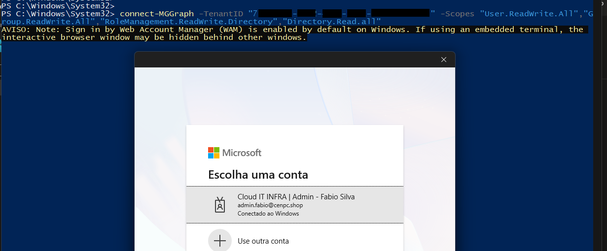

        Confirmando que os dados serão utilizados.

        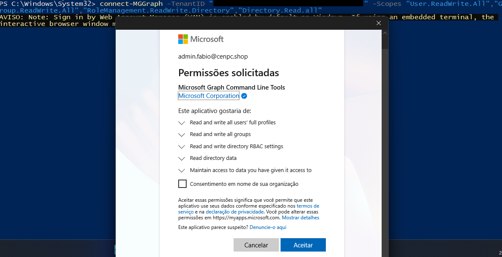

    * Autenticação realizada.

        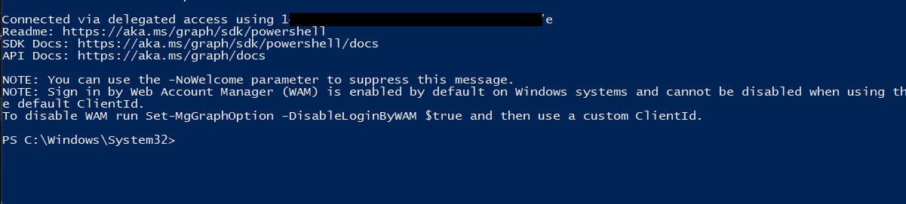

    * Criando uma consulta para capturar usuários com "JobTitle = Senior ou Gerente" e colocando na variavel "$usuarios".

        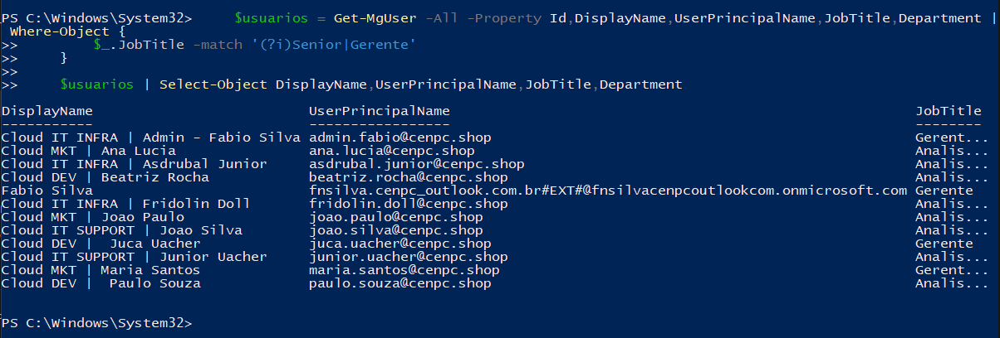

    * Consultando os usuários que foram inseridos na variavel.

        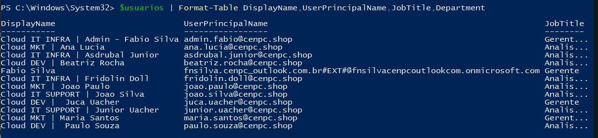

    * Foi executado o comando para guardar na variavel "$grupo" as informações do grupo que foi criado "gp_cloud_invite_ext_users".

        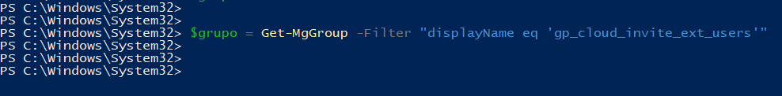

    * Foi executado o comando criar a variavel "$grupo.id" com o objetivo de armazenar o ID do grupo "gp_cloud_invite_ext_users".

        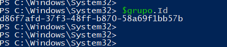

    * Foi executado o comando para adicionar os usuários ao grupo "gp_cloud_invite_ext_users".

        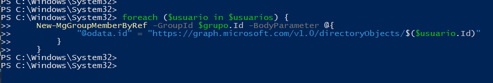

    * Foi executado o comando para consultar os usuários que foram inseridos no grupo.

        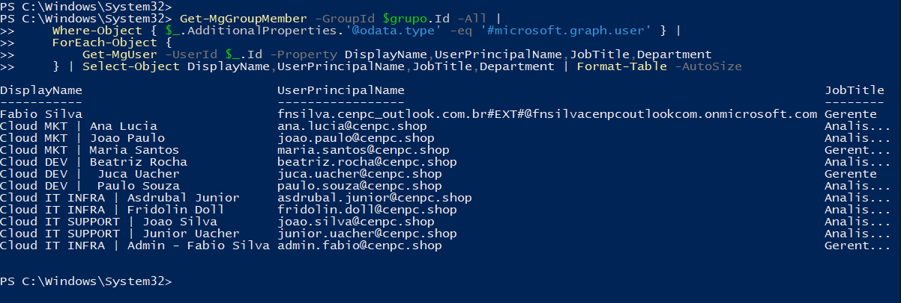

        
# 3. 💻 Comandos / Scripts Utilizados

> Registrar somente os comandos relevantes para reprodução do procedimento.

```powershell
# Comando para conectar no Tenant do Entra ID

    Start-Process powershell  

# Comando para conectar no Tenant do Entra ID

    connect-MGGraph -TenantID "7XXXXXX-XXXX-XXXX-XXXX-XXXXXXX7" -Scopes "User.ReadWrite.All","Group.ReadWrite.All","RoleManagement.ReadWrite.Directory","Directory.ReadWrite.All"

# Criando uma consulta para capturar usuários com JobTitle = Senior ou Gerente e colocando na variavel $usuarios.

    $usuarios = Get-MgUser -All -Property Id,DisplayName,UserPrincipalName,JobTitle,Department | Where-Object {
        $_.JobTitle -match '(?i)Senior|Gerente'
    }
    
    $usuarios | Select-Object DisplayName,UserPrincipalName,JobTitle,Department

# Consultando o grupo que foi criado.    

    $usuarios | Format-Table DisplayName,UserPrincipalName,JobTitle,Department

# Guardando na variavel "$grupo" as informações do grupo que foi criado "gp_cloud_invite_ext_users".

    $grupo = Get-MgGroup -Filter "displayName eq 'gp_cloud_invite_ext_users'"

# Criando a variavel para armazenar o ID do grupo "gp_cloud_invite_ext_users".
    
    $grupo.Id

# Adicionando os usuários no grupo que foi criado.

    foreach ($usuario in $usuarios) {
    New-MgGroupMemberByRef -GroupId $grupo.Id -BodyParameter @{
            "@odata.id" = "https://graph.microsoft.com/v1.0/directoryObjects/$($usuario.Id)"
        }
    }

# Consultando os usuários que foram inclidos no grupo "gp_cloud_licenca_P2".
    
    Get-MgGroupMember -GroupId $grupo.Id -All |
    Where-Object { $_.AdditionalProperties.'@odata.type' -eq '#microsoft.graph.user' } |
    ForEach-Object {
        Get-MgUser -UserId $_.Id -Property DisplayName,UserPrincipalName,JobTitle,Department
    } | Select-Object DisplayName,UserPrincipalName,JobTitle,Department | Format-Table -AutoSize

```
 # 4.🏁 Encerramento

* O bloqueio de envio de convite por usuários não pertencentes ao perfil "Gerente" e "Analista Senior" foi realizado.

* Foi criado um grupo onde somente os usuários pertencentes podem enviar convites para outros colaboradores externos.

    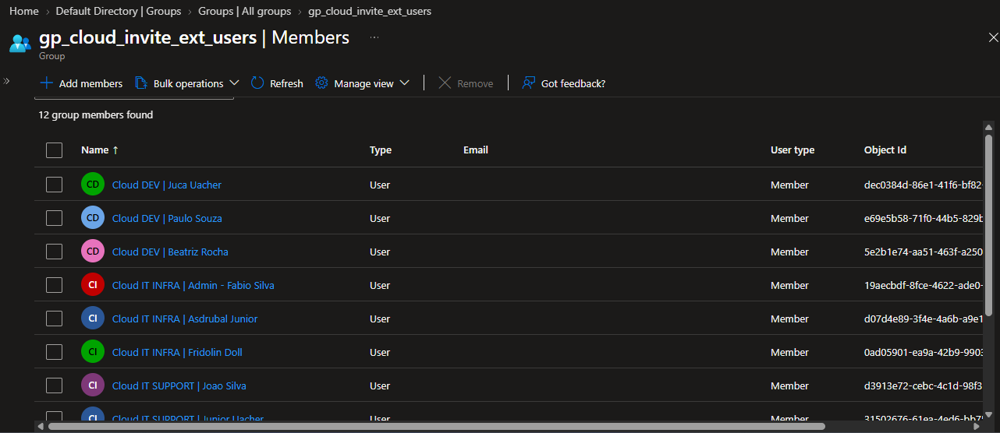

* Usuário com perfil Pleno.

    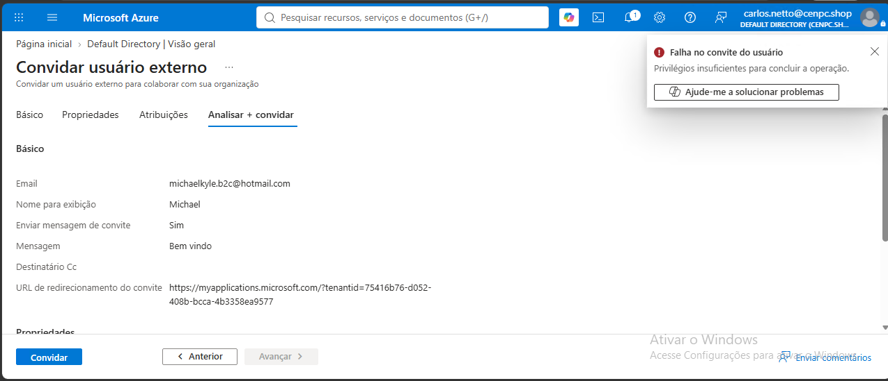

* Usuário com perfil Senior.

    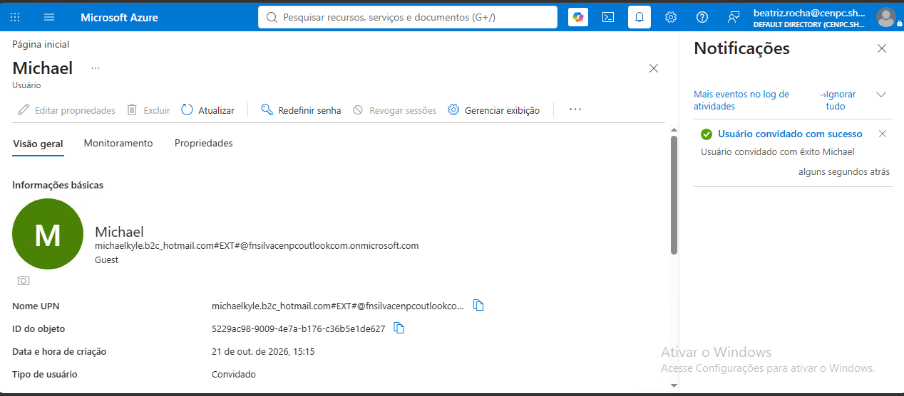

* Status: 
    ```
    ☐ Em análise
    ☐ Em implementação
    ☐ Aguardando validação
    ☑ Concluído
    ```

* Analista responsável: Fabio Silva

#