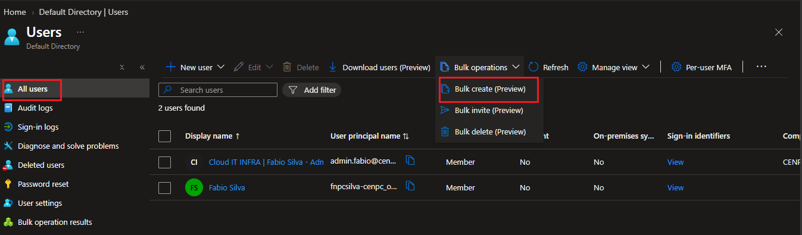
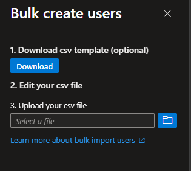
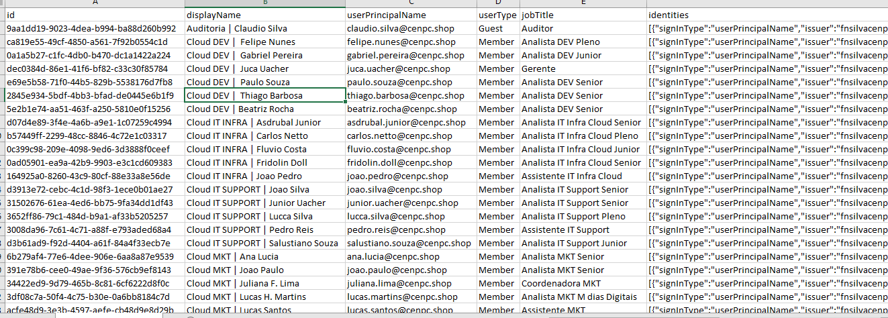
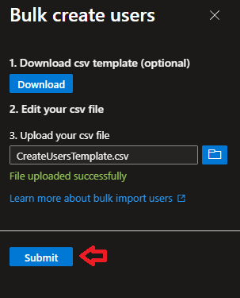
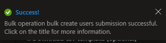
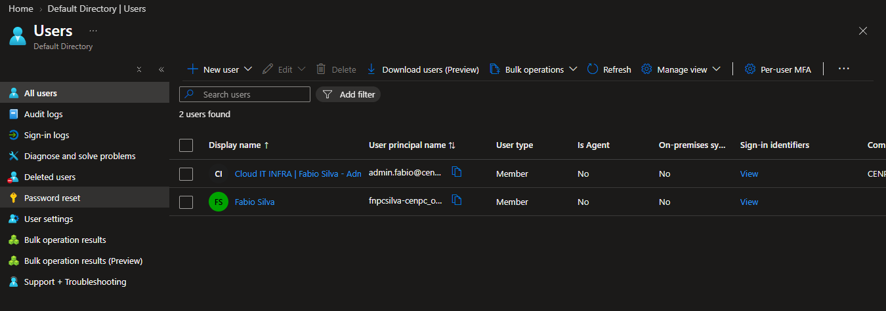
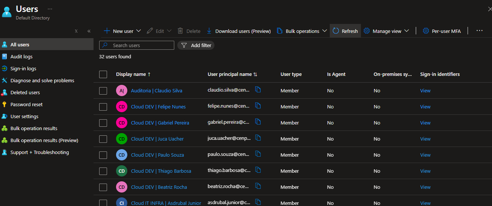

# 🎫 CHAMADO DE : Importando usuários para o Entra ID.

* Número do chamado: TASK-2026-0211-001
* Categoria: Entra ID | Cadastro
* Serviço: Microsoft Entra ID
* Tipo de solicitação: Cadastro
* Prioridade: Média
* Solicitante: Financeiro
* Equipe responsável: Suporte Técnico
* Status: 

    ```
    ☑ Em análise
    ☐ Em implementação
    ☐ Aguardando validação
    ☐ Concluído
    ```

# 1. 📌 Descrição.

* Realize a importação dos usuários que estavam no Tenant antigo e coloque no novo Tenant.

* Os colaboradores do Tenant antigo foram exportados e colocados em um arquivo *.CSV*.

# 2. 📝 Atendimento | 📸 Evidências.

* No Entra ID > Manage > Users > Bulk Operation > Bulk Create.

    
    
* Foi realizado o downalod do arquivo *.CSV* de configuração.

    

* Em seguida, foi mesclado os dados do arquivo do Tenant antigo *ExportUsers_2026-11-2.csv* com o arquivo *CreateUsersTemplate.csv*.

    

* Após o procedimento, foi realizado o Upload das informações editadas no arquivo *.CSV*.

    

    * O procedimento foi realizado com sucesso.

        


# 3. 💻 Comandos / Scripts Utilizados

> Registrar somente os comandos relevantes para reprodução do procedimento.

```powershell
    
    Nenhum comando foi aplicado.

```
# 4. 🔎 Validação dos usuários

* Antes da importação dos usuários.

    

* Depois da importação dos usuários.

    

# 5. 📸 Evidências

```
📁 REQ-2026-1022-001
└── 📁 img
    ├── 📄 01.png
    ├── 📄 02.png
    ├── 📄 03.png
    ├── 📄 04.png
    ├── 📄 05.png
    ├── 📄 06.png
    └── 📄 07.png
```
    
# 6.🏁 Encerramento

* **Motivo do encerramento:** Solicitação atendida e validada com sucesso.

* **Próxima ação:** Nenhuma ação pendente.

* Status:

    ```
    ☐ Em análise
    ☐ Em implementação
    ☐ Aguardando validação
    ☑ Concluído
    ```

* Analista responsável: Fabio Silva

#