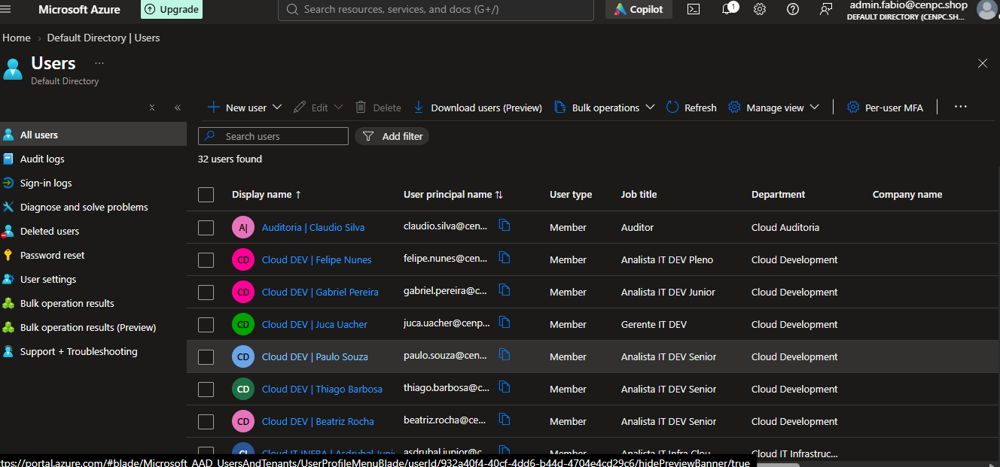
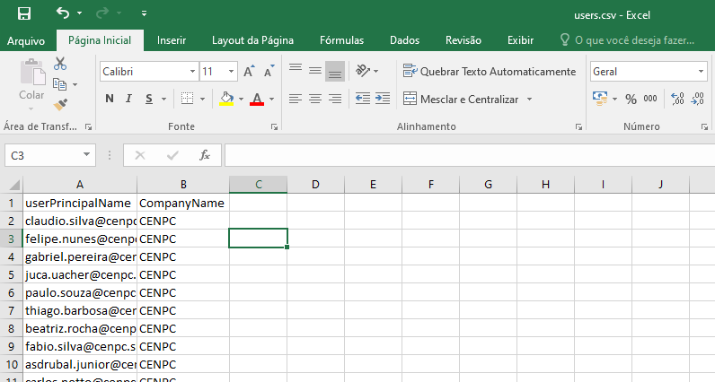
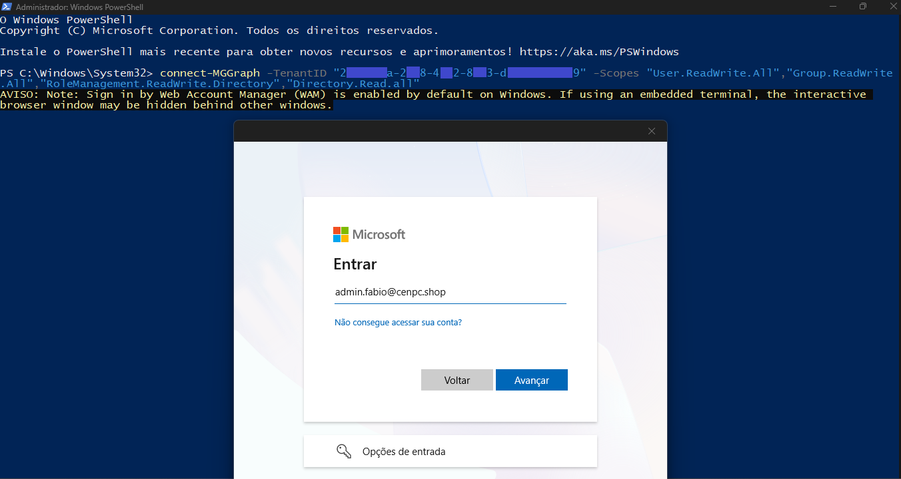
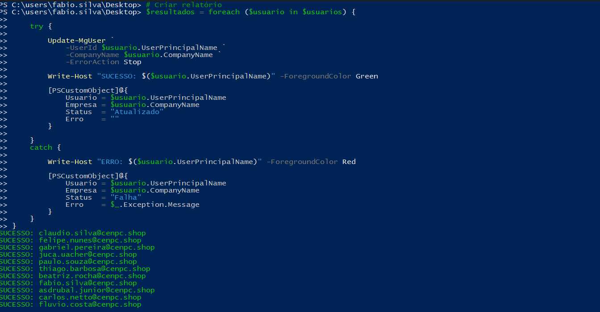
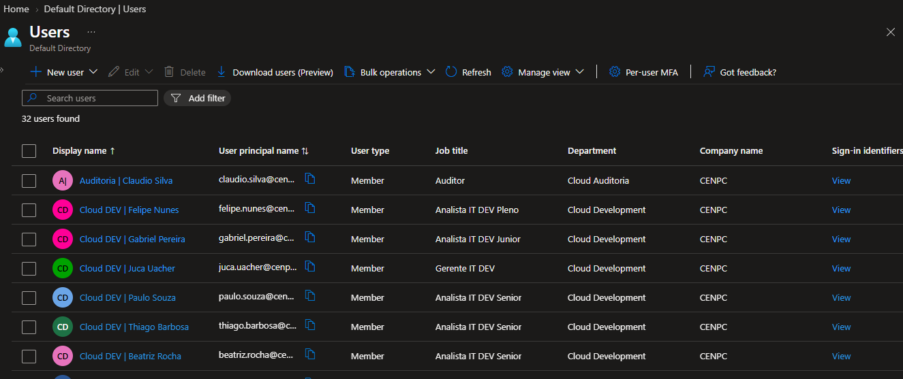

# 🎫 CHAMADO Bulk Update – Company Name

* Número do chamado: Task-2026-0311-001
* Categoria: ATUALIZAÇÃO | NOME DA EMPRESA
* Serviço: Microsoft Entra ID
* Tipo de solicitação: User Management
* Prioridade: Média
* Solicitante: RH
* Equipe responsável: Suporte Técnico
* Status: 

    ```
    ☑ Em análise
    ☐ Em implementação
    ☐ Aguardando validação
    ☐ Concluído
    ```

# 1. 📌 Descrição.

* A equipe do RH solicitou que seja incluido o nome da empresa no campo Company Name para 30 colaboradores. 

# 2. 📝 Atendimento | 📸 Evidências.

* Atualmente o nome da empresa está vazio.

    

* Foi preparado um arquivo *.CSV* com nome **usuarios.csv**.

* Foi exportado do **Entra ID** os 30 Usuários.

* Foram incluidos os 30 colaboradores na planilha criada.

    

    ```
    # Observação:

        Substitua o ponto e virgula (;) por virgula (,)

    ```

* Executado o Powershell *como administrador* para conectar no Microsoft Graph.

    * Executado o comando para iniciar o processo do Powershell.

    * Executado o comando para conectar ao Microsoft Graph.

        

    * Executado o script para realizar o procedimento de Update do Company Name.

        


# 3. 💻 Comandos / Scripts Utilizados

> Registrar somente os comandos relevantes para reprodução do procedimento.

```powershell
# Executado comando para iniciar processo do Powershell.

start-Process powershell

# Executado o comando para conectar ao Microsoft Graph.

connect-MGGraph -TenantID "TenantID" -Scopes "User.ReadWrite.All","Group.ReadWrite.All","RoleManagement.ReadWrite.Directory","Directory.Read.all"

```

```powershell
# Importar usuários do CSV
$usuarios = Import-Csv "C:\Temp\users.csv"

# Criar relatório
$resultados = foreach ($usuario in $usuarios) {

    try {

        Update-MgUser `
            -UserId $usuario.UserPrincipalName `
            -CompanyName $usuario.CompanyName `
            -ErrorAction Stop

        Write-Host "SUCESSO: $($usuario.UserPrincipalName)" -ForegroundColor Green

        [PSCustomObject]@{
            Usuario = $usuario.UserPrincipalName
            Empresa = $usuario.CompanyName
            Status  = "Atualizado"
            Erro    = ""
        }

    }
    catch {

        Write-Host "ERRO: $($usuario.UserPrincipalName)" -ForegroundColor Red

        [PSCustomObject]@{
            Usuario = $usuario.UserPrincipalName
            Empresa = $usuario.CompanyName
            Status  = "Falha"
            Erro    = $_.Exception.Message
        }
    }
}

# Exportar relatório
$resultados | Export-Csv `
    "C:\Temp\relatorio_atualizacao.csv" `
    -NoTypeInformation -Encoding UTF8
```

# 4. 🔎 Validação dos usuários

* Após o procedimento, o campo (CompanyName - Nome da empresa) foram atualizados para os 30 colaboradores.

    

# 5. 📸 Evidências

```
📁 TASK-2026-0311-001
└── 📁 img
    ├── 📄 01.png
    ├── 📄 02.png
    ├── 📄 03.png
    ├── 📄 04.png
    └── 📄 05.png
```
   
# 6.🏁 Encerramento

* **Motivo do encerramento:** Solicitação atendida e validada com sucesso.

* **Próxima ação:** Nenhuma ação pendente.

* Status:

    ```
    ☐ Em análise
    ☐ Em implementação
    ☐ Aguardando validação
    ☑ Concluído
    ```

* Analista responsável: Fabio Silva

#