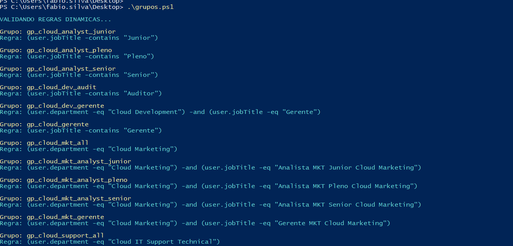
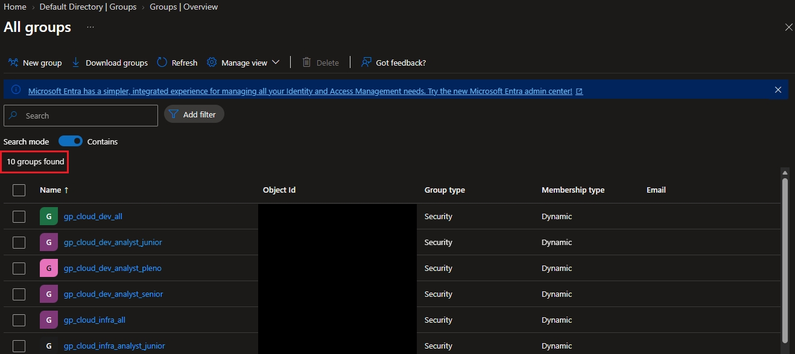

# 🎫 CHAMADO - Criando grupos dinamicos - Microsoft Graph.

* Número do chamado: TASK-2026-0311-002
* Categoria: Groups | Dymamic Groups
* Serviço: Microsoft Entra ID
* Tipo de solicitação: Mudança / Implantação
* Prioridade: Média
* Solicitante: IT Infra
* Equipe responsável: Suporte Técnico
* Status: 

    ```
    ☑ Em análise
    ☐ Em implementação
    ☐ Aguardando validação
    ☐ Concluído
    ```

# 1. 📌 Descrição.

* Solicito a criação dos grupos referente aos departamentos abaixo:

```Text

    * Analista Junior - All.
    * Analista Pleno - All.
    * Analista Senior - All.
    * Gerentes - All.
    * Development - Gerente.
    * Marketing - All.
    * Marketing - Analista Junior.
    * Marketing - Analista Pleno.
    * Marketing - Analista Senior.
    * Marketing - Gerente.
    * Support - All
    * Support - Analista Junior. 
    * Support - Analista Pleno. 
    * Support - Analista Senior.
    * Support - Gerente.  

```

# 2. 📝 Atendimento | 📸 Evidências.

* Foram criadas as taxônomias para criação dos grupos.

```Text
    * gp_cloud_analyst_junior
    * gp_cloud_analyst_pleno
    * gp_cloud_analyst_senior
    * gp_cloud_dev_audit
    * gp_cloud_dev_gerente
    * gp_cloud_gerente
    * gp_cloud_mkt_all
    * gp_cloud_mkt_analyst_junior
    * gp_cloud_mkt_analyst_pleno
    * gp_cloud_mkt_analyst_senior
    * gp_cloud_mkt_gerente
    * gp_cloud_support_all
    * gp_cloud_support_analyst_junior
    * gp_cloud_support_analyst_pleno
    * gp_cloud_support_analyst_senior
    * gp_cloud_support_gerente

```
* Foram verificados os atributos que seriam utilizados para criar as regras.

```Text
------------------------------------------------------------------------------------------
displayName	JobTitle	        |   Departament
------------------------------------------------------------------------------------------
gp_cloud_analyst_junior	        |	
------------------------------------------------------------------------------------------
gp_cloud_analyst_pleno	        |	
------------------------------------------------------------------------------------------
gp_cloud_analyst_senior		    |
------------------------------------------------------------------------------------------
gp_cloud_dev_gerente	        |   Gerente IT DEV Cloud Development
------------------------------------------------------------------------------------------
gp_cloud_gerente		        |
------------------------------------------------------------------------------------------
gp_cloud_mkt_all		        |   Cloud Marketing
------------------------------------------------------------------------------------------
gp_cloud_mkt_analyst_junior	    |   Analista MKT Junior	Cloud Marketing
------------------------------------------------------------------------------------------
gp_cloud_mkt_analyst_pleno	    |   Analista MKT Pleno Cloud Marketing
------------------------------------------------------------------------------------------
gp_cloud_mkt_analyst_senior	    |   Analista MKT Senior	Cloud Marketing
------------------------------------------------------------------------------------------
gp_cloud_mkt_gerente	        |   Gerente MKT	Cloud Marketing
------------------------------------------------------------------------------------------
gp_cloud_support_all		    |
------------------------------------------------------------------------------------------
gp_cloud_support_analyst_junior	|   Analista IT Support Junior Cloud IT Support Technical
------------------------------------------------------------------------------------------
gp_cloud_support_analyst_pleno	|   Analista IT Support Pleno Cloud IT Support Technical
------------------------------------------------------------------------------------------
gp_cloud_support_analyst_senior	|   Analista IT Support Senior Cloud IT Support Technical
------------------------------------------------------------------------------------------
gp_cloud_support_gerente		|   Gerente Cloud IT Support Technical
------------------------------------------------------------------------------------------
```
* Realizando autenticação no Microsoft Graph.

    

* Executando o script para criação dos grupos dinâmicos.

    

# 3. 💻 Comandos / Scripts Utilizados

> Registrar somente os comandos relevantes para reprodução do procedimento.

```powershell

# ==========================================
# CRIACAO DE GRUPOS DINAMICOS - ENTRA ID
# Microsoft Graph PowerShell
# ==========================================

# Departamentos utilizados nas regras
$DeptCloud    = "Cloud"
$DeptCloudDev = "Cloud Development"
$DeptMkt      = "Cloud Marketing"
$DeptSupport  = "Cloud IT Support Technical"

# ==========================================
# LISTA DE GRUPOS E REGRAS DINAMICAS
# ==========================================

$Grupos = @(

    @{
        Nome = "gp_cloud_analyst_junior"
        Regra = '(user.jobTitle -contains "Junior")'
    },
    @{
        Nome = "gp_cloud_analyst_pleno"
        Regra = '(user.jobTitle -contains "Pleno")'
    },
    @{
        Nome = "gp_cloud_analyst_senior"
        Regra = '(user.jobTitle -contains "Senior")'
    },
    @{
        Nome = "gp_cloud_dev_audit"
        Regra = '(user.jobTitle -contains "Auditor")'
    },
    @{
        Nome = "gp_cloud_dev_gerente"
        Regra = "(user.department -eq `"$DeptCloudDev`") -and (user.jobTitle -eq `"Gerente`")"
    },
    @{
        Nome = "gp_cloud_gerente"
        Regra = '(user.jobTitle -contains "Gerente")'
    },
    @{
        Nome = "gp_cloud_mkt_all"
        Regra = "(user.department -eq `"$DeptMkt`")"
    },
    @{
        Nome = "gp_cloud_mkt_analyst_junior"
        Regra = "(user.department -eq `"$DeptMkt`") -and (user.jobTitle -eq `"Analista MKT Junior Cloud Marketing`")"
    },
    @{
        Nome = "gp_cloud_mkt_analyst_pleno"
        Regra = "(user.department -eq `"$DeptMkt`") -and (user.jobTitle -eq `"Analista MKT Pleno Cloud Marketing`")"
    },
    @{
        Nome = "gp_cloud_mkt_analyst_senior"
        Regra = "(user.department -eq `"$DeptMkt`") -and (user.jobTitle -eq `"Analista MKT Senior Cloud Marketing`")"
    },
    @{
        Nome = "gp_cloud_mkt_gerente"
        Regra = "(user.department -eq `"$DeptMkt`") -and (user.jobTitle -eq `"Gerente MKT Cloud Marketing`")"
    },
    @{
        Nome = "gp_cloud_support_all"
        Regra = "(user.department -eq `"$DeptSupport`")"
    },
    @{
        Nome = "gp_cloud_support_analyst_junior"
        Regra = "(user.department -eq `"$DeptSupport`") -and (user.jobTitle -eq `"Analista IT Support Junior Cloud IT Support Technical`")"
    },
    @{
        Nome = "gp_cloud_support_analyst_pleno"
        Regra = "(user.department -eq `"$DeptSupport`") -and (user.jobTitle -eq `"Analista IT Support Pleno Cloud IT Support Technical`")"
    },
    @{
        Nome = "gp_cloud_support_analyst_senior"
        Regra = "(user.department -eq `"$DeptSupport`") -and (user.jobTitle -eq `"Analista IT Support Senior Cloud IT Support Technical`")"
    },
    @{
        Nome = "gp_cloud_support_gerente"
        Regra = "(user.department -eq `"$DeptSupport`") -and (user.jobTitle -eq `"Gerente Cloud IT Support Technical`")"
    }
)

# ==========================================
# VALIDAR CONEXAO MICROSOFT GRAPH
# ==========================================

if (-not (Get-MgContext)) {

    Write-Host "Conectando ao Microsoft Graph..." -ForegroundColor Yellow

    Connect-MgGraph -Scopes "Group.ReadWrite.All"

}

# ==========================================
# VALIDAR REGRAS ANTES DA CRIACAO
# ==========================================

Write-Host "`nVALIDANDO REGRAS DINAMICAS..." -ForegroundColor Cyan

foreach ($Grupo in $Grupos) {

    Write-Host "`nGrupo: $($Grupo.Nome)" -ForegroundColor Yellow
    Write-Host "Regra: $($Grupo.Regra)" -ForegroundColor Cyan

}

# ==========================================
# CONTADORES
# ==========================================

$Criados = 0
$Existentes = 0
$Erros = 0

# ==========================================
# CRIAR GRUPOS DINAMICOS
# ==========================================

foreach ($Grupo in $Grupos) {

    $NomeGrupo = $Grupo.Nome

    try {

        # Verificar se o grupo ja existe
        $Existente = Get-MgGroup `
            -Filter "displayName eq '$NomeGrupo'" `
            -ErrorAction Stop

        if ($Existente) {

            Write-Host "`nGrupo ja existe: $NomeGrupo" -ForegroundColor Yellow

            $Existentes++
            continue

        }

        # Configuracao do novo grupo
        $Parametros = @{

            DisplayName                   = $NomeGrupo
            Description                   = "Grupo dinamico de usuarios - $NomeGrupo"
            MailEnabled                   = $false
            MailNickname                  = $NomeGrupo
            SecurityEnabled               = $true
            GroupTypes                    = @("DynamicMembership")
            MembershipRule                = $Grupo.Regra
            MembershipRuleProcessingState = "On"

        }

        # Criar grupo
        New-MgGroup -BodyParameter $Parametros -ErrorAction Stop

        Write-Host "`nGrupo criado com sucesso: $NomeGrupo" -ForegroundColor Green

        Write-Host "Regra: $($Grupo.Regra)" -ForegroundColor Cyan

        $Criados++

    }
    catch {

        Write-Host "`nErro ao criar: $NomeGrupo" -ForegroundColor Red

        Write-Host "Detalhes: $($_.Exception.Message)" -ForegroundColor Red

        $Erros++

    }

}

# ==========================================
# RELATORIO FINAL
# ==========================================

Write-Host "`n==========================================" -ForegroundColor Cyan

Write-Host "RELATORIO DE EXECUCAO" -ForegroundColor Cyan

Write-Host "==========================================" -ForegroundColor Cyan

Write-Host "Total de grupos solicitados: $($Grupos.Count)"
Write-Host "Grupos criados: $Criados" -ForegroundColor Green
Write-Host "Grupos existentes: $Existentes" -ForegroundColor Yellow
Write-Host "Grupos com erro: $Erros" -ForegroundColor Red

Write-Host "==========================================" -ForegroundColor Cyan

Write-Host "`nProcessamento finalizado!" -ForegroundColor Green

```

# 4. 🔎 Validação dos usuários

* Antes de executar o script tinham 10 grupos criados.

    

* Depois do procedimento subiram para 26 grupos.

    

* Desconectado do Microsoft Graph.

```Powershell

Disconnect-MgGraph

```

# 5. 📸 Evidências

```
📁 TASK-2026-0311-002
└── 📁 img
    ├── 📄 01.png
    ├── 📄 02.png
    ├── 📄 03.png
    └── 📄 04.png
```
   
# 6.🏁 Encerramento

* **Motivo do encerramento:** Solicitação atendida e validada com sucesso.

* **Próxima ação:** Nenhuma ação pendente.

* Status:

    ```
    ☐ Em análise
    ☐ Em implementação
    ☐ Aguardando validação
    ☑ Concluído
    ```

* Analista responsável: Fabio Silva

#