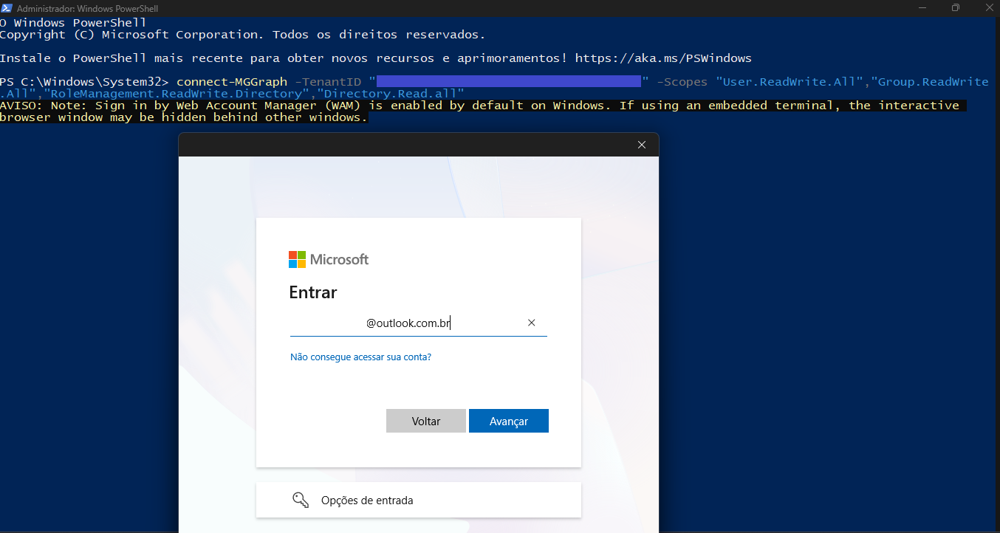
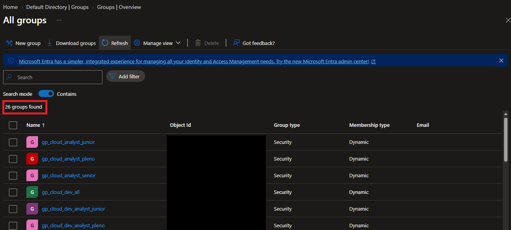

# 🎫 CHAMADO - Criando grupos dinamicos - Microsoft Graph.

* Número do chamado: TASK-2026-0311-002
* Categoria: Groups | Dymamic Groups
* Serviço: Microsoft Entra ID
* Tipo de solicitação: Mudança / Implantação
* Prioridade: Média
* Solicitante: IT Infra
* Equipe responsável: Suporte Técnico
* Status: 

    ```
    ☑ Em análise
    ☐ Em implementação
    ☐ Aguardando validação
    ☐ Concluído
    ```

# 1. 📌 Descrição.

* Solicito a criação dos grupos referente aos departamentos abaixo:

```Text

    * Analista Junior - All.
    * Analista Pleno - All.
    * Analista Senior - All.
    * Gerentes - All.
    * Development - Gerente.
    * Marketing - All.
    * Marketing - Analista Junior.
    * Marketing - Analista Pleno.
    * Marketing - Analista Senior.
    * Marketing - Gerente.
    * Support - All
    * Support - Analista Junior. 
    * Support - Analista Pleno. 
    * Support - Analista Senior.
    * Support - Gerente.  

```

# 2. 📝 Atendimento | 📸 Evidências.

* Foram criadas as taxônomias para criação dos grupos.

```Text
    * gp_cloud_analyst_junior
    * gp_cloud_analyst_pleno
    * gp_cloud_analyst_senior
    * gp_cloud_dev_audit
    * gp_cloud_dev_gerente
    * gp_cloud_gerente
    * gp_cloud_mkt_all
    * gp_cloud_mkt_analyst_junior
    * gp_cloud_mkt_analyst_pleno
    * gp_cloud_mkt_analyst_senior
    * gp_cloud_mkt_gerente
    * gp_cloud_support_all
    * gp_cloud_support_analyst_junior
    * gp_cloud_support_analyst_pleno
    * gp_cloud_support_analyst_senior
    * gp_cloud_support_gerente

```
* Foram verificados os atributos que seriam utilizados para criar as regras.

```Text
------------------------------------------------------------------------------------------
displayName	JobTitle	        |   Departament
------------------------------------------------------------------------------------------
gp_cloud_analyst_junior	        |	
------------------------------------------------------------------------------------------
gp_cloud_analyst_pleno	        |	
------------------------------------------------------------------------------------------
gp_cloud_analyst_senior		    |
------------------------------------------------------------------------------------------
gp_cloud_dev_gerente	        |   Gerente IT DEV	Cloud Development
------------------------------------------------------------------------------------------
gp_cloud_gerente		        |
------------------------------------------------------------------------------------------
gp_cloud_mkt_all		        |   Cloud Marketing
------------------------------------------------------------------------------------------
gp_cloud_mkt_analyst_junior	    |   Analista MKT Junior	Cloud Marketing
------------------------------------------------------------------------------------------
gp_cloud_mkt_analyst_pleno	    |   Analista MKT Pleno	Cloud Marketing
------------------------------------------------------------------------------------------
gp_cloud_mkt_analyst_senior	    |   Analista MKT Senior	Cloud Marketing
------------------------------------------------------------------------------------------
gp_cloud_mkt_gerente	        |   Gerente MKT	Cloud Marketing
------------------------------------------------------------------------------------------
gp_cloud_support_all		    |
------------------------------------------------------------------------------------------
gp_cloud_support_analyst_junior	|   Analista IT Support Junior	Cloud IT Support Technical
------------------------------------------------------------------------------------------
gp_cloud_support_analyst_pleno	|   Analista IT Support Pleno	Cloud IT Support Technical
------------------------------------------------------------------------------------------
gp_cloud_support_analyst_senior	|   Analista IT Support Senior	Cloud IT Support Technical
------------------------------------------------------------------------------------------
gp_cloud_support_gerente		|   Cloud IT Support Technical
------------------------------------------------------------------------------------------
```
* 
    

* 

# 3. 💻 Comandos / Scripts Utilizados

> Registrar somente os comandos relevantes para reprodução do procedimento.

```powershell
# Exemplo
Get-MgUser -Filter "department eq 'Marketing'"
```

Ou, quando aplicável:

```powershell
# Exemplo de consulta de atribuições RBAC
Get-AzRoleAssignment `
    -SignInName usuario@empresa.com `
    -Scope "/subscriptions/<subscription-id>"
```

# 4. 🔎 Validação dos usuários

# 5. 📸 Evidências

```
📁 TASK-2026-0311-0021
└── 📁 img
    ├── 📄 01.png
    ├── 📄 01.png
    ├── 📄 01.png
    ├── 📄 01.png
    ├── 📄 01.png
    ├── 📄 01.png
    └── 📄 01.png
```

    
# 6.🏁 Encerramento


**Motivo do encerramento:
**Solicitação atendida e validada com sucesso.

**Próxima ação:
** Nenhuma ação pendente.


    

* 

* Status:

    ```
    ☐ Em análise
    ☐ Em implementação
    ☐ Aguardando validação
    ☑ Concluído
    ```

* Analista responsável: Fabio Silva

#