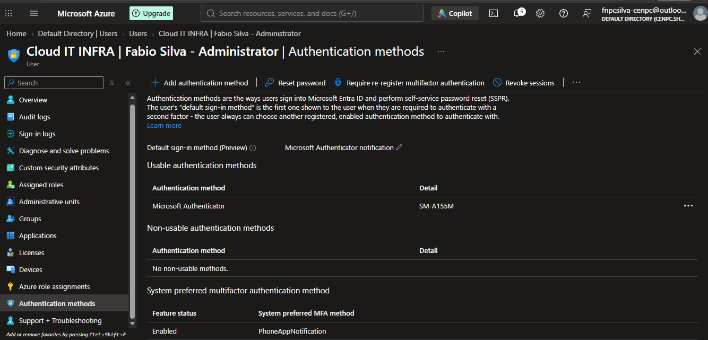
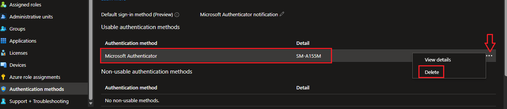
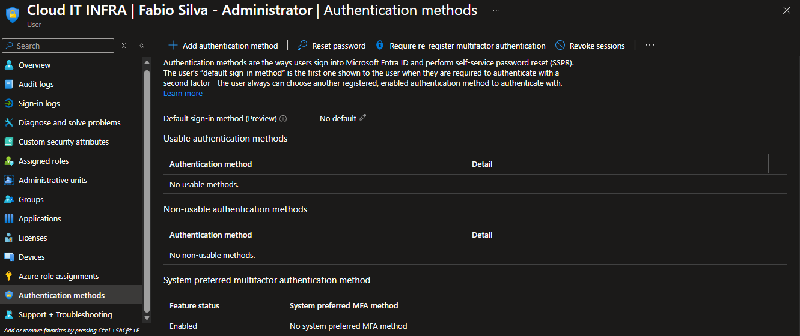
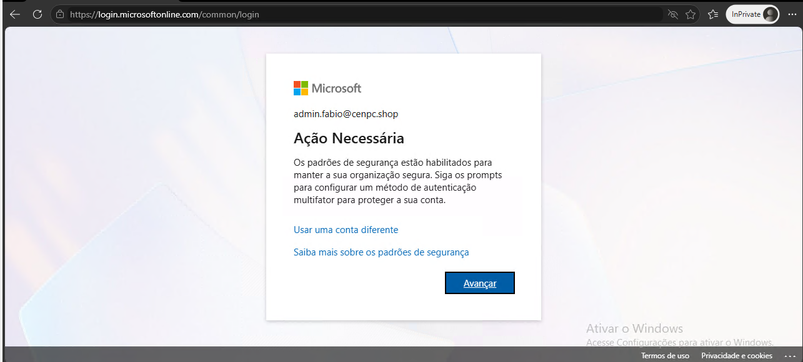
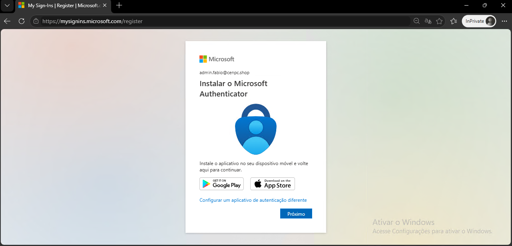
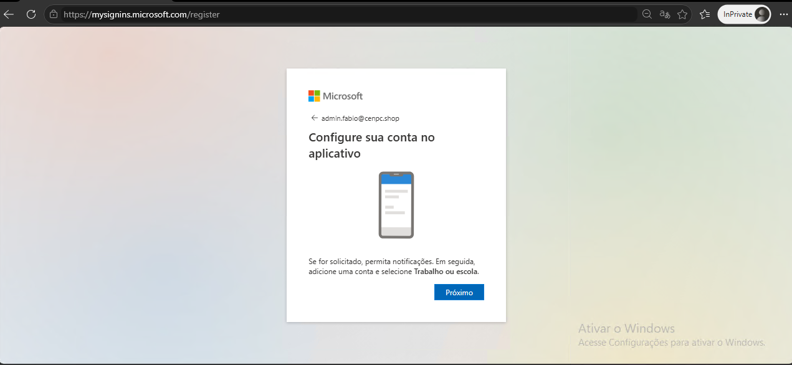
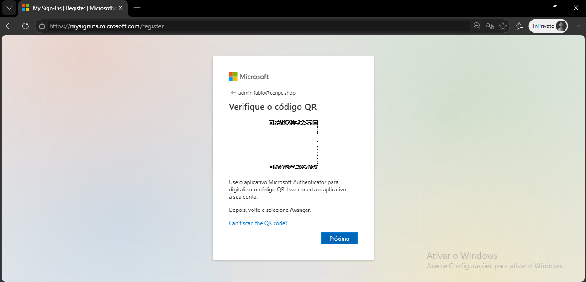
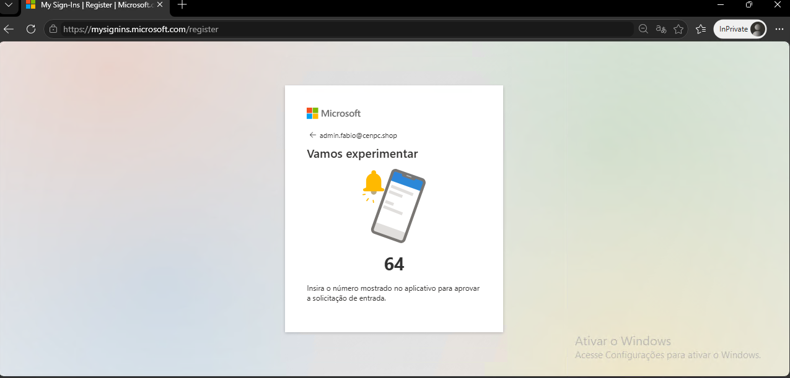
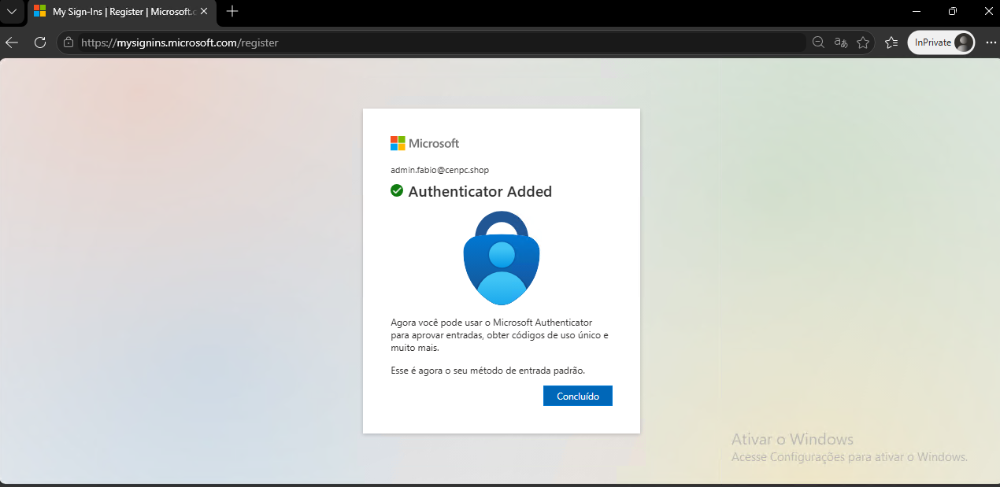
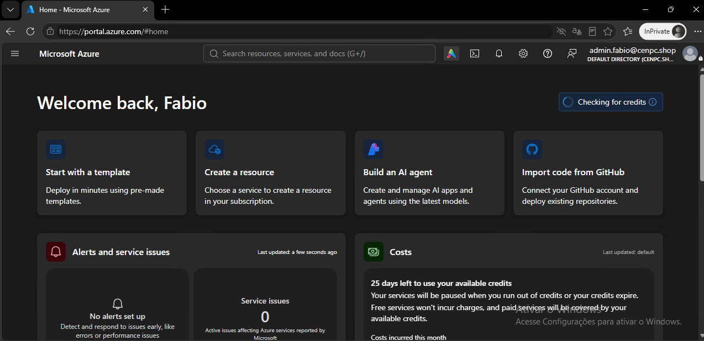

# 🎫 CHAMADO DE ACESSO — FALHA MICROSOFT AUTHENTICATOR

* Número do chamado: INC-2026-0711-001
* Categoria: Autenticação | MS Autenticator
* Serviço: Microsoft Entra ID
* Tipo de solicitação: Incidente
* Prioridade: Média
* Solicitante: Infraestrutura
* Equipe responsável: Suporte Técnico
* Status: 

    ```
    ☑ Em análise
    ☐ Em implementação
    ☐ Aguardando validação
    ☐ Concluído
    ```

# 1. 📌 Descrição.

* O colaborador informou que não está conseguindo utilizar o APP Autenticator da Microsoft.

* Ao tentar realizar o logon no portal Azure, o codigo de autenticação não é exibido no Autenticator.

* O colaborador informou que desinstalou/Instalou o APP novamente no celular, porem o problema continua.

# 2. 📝 Atendimento | 📸 Evidências.

* Com uma conta Administrativa, foi realizado logon no Portal Azure.

    * Entra ID > Manage > Users > *Selecionada a Conta do colaborador* > Authentication Methods.

        .

    * Em Microsoft Authenticator *"clique nos três pontos"* > **Delete** para remover o dispositivo.

        .

    * Após deletar o dispositivo, foi solicitado ao colaborador que realizasse novamente a autenticação no Portal Azure.

        .

* Após inserir aos dados da autenticação manual, o portal solicitou fosse realizado o procedimento de autenticação MFA.

    .

* O portal abriu a tela de instrução/configuração do APP authenticator.

    .

* Instruções de como realizar a configuração no APP.

    .

* OR Code apresentado para o scan no APP.

    .

* Confirmação com o codigo validador.

    .

* App do authenticator configurado com sucesso.

    .


# 3. 💻 Comandos / Scripts Utilizados

> Registrar somente os comandos relevantes para reprodução do procedimento.

```powershell
# Exemplo
    Nenhum codígo foi utilizado.
```

# 4. 🔎 Validação dos usuários

* A autenticação foi realizada com sucesso no portal Azure.

    .

# 5. 📸 Evidências

```
📁 INC-2026-0711-001
└── 📁 img
    ├── 📄 01.png
    ├── 📄 02.png
    ├── 📄 03.png
    ├── 📄 04.png
    ├── 📄 05.png
    ├── 📄 06.png
    ├── 📄 07.png
    ├── 📄 08.png
    ├── 📄 09.png
    └── 📄 10.png
```
   
# 6.🏁 Encerramento

* **Motivo do encerramento:** Solicitação atendida e validada com sucesso.

* **Próxima ação:** Nenhuma ação pendente.

* Status:

    ```
    ☐ Em análise
    ☐ Em implementação
    ☐ Aguardando validação
    ☑ Concluído
    ```

* Analista responsável: Fabio Silva

#