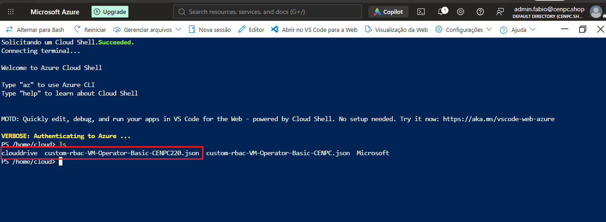
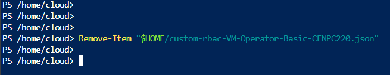
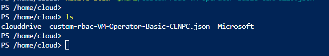

# Cloud Shell - Excluindo arquivos no Storage Account


# 📌 Descrição.

* Existe um arquivo antigo que está ocupando espaço no storage Acoount e deve ser exluido.

# 🎯 Objetivo:

* Excluir arquivos do Storage Account usando **Cloud Shell**.

---

# 📝 Procedimentos | 📸 Evidências | 💻 Comandos | 🛠️ Scripts .

1) Executado o comando abaixo para listar os arquivos disponiveis no Storage Account.

    ```Powershell
    ls
    ```
    

2) Para excluir o arquivo selecionado, execute o comando abaixo.

    ```powershell
    Remove-Item "$HOME/custom-rbac-VM-Operator-Basic-CENPC220.json"
    ```
    

3) Executando novamente o comando para listar os arquivos armazenados.

    ```Powershell
    ls
    ```
    


# ✅ Resultado

**Chamado resolvido com sucesso.**

A solicitação foi atendida conforme os requisitos definidos pelo solicitante. 

# 🏁 Encerramento

* **Motivo do encerramento:** *Solicitação atendida e validada com sucesso.*

* **Próxima ação:** *Nenhuma ação pendente.*

* Status: 
    ```
    ☐ Em análise
    ☐ Em implementação
    ☐ Aguardando validação
    ☑ Concluído
    ```
* Analista responsável: Fabio Silva

#