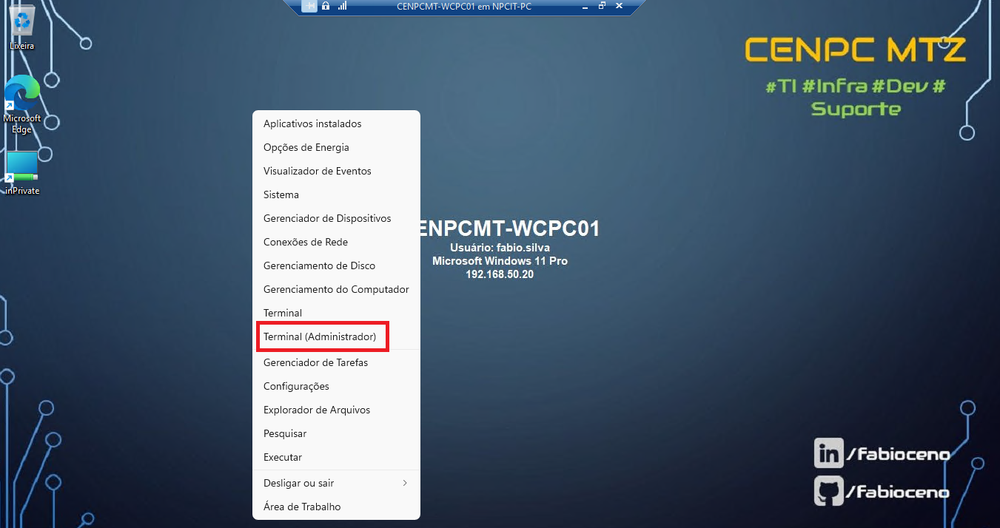
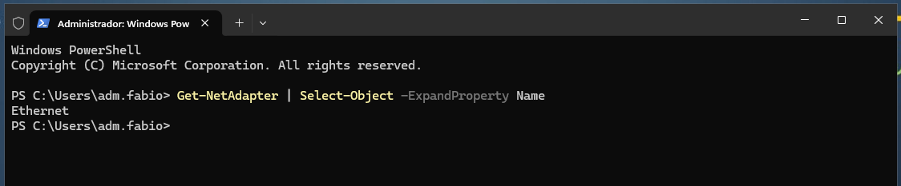
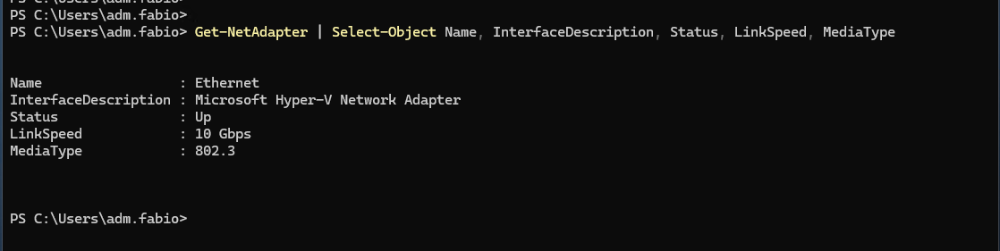
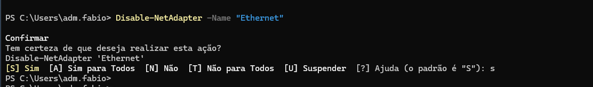

# POWERSHELL - Reset da placa de rede no Windows.

# 📌 Descrição.

* Procedimento para realizar o reset da placa de rede no Windows sem precisar reiniciar o computador, você pode usar comandos em powershell com privilégios de administrador. Siga os passos abaixo:

# 📝 Procedimentos | 📸 Evidências | 💻 Comandos / Scripts Utilizados.

1) Inicie o *Terminal* ou *Prompt Powershell* como **Administrador local**.

    

2) Em seguida execute o comando *conforme o exemplo na imagem abaixo* para realizar o reset da placa de rede no Windows.

    * Descobrindo o nome que está a interface de rede.

    ```powershell
    
        Get-NetAdapter | Select-Object -ExpandProperty Name
    
    ```
    

    * Para ter uma visão mais detalhada, execute o comando *conforme o exemplo na imagem abaixo.*

    ```powershell
    
        Get-NetAdapter | Select-Object Name, InterfaceDescription, Status, LinkSpeed, MediaType
    
    ```
    
    
    * Desativando a placa de rede.

    ```powershell
    
        Disable-NetAdapter -Name "Nome_da_Conexão"
    
    ```
    

    * Em seguida, reative a conexão com o comando *conforme a imagem no exemplo abaixo*.

    ```powershell
    
        Enable-NetAdapter -Name "Nome_da_Conexão"
    
    ```
    
    
    * Execute o comando *conforme o exemplo na imagem abaixo* novamente para verificar o status da conexão.

    ```powershell
    
        Get-NetAdapter | Select-Object Name, InterfaceDescription, Status, LinkSpeed, MediaType
    
    ```
    

* Quando for uma conexão através do **WI-FI** utilize o comando *conforme a imagem no exemplo abaixo* para verificar o nome da conexão.

    


# 🏁 Encerramento

### Com os procedimentos realizados acima, não se faz necessário reiniciar o computador para realizar o reset da placa de rede no Windows.

* **Atualizado em:** 17/10/2026.

* **Autor:** Fabio Silva.