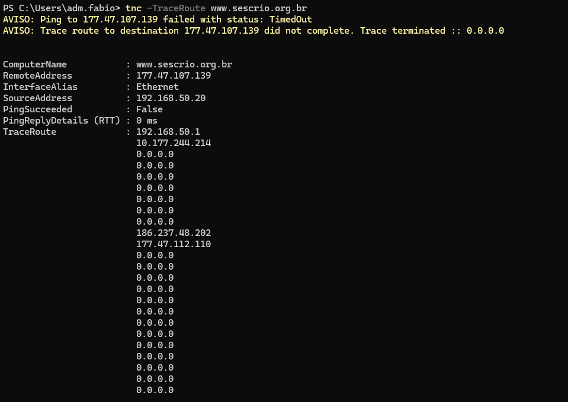
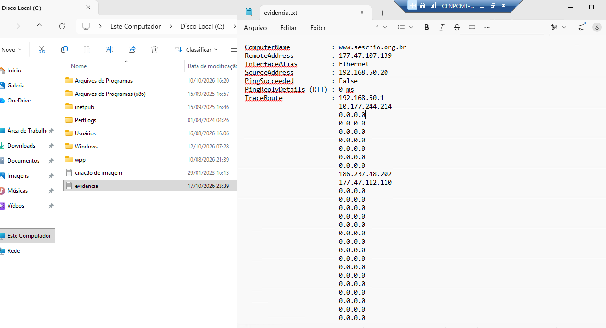

# POWERSHELL - Analisando rotas para sites.

# 📌 Descrição.

* Procedimento para mapear uma rota como exemplo *para o site Portal Sesc Rio de Janeiro* utilizando o comando **Test-NetConnection -TraceRoute**.


# 📝 Procedimentos | 📸 Evidências | 💻 Comandos / Scripts Utilizados.

1) Inicie o *Terminal* ou *Prompt Powershell* como **Administrador local**.

    

2) Execute o comando conforme o exemplo abaixo:

    ```powershell        
        tnc -TraceRoute www.sescrio.org.br        
    ```
    
    **ou**

    ```powershell        
        Test-NetConnection -TraceRoute www.sescrio.org.br       
    ```

    * Aguarde concluir o mapeamento.

    

* Para exportar este teste informe o caminho da pasta de destino, salvando o teste em *.TXT*.

    ```powershell        
        tnc -TraceRoute www.sescrio.org.br > C:\evidencia.txt        
    ```

    

* Após concluir, verifique o arquivo *.TXT* que foi criado no diretório raiz.

    


# 🏁 Encerramento

### Com os procedimentos realizados acima podemos diagnostticar se uma determinada rota está sendo concluída com sucesso.

* **Atualizado em:** 17/10/2026

* **Autor:** Fabio Silva